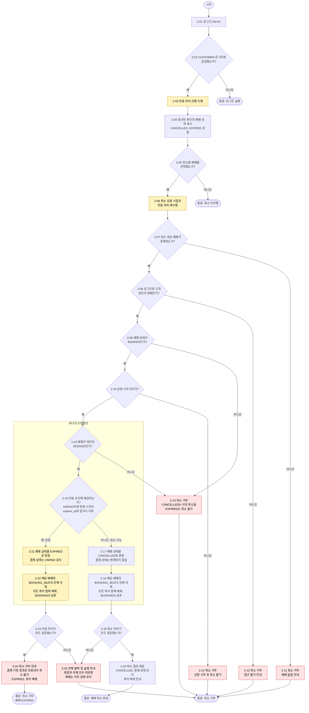
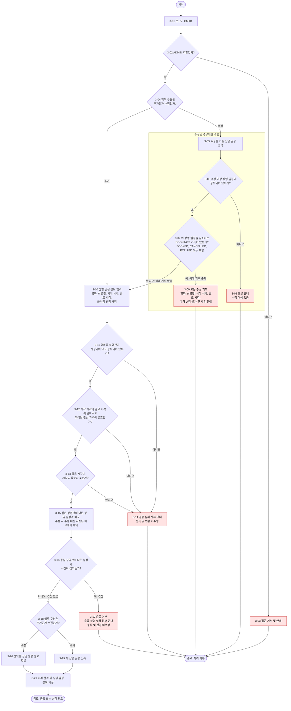

# 업무 흐름도

**프로젝트명:** 영화관 예매 및 좌석 관리 시스템 (Cinema Reservation System)

---

## 1. 업무 흐름도 개요

### 1.1 목적

업무 흐름도(Business Process Flowchart)는 업무가 시작되어 종료될 때까지의 처리 순서, 판단 조건, 예외 처리 경로를 도형과 화살표로 나타낸 문서이다. 업무 기능도가 "무엇을 하는가"를 계층적으로 분해한 문서이고 단위 업무 기술서가 "각 업무를 어떤 조건과 규칙으로 처리하는가"를 문장으로 정의한 문서라면, 업무 흐름도는 "어떤 순서로 확인하고 처리하는가"를 시각적으로 나타낸다.

본 문서는 정상 처리 경로뿐 아니라 검증 실패와 거부 경로를 함께 표현하여, 이후 데이터베이스 설계와 응용 프로그램 설계에서 확인 순서와 처리 단위(트랜잭션)를 판단하는 기준으로 활용하는 것을 목적으로 한다.

### 1.2 작성 기준 문서

본 문서는 다음 문서에서 승인된 내용을 따른다.

| 문서 | 파일 | 활용 내용 |
|---|---|---|
| 프로젝트 개요서 (B01) | `project_overview.md` | 업무 규칙 BR-01 ~ BR-15, 사용자 역할, 승인된 범위 |
| 업무 기능도 (B02) | `business_function.md` | 기능 번호 CM-01, CM-02, C-01 ~ C-09, A-01 ~ A-03 |
| 단위 업무 기술서 (B03) | `unit_business_description.md` | 단위 업무별 처리 순서, 예외 및 제약사항 |
| 업무 규칙 결정 기록 (BR-DL-001) | `business_rules_decision_log.md` | 승인된 결정 D1 ~ D6, 상태값 정의 |

흐름도의 내용이 B03 또는 BR-DL-001과 다른 경우에는 승인된 최신 결정(D1 ~ D6)을 따른다.

### 1.3 대상 프로세스의 범위

본 문서는 다음 세 개의 업무 프로세스를 대상으로 한다. 세 프로세스의 제목은 본 문서 안에서 흐름도를 구분하기 위한 문서 식별자이며, 업무 기능도에 정의된 14개 기능 외에 새로운 응용 기능을 정의하는 것이 아니다.

| 프로세스 | 제목 | 수행 주체 | 관련 기능 ID |
|---|---|---|---|
| Process 01 | 예매 및 모의 결제 | 고객 (조회 및 좌석 선택 단계는 로그인하지 않은 방문자 포함) | CM-01, C-02, C-03, C-04, C-05, C-06, C-07 |
| Process 02 | 예매 취소 | 고객 | CM-01, C-08, C-09 |
| Process 03 | 상영 일정 관리 | 관리자 | CM-01, A-02 |

위 프로세스에 포함되지 않는 기능(CM-02 로그아웃, C-01 회원가입, A-01 영화 관리, A-03 예매 목록 조회)의 흐름도는 본 문서의 범위에 포함하지 않는다. 다만 만료 처리는 A-03을 포함한 여러 조회 기능에서도 선행되는 공통 처리이며, 본 문서에서는 세 프로세스에 나타나는 범위에서만 표현한다.

### 1.4 업무 기능과 업무 흐름의 관계

업무 기능은 시스템이 제공하는 단위 기능이고, 업무 흐름은 여러 단위 기능이 어떤 순서와 조건으로 연결되어 하나의 업무 목적을 달성하는지를 나타낸다. 예를 들어 "예매 및 모의 결제" 흐름은 영화 조회(C-02)에서 모의 결제(C-07)까지 일곱 개의 기능을 순서대로 연결하며, 하나의 기능이 여러 흐름 단계로 나뉘어 나타나기도 한다. 각 흐름 단계에는 관련 기능 ID를 표시하여 B02, B03과 추적할 수 있도록 한다.

### 1.5 도형 범례

| 도형 | Mermaid 표기 | 의미 |
|---|---|---|
| 둥근 모서리 도형 | `([ ])` | 시작 및 종료 (terminator) |
| 사각형 | `[ ]` | 처리 (processing) |
| 마름모 | `{ }` | 판단 (decision). 모든 판단 도형은 "예" / "아니오" 또는 이에 준하는 분기를 표시한다. |
| 화살표 | `-->` | 처리의 진행 방향 |
| 노란색 사각형 | — | 만료 처리 (D3) |
| 붉은색 사각형 | — | 검증 실패에 따른 거부 및 실패 처리 |
| 파란색 사각형 | — | 결제 기한 이전의 결제 대기 상태 (`BOOKED` + `UNPAID` 유지, Process 01에만 사용) |
| 녹색 도형 | — | 최종 검증과 상태 변경이 하나의 원자적 처리로 수행되는 단계 (Process 01의 1-35, 1-36, 1-41) |

각 처리 및 판단 도형의 앞에는 흐름도 내 단계 번호(예: `1-07`)를 표기하며, 도형 아래의 설명표는 이 번호로 도형과 대응한다.

### 1.6 공통 전제

세 프로세스에 공통으로 적용되는 전제는 다음과 같다.

| 구분 | 내용 | 근거 |
|---|---|---|
| 예매 상태 | `BOOKED`, `CANCELLED`, `EXPIRED` | BR-DL-001 3.1 |
| 결제 상태 | `UNPAID`, `PAID` (예매 상태와 별개의 속성) | BR-DL-001 3.2 |
| 좌석 점유 | `PAID`인 `BOOKED` 예매는 계속 좌석을 점유한다. `UNPAID`인 `BOOKED` 예매는 결제 기한(`expires_at`)까지만 좌석을 점유한다. `CANCELLED` 및 `EXPIRED` 예매는 좌석을 점유하지 않는다. | BR-08, D1, D3 |
| 결제 기한 | `expires_at = booked_at + 10분`. `booked_at`은 예매 확정이 성공적으로 기록된 시각이다. | D3 |
| 결제 허용 조건 | 현재 시각 < `expires_at` 인 경우에만 결제를 허용한다. | D3 |
| 만료 조건 | 현재 시각 >= `expires_at` 이고 결제 상태가 `UNPAID`이면 만료된 것으로 본다. | D3 |
| 만료 처리 | 예매 상태를 `EXPIRED`로 변경하고, 결제 상태는 `UNPAID`로 유지하며, 해당 예매의 `BOOKING_SEATS`를 모두 삭제하고, `BOOKINGS`는 이력으로 보존한다. 상태 변경과 좌석 해제는 하나의 트랜잭션으로 처리하며, 같은 예매에 반복 수행하여도 결과가 같다. | D3 |
| 만료 처리 선행 | 결제 처리, 예매 확정, 좌석 현황 판정, 예매 취소를 수행하기 전에 만료 처리를 먼저 수행한다. | D3 |
| 만료 처리의 실행 방식 | 정기 처리, 요청 시점 처리 등 만료 처리를 실행하는 방식은 확정되지 않았으며 응용 프로그램 설계 단계에서 결정한다. 본 문서의 흐름도는 만료 처리를 논리적 처리로만 표현하고 특정 실행 방식을 전제하지 않는다. | D3, BR-DL-001 5.4 |
| 로그인 없는 방문자 | 로그인하지 않은 접근을 의미하며 별도의 계정 역할이 아니다. 계정 역할은 CUSTOMER와 ADMIN뿐이다. | D4 |

---

## 2. 예매 및 모의 결제 프로세스

### 2.1 프로세스 설명

Process 01은 고객이 영화를 조회하고 상영 일정과 좌석을 선택한 후 예매를 확정하고, 결제 기한 안에 모의 결제를 수행하는 흐름이다. 이 프로세스는 다음 세 단계로 구성된다.

1. **조회 및 좌석 선택 (1-01 ~ 1-11):** 로그인 없이 영화, 상영 일정, 좌석 현황을 조회하고 좌석을 임시로 선택한다. 좌석 선택은 좌석을 점유하지 않으며 결제 기한도 시작되지 않는다. (D3, D4)
2. **예매 확정 (1-12 ~ 1-27):** CUSTOMER로 로그인한 후 상영 일정과 선택 좌석을 다시 검증하고, 예매와 예매 좌석 상세 정보를 하나의 처리로 저장한다. 예매는 `BOOKED` + `UNPAID`로 생성되며 결제 기한이 설정된다.
3. **모의 결제 및 만료 (1-28 ~ 1-41):** 예매 확정 후의 처리는 고객이 결제를 요청하는지에 따라 다음과 같이 구분한다.
   - **결제를 요청하는 경우:** 만료 처리를 선행하고, 본인의 `BOOKED` + `UNPAID` 예매인지 확인한 후, 현재 시각 < `expires_at` 인지 예비 확인(1-33)하여 모의 결제를 수행한다(1-34). 결제 상태를 `PAID`로 저장하는 시점에는 예매 상태 `BOOKED`, 결제 상태 `UNPAID`, 현재 시각 < `expires_at`을 최종 검증(1-35)하며, 모두 만족하는 경우에만 같은 원자적 처리 안에서 `PAID`로 변경한다(1-36). 최종 검증에 실패하면 `PAID`로 변경하지 않고 사유를 구분한다(1-41). 예매가 여전히 `BOOKED` + `UNPAID`이면서 현재 시각 >= `expires_at` 이면 결제를 거부한 후 만료 처리를 수행하고, 예매 상태 또는 결제 상태가 이미 변경되어 만료 조건에 해당하지 않으면 실제 사유로 결제를 거부하며 만료 처리는 수행하지 않는다. 예비 확인(1-33)에서 현재 시각 >= `expires_at` 인 경우에도 결제를 거부한 후 만료 처리를 수행한다. 최종 검증, 상태 변경, 만료 시의 좌석 해제는 하나의 원자적 처리로 수행한다.
   - **결제를 요청하지 않는 경우:** 결제를 요청하지 않았다는 사실만으로 만료로 보지 않으며, 현재 시각 >= `expires_at` 인지 별도로 판단한다. 기한이 지났으면 만료 처리를 실행하고, 기한이 지나지 않았으면 `BOOKED` + `UNPAID` 상태를 유지하며 `expires_at`까지 좌석을 계속 점유하는 결제 대기 상태로 둔다.

만료 처리는 좌석 현황 판정(1-07), 예매 확정 검증(1-17), 결제 처리(1-30)에 앞서 각각 선행되며, 만료 처리의 내용은 1-39에 표현한다. 만료 처리의 실행 방식은 확정되지 않았으며 응용 프로그램 설계에서 결정한다.

### 2.2 업무 흐름도

흐름도의 단계 번호는 위 세 단계에 대응한다. 1-01 ~ 1-11은 조회 및 좌석 선택, 1-12 ~ 1-27은 예매 확정, 1-28 ~ 1-41은 모의 결제 및 만료이다. 노란색 도형은 만료 처리, 붉은색 도형은 거부 및 실패 처리, 파란색 도형은 결제 대기 상태이다.

```mermaid
flowchart TD
    START([시작]) --> A01

    %% 단계 1. 조회 및 좌석 선택 (1-01 ~ 1-11, 로그인 불필요)
        A01["1-01 등록된 영화 목록 조회"]
        A02["1-02 영화 및 상영 날짜 선택"]
        A03["1-03 상영 일정 조회"]
        A04{"1-04 상영 일정이 있는가?"}
        A05["1-05 상영 일정 없음 안내"]
        A06["1-06 상영 일정 선택"]
        A07["1-07 만료 처리 선행 수행"]
        A08["1-08 좌석 현황 조회<br/>좌석별 예매 가능 여부 제공"]
        A09["1-09 좌석 임시 선택<br/>좌석 미점유, 결제 기한 미시작"]
        A10{"1-10 1개 이상 선택했고<br/>모두 예매 가능한가?"}
        A11["1-11 좌석 재선택 안내"]

    %% 단계 2. 예매 확정 (1-12 ~ 1-27, CUSTOMER 로그인 필수)
        B01["1-12 예매 확정 요청"]
        B02{"1-13 CUSTOMER로<br/>로그인되어 있는가?"}
        B03["1-14 로그인 요구 CM-01"]
        B04{"1-15 CUSTOMER 로그인에<br/>성공했는가?"}
        B05{"1-16 상영 일정이<br/>존재하는가?"}
        B06["1-17 만료 처리 선행 수행"]
        B07{"1-18 상영이 시작되기<br/>전인가?"}
        B08{"1-19 좌석이 1개 이상이며<br/>모두 해당 상영관 소속인가?"}
        B09{"1-20 이미 유효한 예매가<br/>있는 좌석이 있는가?"}
        B10["1-21 좌석 재선택 안내"]
        B11["1-22 예매 거부 및 사유 안내<br/>예매 미생성"]
        B12["1-23 총 예매 금액 계산<br/>좌석당 가격 x 좌석 수"]
        B13["1-24 booked_at 기록<br/>expires_at = booked_at + 10분"]
        B14["1-25 예매와 모든 좌석 상세를<br/>원자적으로 저장<br/>BOOKED, UNPAID, 좌석별 가격"]
        B15{"1-26 저장에 성공했는가?"}
        B16["1-27 전체 롤백 및 실패 안내<br/>부분 예매 없음"]

    %% 단계 3. 모의 결제 및 만료 (1-28 ~ 1-41)
        C01["1-28 예매 확정 결과 제공<br/>모의 결제 연결"]
        C02{"1-29 모의 결제를<br/>요청하는가?"}
        C03["1-30 만료 처리 선행 수행"]
        C04{"1-31 본인의 BOOKED, UNPAID<br/>예매인가?"}
        C05["1-32 결제 거부 및 사유 안내"]
        C06{"1-33 예비 확인<br/>현재 시각이 expires_at보다<br/>이른가?"}
        C07["1-34 모의 결제 처리<br/>실제 결제 서비스 미연동"]
        C13{"1-35 최종 검증 - 원자적 처리<br/>BOOKED, UNPAID이며 현재 시각이<br/>expires_at보다 이른가?"}
        C08["1-36 결제 상태를 PAID로 변경<br/>1-35와 같은 원자적 처리"]
        C10["1-37 결제 거부 - PAID로 변경하지 않음<br/>결제 기한 경과 안내"]
        C09{"1-38 결제 요청 없음<br/>현재 시각 >= expires_at인가?"}
        C11["1-39 만료 처리 실행 - 원자적 처리<br/>예매 상태 EXPIRED, 결제 상태 UNPAID 유지<br/>BOOKING_SEATS 전체 삭제, BOOKINGS 보존<br/>모든 좌석 함께 해제"]
        C14{"1-41 최종 검증 실패 사유 판정 - 원자적 처리<br/>BOOKED, UNPAID이며 현재 시각이<br/>expires_at과 같거나 이후인가?"}
        C12["1-40 결제 대기 상태 유지<br/>현재 처리만 종료, 예매는 취소·만료되지 않음<br/>BOOKED, UNPAID 유지<br/>expires_at까지 좌석 계속 점유"]

    A01 --> A02 --> A03 --> A04
    A04 -->|예| A06
    A04 -->|아니오| A05 --> A02
    A06 --> A07 --> A08 --> A09 --> A10
    A10 -->|예| B01
    A10 -->|아니오| A11 --> A07

    B01 --> B02
    B02 -->|예| B05
    B02 -->|아니오| B03 --> B04
    B04 -->|예| B05
    B04 -->|아니오| ENDN([종료: 예매 미진행])
    B05 -->|예| B06
    B05 -->|아니오| B11
    B06 --> B07
    B07 -->|예| B08
    B07 -->|아니오| B11
    B08 -->|예| B09
    B08 -->|아니오| B11
    B09 -->|아니오| B12
    B09 -->|예| B10 --> A07
    B11 --> ENDF([종료: 예매 거부])
    B12 --> B13 --> B14 --> B15
    B15 -->|예| C01
    B15 -->|아니오| B16 --> ENDF

    C01 --> C02
    C02 -->|예| C03 --> C04
    C02 -->|아니오| C09
    C09 -->|예| C11
    C09 -->|아니오| C12 --> ENDW(["결제 대기 상태<br/>(기한 내 결제 재요청 시 결제 절차 재진입)"])
    C04 -->|아니오| C05 --> ENDP([종료: 결제 거부])
    C04 -->|예| C06
    C06 -->|예| C07 --> C13
    C06 -->|아니오| C10
    C13 -->|예| C08 --> ENDS([종료: 결제 완료<br/>좌석 계속 점유])
    C13 -->|아니오| C14
    C14 -->|예: 기한 경과| C10
    C14 -->|아니오: 상태 변경됨| C05
    C10 --> C11
    C11 --> ENDE([종료: 예매 EXPIRED<br/>좌석 해제])

    classDef expire fill:#fff3bf,stroke:#b08900,color:#000
    classDef reject fill:#ffe3e3,stroke:#c92a2a,color:#000
    classDef pending fill:#d0ebff,stroke:#1971c2,color:#000
    classDef atomic fill:#d3f9d8,stroke:#2b8a3e,color:#000
    class A07,B06,C03,C11 expire
    class A05,B11,B16,C05,C10 reject
    class C12 pending
    class C13,C08,C14 atomic
```

### 2.3 단계별 설명표

| 단계 | 처리 내용 | 관련 기능 ID | 관련 업무 규칙 / 결정 |
|---|---|---|---|
| 1-01 | 로그인 여부와 관계없이 시스템에 등록된 영화 목록을 조회한다. | C-02 | BR-05, D4 |
| 1-02 | 조회한 영화 중 하나와 조회할 상영 날짜를 선택한다. | C-02, C-03 | D4 |
| 1-03 | 선택한 영화의 해당 날짜 상영 일정을 상영 시작 시각 순으로 조회한다. 상영 시작·종료 시각, 상영관, 상영 일정별 좌석당 관람 가격을 함께 제공한다. | C-03 | BR-03, D4, D6 |
| 1-04 | 해당 영화와 날짜에 상영 일정이 있는지 판단한다. 없으면 1-05로 진행한다. | C-03 | — |
| 1-05 | 상영 일정이 없음을 안내하고 영화와 날짜를 다시 선택하도록 1-02로 되돌아간다. | C-03 | — |
| 1-06 | 조회된 상영 일정 중 하나를 선택한다. | C-03, C-04 | D4 |
| 1-07 | 좌석 현황을 판정하기 전에 만료 처리를 선행한다. 결제 기한이 지난 미결제 예매의 좌석이 '예매 불가'로 제공되지 않도록 한다. 만료 처리의 내용은 1-39와 같다. | C-04 | D3 |
| 1-08 | 상영 일정의 상영관에 속한 좌석 전체에 대하여, 해당 상영 일정에 유효한 예매가 있으면 '예매 불가', 없으면 '예매 가능'으로 판정하여 제공한다. `CANCELLED` 및 `EXPIRED` 예매의 좌석은 '예매 가능'으로 판정한다. | C-04 | BR-02, BR-07, BR-08, D1, D3, D4 |
| 1-09 | 예매 가능한 좌석을 한 개 이상 임시로 선택한다. 이 선택은 좌석을 예약하거나 점유하지 않으며 결제 기한도 시작하지 않는다. | C-05 | BR-06, D3, D4 |
| 1-10 | 선택한 좌석이 한 개 이상이며 모두 해당 상영관에 속하고 '예매 가능' 상태인지 판단한다. 충족하지 않으면 1-11로 진행한다. | C-05 | BR-07, BR-08 |
| 1-11 | 선택 불가 좌석을 제외하고 사유를 안내한 후 1-07로 되돌아간다. 만료 처리를 선행하고 좌석 현황을 다시 조회(1-08)하여 최신 좌석 현황을 제공한 다음 좌석을 다시 선택(1-09)하게 한다. 이전에 조회한 좌석 현황을 그대로 사용하지 않는다. | C-04, C-05 | BR-08, D3 |
| 1-12 | 임시 선택한 좌석에 대하여 예매 확정을 요청한다. 로그인은 이 시점부터 필수이다. | C-06 | BR-05, D4 |
| 1-13 | 현재 접속이 CUSTOMER로 로그인된 상태인지 판단한다. 로그인되어 있으면 1-16으로, 그렇지 않으면 1-14로 진행한다. ADMIN은 예매 확정의 담당 사용자가 아니다. | C-06 | BR-05, D4 |
| 1-14 | 로그인하지 않은 방문자에게 CUSTOMER 계정으로의 로그인을 요구하고 로그인을 수행한다. | CM-01, C-06 | BR-05, D4 |
| 1-15 | CUSTOMER로 로그인에 성공했는지 판단한다. 실패하면 예매를 진행하지 않고 종료한다. | CM-01 | BR-05 |
| 1-16 | 예매하려는 상영 일정이 존재하는지 다시 확인한다. 존재하지 않으면 1-22로 진행한다. | C-06 | — |
| 1-17 | 좌석의 중복 여부를 확인하기 전에 만료 처리를 선행한다. 결제 기한이 지난 미결제 예매의 좌석이 중복 예매로 판단되지 않도록 한다. | C-06 | D3 |
| 1-18 | 현재 시각이 상영 시작 시각 이전인지 판단한다. 이미 상영이 시작된 상영 일정은 예매할 수 없으므로 1-22로 진행한다. | C-06 | BR-12 |
| 1-19 | 선택한 좌석이 한 개 이상이며 모두 해당 상영 일정의 상영관에 속한 좌석인지 판단한다. 다른 상영관의 좌석이 하나라도 포함되면 1-22로 진행한다. | C-06 | BR-06, BR-07 |
| 1-20 | 선택한 좌석 중 같은 상영 일정에 이미 유효한 예매가 있는 좌석이 있는지 다시 확인한다. 다른 고객이 먼저 예매를 확정한 경우를 포함하며, 하나라도 있으면 일부 좌석만 예매하지 않고 예매 전체를 확정하지 않는다. | C-06 | BR-08, D3 |
| 1-21 | 사용자에게 좌석 재선택을 안내하고, 만료 처리 선행(1-07)부터 좌석 현황을 다시 조회한다. | C-04, C-06 | BR-08, D3 |
| 1-22 | 예매를 거부하고 사유(상영 일정 없음, 상영 시작 후, 상영관에 속하지 않는 좌석)를 안내한다. 예매와 좌석 상세 정보는 생성하지 않는다. | C-06 | BR-07, BR-12 |
| 1-23 | 모든 검증을 통과하면 총 예매 금액을 '상영 일정의 좌석당 관람 가격 x 선택한 좌석 수'로 계산한다. 영화관 전체에 적용되는 단일 고정 가격은 사용하지 않는다. | C-06 | D6 |
| 1-24 | 예매 확정이 성공적으로 기록되는 시각을 `booked_at`으로 기록하고, 결제 기한 `expires_at`을 `booked_at` + 10분으로 계산한다. 10분은 좌석 선택 시점이 아니라 예매 확정 시점부터 계산한다. | C-06 | D3 |
| 1-25 | 로그인한 고객, 상영 일정, `booked_at`, `expires_at`, 총 예매 금액을 포함하는 예매를 예매 상태 `BOOKED`, 결제 상태 `UNPAID`로 저장하고, 모든 좌석의 상세 정보(좌석, 예매 시점의 좌석별 가격)를 함께 저장한다. 예매와 좌석 상세 정보는 모두 성공하거나 모두 실패하는 하나의 처리로 수행한다. | C-06 | BR-06, BR-08, D3, D6 |
| 1-26 | 예매와 좌석 상세 정보의 저장이 모두 성공했는지 판단한다. 다른 고객의 동시 예매 등으로 일부라도 저장하지 못하면 1-27로 진행한다. | C-06 | BR-08 |
| 1-27 | 저장된 내용을 모두 취소(롤백)하고 실패 사유를 안내한다. 일부 좌석만 저장된 예매는 남기지 않는다. | C-06 | BR-08, D3 |
| 1-28 | 예매 확정 결과(예매 번호, 예매 내용, 예매 일시, 결제 기한, `BOOKED`, `UNPAID`)를 제공하고 모의 결제로 연결한다. 이 시점부터 좌석은 결제 기한까지 점유된다. 예매 확정 단계에서는 결제를 처리하지 않는다. | C-06, C-07 | BR-15, D3 |
| 1-29 | 고객이 모의 결제를 요청하는지 판단한다. 요청하면 1-30으로, 요청하지 않으면 결제 기한 경과 여부를 확인하는 1-38로 진행한다. 결제를 요청하지 않았다는 사실만으로 결제 기한이 지난 것으로 보지 않는다. | C-07 | D3 |
| 1-30 | 결제를 처리하기 전에 만료 처리를 선행한다. | C-07 | D3 |
| 1-31 | 결제 대상 예매가 로그인한 고객 본인의 예매이며 예매 상태가 `BOOKED`, 결제 상태가 `UNPAID`인지 판단한다. `CANCELLED`, `EXPIRED`, `PAID` 예매이거나 타인의 예매이면 1-32로 진행한다. | C-07 | BR-09, D3 |
| 1-32 | 결제를 거부하고 실제 사유를 안내한다. 1-31에서 본인의 `BOOKED` + `UNPAID` 예매가 아닌 경우와, 1-41에서 최종 검증 시점에 예매 상태 또는 결제 상태가 이미 변경된 것으로 판정된 경우(예: 이미 `PAID`, `CANCELLED`, `EXPIRED`)에 도달한다. 결제 상태를 `PAID`로 변경하지 않으며, 만료 조건에 해당하지 않는 예매를 만료되었다고 안내하거나 만료 처리하지 않는다. 이미 `EXPIRED`인 예매는 다시 활성화하지 않으며 새로 예매해야 한다. | C-07 | BR-09, D3 |
| 1-33 | 결제 요청에 대한 예비 확인이다. 현재 시각이 `expires_at`보다 엄격하게 이른지 판단하여, 현재 시각 < `expires_at` 이면 모의 결제를 진행하는 1-34로, 현재 시각 >= `expires_at` 이면 결제를 거부하는 1-37로 진행한다. 이 확인은 결제 상태를 변경하기 전에 불필요한 결제 처리를 막기 위한 것이며, 이 확인을 통과했다는 사실만으로 `PAID` 변경을 확정하지 않는다. | C-07 | D3 |
| 1-34 | 외부 결제 서비스(결제 게이트웨이)와 연동하지 않고 결제가 정상적으로 완료된 것으로 모의 처리한다. 카드 정보 등 실제 결제 정보는 입력받거나 저장하지 않는다. 이 단계는 결제 상태를 변경하지 않는다. | C-07 | BR-15 |
| 1-35 | 결제 상태를 `PAID`로 저장하는 시점의 최종 검증이다. 1-33의 예비 확인 이후 결제 기한이 지났거나 다른 요청으로 상태가 바뀌었을 수 있으므로, 상태를 변경하는 원자적 처리 안에서 예매 상태가 `BOOKED`이고, 결제 상태가 `UNPAID`이며, 현재 시각 < `expires_at` 인지를 다시 확인한다. 세 조건을 모두 만족하면 1-36으로 진행하고, 하나라도 만족하지 않으면 `PAID`로 변경하지 않고 실패 사유를 판정하는 1-41로 진행한다. 최종 검증(1-35, 1-41), 결제 상태 변경(1-36), 만료 시의 상태 변경과 좌석 해제(1-39)는 시각 경계의 경쟁 상황이 생기지 않도록 하나의 원자적 처리로 수행한다. | C-07 | D3 |
| 1-36 | 1-35의 최종 검증을 통과한 경우에만, 같은 원자적 처리 안에서 결제 상태를 `PAID`로 변경한다. 예매 상태는 `BOOKED`로 유지하며, `PAID`인 예매는 결제 기한 규칙에 따라 만료되지 않고 좌석을 계속 점유한다. | C-07 | D3 |
| 1-37 | 1-33에서 현재 시각 >= `expires_at` 로 판단되었거나, 1-41에서 예매가 여전히 `BOOKED` + `UNPAID`이면서 현재 시각 >= `expires_at` 로 판정된 경우 결제를 거부하고 결제 상태를 `PAID`로 변경하지 않으며, 결제 기한 경과를 안내한다. 이 시각 이후에 완료되는 결제는 허용하지 않는다. 이어서 만료 처리가 수행되도록 1-39로 진행한다. | C-07 | D3 |
| 1-38 | 결제 요청이 없는 경우에 결제 기한이 지났는지 판단한다. 현재 시각 >= `expires_at` 이고 결제 상태가 `UNPAID`이면 1-39로, 현재 시각 < `expires_at` 이면 1-40으로 진행한다. 결제 기한이 지나기 전에는 예매를 만료시키지 않는다. | C-07 | D3 |
| 1-39 | 만료 처리를 실행한다. 예매 상태를 `EXPIRED`로 변경하고, 결제 상태는 `UNPAID`로 유지하며, 해당 예매의 `BOOKING_SEATS`를 모두 삭제하고, `BOOKINGS`는 이력으로 보존하여 모든 좌석을 함께 해제한다. 만료 조건(`BOOKED` + `UNPAID` + 현재 시각 >= `expires_at`)의 확인, 상태 변경과 좌석 해제는 하나의 원자적 처리(트랜잭션)로 수행하며 부분 만료는 허용하지 않는다. 같은 예매에 반복 수행하여도 결과가 같고, 이미 `BOOKED` + `UNPAID`가 아닌 예매에는 영향을 주지 않는다. 이미 선행 수행(1-07, 1-17, 1-30)으로 처리된 예매에도 결과가 달라지지 않는다. 실행 방식은 응용 프로그램 설계에서 결정하며 특정 방식(정기 처리, 요청 시점 처리 등)을 전제하지 않는다. | C-04, C-06, C-07 | D1, D3 |
| 1-40 | 결제 기한이 아직 지나지 않았으므로 예매 상태 `BOOKED`, 결제 상태 `UNPAID`를 유지하고, 좌석은 `expires_at`까지 계속 점유한다. 결제 대기 상태는 현재의 처리(상호작용)만 종료할 뿐 예매를 취소하거나 만료시키지 않는 일시적 상태이며, 예매를 미리 만료시키지 않는다. 고객은 이후 예매 내역 조회(C-08)를 통해 해당 예매에 접근하여 `expires_at` 이전에 모의 결제(C-07)를 다시 요청할 수 있으며, 이 경우 1-29부터 결제 절차에 재진입한다. `expires_at`이 지나도록 결제하지 않으면 이후 수행되는 만료 처리(1-39)에서 `EXPIRED`로 변경된다. 새로운 기능을 추가하지 않으며 기존 기능 C-08, C-07을 이용한다. | C-06, C-07, C-08 | D3 |
| 1-41 | 1-35의 최종 검증에 실패한 경우, 같은 원자적 처리 안에서 실패 사유를 구분한다. 예매가 여전히 `BOOKED` + `UNPAID`이고 현재 시각 >= `expires_at` 이면 결제 기한 경과에 해당하므로 1-37을 거쳐 만료 처리(1-39)를 수행한다. 그렇지 않은 경우, 즉 예매 상태 또는 결제 상태가 이미 변경되어 만료 조건에 해당하지 않는 경우에는 1-32로 진행하여 실제 사유로 결제를 거부하며, `PAID`로 변경하지 않고 만료 처리도 수행하지 않는다. | C-07 | D3 |
| 종료 | 종료 유형은 '예매 미진행'(로그인 실패), '예매 거부'(1-22, 1-27), '결제 거부'(1-32), '결제 완료'(1-36), '예매 EXPIRED'(1-39), '결제 대기 상태'(1-40)이다. 결제 대기 상태는 종료가 아니라 현재 처리만 끝나는 일시적 상태이며, 만료가 아니라 `BOOKED` + `UNPAID` 상태가 유지된다. 기한 내 결제를 다시 요청하면 결제 절차에 재진입한다. | C-06, C-07, C-08 | D3 |

### 2.4 처리 순서에 대한 유의사항

- 만료 처리는 좌석 현황 판정(1-07), 예매 확정 검증(1-17), 결제 처리(1-30)보다 항상 먼저 수행한다. 결제 기한이 지난 미결제 예매를 '예매 불가' 좌석으로 판단하거나 결제 가능한 예매로 처리해서는 안 된다. (D3)
- 좌석 현황의 '예매 가능' 판정(1-08)과 좌석 임시 선택(1-09)은 좌석을 점유하지 않으므로, 선택 이후 다른 고객이 먼저 예매를 확정할 수 있다. 이 때문에 예매 확정 시점에 좌석의 유효한 예매 여부를 다시 확인한다(1-20). (D3, D4)
- 좌석을 다시 선택하는 경우(1-11, 1-21)에는 모두 만료 처리 선행(1-07)과 좌석 현황 재조회(1-08)로 되돌아간다. 먼저 조회한 좌석 현황은 시간이 지나면 최신이 아닐 수 있으므로, 재선택 시마다 최신 좌석 현황을 기준으로 선택하게 한다. (D3, D4)
- 결제 상태를 `PAID`로 변경하는 시점(1-35, 1-36)에도 결제 기한을 다시 검증한다. 1-33의 예비 확인과 `PAID` 저장 사이에 결제 기한(`expires_at`)에 도달할 수 있으므로, 상태를 저장하는 원자적 처리 안에서 예매 상태 `BOOKED`, 결제 상태 `UNPAID`, 현재 시각 < `expires_at`을 모두 확인한 경우에만 `PAID`로 변경한다. 하나라도 만족하지 않으면 `PAID`로 변경하지 않고 실패 사유를 구분한다(1-41). 예매 상태 또는 결제 상태가 이미 변경되어 만료 조건에 해당하지 않는 경우에는 실제 사유로 결제를 거부하고(1-32) 만료 처리를 수행하지 않는다. 예매가 여전히 `BOOKED` + `UNPAID`이면서 현재 시각 >= `expires_at` 인 경우에만 1-37(결제 거부)을 거쳐 만료 처리(1-39)를 수행하며, 이때 예매 상태 `EXPIRED`, 결제 상태 `UNPAID` 유지, `BOOKING_SEATS` 삭제, `BOOKINGS` 보존이 하나의 원자적 처리로 이루어진다. 최종 검증과 상태 변경 및 좌석 해제는 모두 성공하거나 모두 실패해야 한다. 이를 구현하는 구체적인 방식(트랜잭션 격리, 조건부 갱신 등)은 응용 프로그램 설계에서 결정한다. (D3)
- 결제 대기 상태(1-40)는 현재의 처리만 종료하는 일시적 상태이며 예매를 취소하거나 만료시키지 않는다. 고객은 `expires_at` 이전에 예매 내역 조회(C-08)를 통해 해당 예매에 접근하여 모의 결제(C-07)를 다시 요청할 수 있다. (D3)
- 만료 처리의 실행 방식(정기 처리, 요청 시점 처리 등)은 확정되지 않았으며 응용 프로그램 설계에서 결정한다. 어떠한 방식을 선택하더라도 결제 기한은 반드시 지켜져야 하며, 위의 선행 수행 지점에서는 기한이 지난 미결제 예매가 모두 만료 처리된 상태이어야 한다. (D3)

---

## 3. 예매 취소 프로세스

### 3.1 프로세스 설명

Process 02는 CUSTOMER로 로그인한 고객이 본인의 예매 내역에서 하나의 예매를 선택하여 상영 시작 전에 취소하는 흐름이다. 만료 처리는 이 흐름에서 두 번 수행한다.

1. **예매 내역 표시 전 (2-03):** CUSTOMER 로그인에 성공하면 먼저 만료 처리를 수행하여 결제 기한이 지난 미결제 예매를 `EXPIRED`로 변경하고, 그 결과가 반영된 예매 내역(`CANCELLED`, `EXPIRED` 예매 포함)을 표시한다.
2. **취소 요청 시점 (2-06):** 고객이 예매 내역을 보거나 취소할 예매를 선택하는 동안 예매가 결제 기한(`expires_at`)에 도달할 수 있으므로, 취소할 예매를 선택한 직후 취소 검증에 앞서 만료 처리를 다시 수행한다. 이 시점에 만료 처리된 예매는 `EXPIRED`가 되므로 취소할 수 없다.

이후 예매의 존재, 소유자, 예매 상태, 상영 시작 여부를 순서대로 확인한 후, 하나의 트랜잭션(2-15 ~ 2-25) 안에서 상태 변경 직전의 예매 상태와 만료 조건을 다시 판단한다. 이 판단 결과는 서로 배타적인 두 가지이며, 각각 하나의 원자적 처리로 수행한다.

- **취소 결과 (2-17 ~ 2-20):** 예매가 여전히 `BOOKED`이고 만료 조건에 해당하지 않으면 예매 상태를 `CANCELLED`로 변경하고, 해당 예매의 `BOOKING_SEATS`를 모두 삭제하여 모든 좌석을 함께 해제하며, `BOOKINGS`는 이력으로 보존한다. 결제 상태는 변경하지 않는다.
- **만료 결과 (2-21 ~ 2-24):** 예매가 `BOOKED`이고 결제 상태가 `UNPAID`이며 현재 시각 >= `expires_at` 이면 예매 상태를 `EXPIRED`로 변경하고, 결제 상태는 `UNPAID`로 유지하며, 해당 예매의 `BOOKING_SEATS`를 모두 삭제하고, `BOOKINGS`는 보존한다. 이 예매는 취소되지 않고 취소 요청은 거부된다. 이 만료는 정당한 만료 처리이므로 취소 요청이 거부되었다는 이유로 롤백하지 않는다.

각 결과의 상태 변경과 좌석 상세 정보 삭제는 모두 성공하거나 모두 실패해야 하며, 하나라도 실패하면 해당 트랜잭션 전체를 롤백한다(2-25). 롤백된 경우에는 `CANCELLED` 또는 `EXPIRED`로 변경되었다고 안내하지 않는다. 일부 좌석만 취소하는 기능과 환불 처리는 제공하지 않는다. (D1, D3)

### 3.2 업무 흐름도

### 3.3 단계별 설명표

| 단계 | 처리 내용 | 관련 기능 ID | 관련 업무 규칙 / 결정 |
|---|---|---|---|
| 2-01 | 고객이 계정 ID와 비밀번호로 로그인한다. | CM-01 | BR-05 |
| 2-02 | CUSTOMER로 로그인에 성공했는지 판단한다. 실패하면 취소를 진행하지 않고 종료한다. | CM-01, C-09 | BR-09 |
| 2-03 | 예매 내역을 표시하기 전에 만료 처리를 선행한다. 결제 기한이 지난 미결제 예매는 이 시점에 `EXPIRED`로 변경되고 좌석 상세 정보가 삭제되며, 만료 처리 내용은 1-39와 같다. 이를 통해 예매 내역이 현재 시각 기준의 예매 상태를 반영하도록 한다. | C-08, C-09 | D3 |
| 2-04 | 만료 처리가 반영된 로그인한 고객 본인의 예매 내역을 예매 상태와 관계없이 표시한다. `CANCELLED` 및 `EXPIRED` 예매의 본 정보도 포함하며, 예매 좌석 상세 정보가 삭제된 예매는 좌석 목록을 제공하지 않는다. | C-08 | BR-09, BR-11, D1, D3 |
| 2-05 | 표시된 예매 내역 중 취소할 예매를 하나 선택했는지 판단한다. 선택하지 않으면 취소를 진행하지 않고 종료한다. 하나의 예매 단위로만 취소하며 좌석 일부만 취소하는 기능은 제공하지 않는다. | C-09 | BR-11, D1 |
| 2-06 | 취소 검증에 앞서 만료 처리를 다시 수행한다. 고객이 예매 내역을 보거나 예매를 선택하는 동안 결제 기한에 도달한 미결제 예매는 현재 시각 >= `expires_at` 이고 결제 상태가 `UNPAID`인 예매는 이 시점에 `EXPIRED`로 변경되고, `BOOKING_SEATS`가 모두 삭제되며 `BOOKINGS`는 보존된다. 만료 처리 내용은 1-39와 같다. 이렇게 `EXPIRED`가 된 예매는 2-09에서 취소가 거부된다. 결제 기한에 도달하지 않았거나 `PAID`인 `BOOKED` 예매는 변경되지 않고 이후 검증으로 진행한다. | C-09 | D3 |
| 2-07 | 취소 대상 예매가 존재하는지 판단한다. 존재하지 않으면 2-11로 진행한다. | C-09 | — |
| 2-08 | 취소 대상 예매가 로그인한 고객 본인의 예매인지 판단한다. 타인의 예매이면 2-12로 진행한다. | C-09 | BR-09 |
| 2-09 | 예매 상태가 `BOOKED`인지 판단한다. 이미 `CANCELLED`이거나 만료 처리(2-03, 2-06)로 `EXPIRED`가 된 예매이면 2-13으로 진행한다. 예매 내역 표시 중 만료된 예매는 `BOOKED`로 취급하지 않는다. | C-09 | D1, D3 |
| 2-10 | 현재 시각이 해당 예매의 상영 시작 시각 이전인지 판단한다. 상영이 시작된 이후이면 2-14로 진행한다. | C-09 | BR-10 |
| 2-11 | 예매가 존재하지 않음을 안내하고 취소하지 않는다. | C-09 | — |
| 2-12 | 본인의 예매가 아니므로 취소를 허용하지 않고 접근할 수 없음을 안내한다. | C-09 | BR-09 |
| 2-13 | 이미 취소되었거나(`CANCELLED`) 만료된(`EXPIRED`) 예매는 취소하지 않고 사유를 안내한다. `EXPIRED` 예매는 다시 활성화할 수 없으며 새로 예매해야 한다. | C-09 | D1, D3 |
| 2-14 | 상영이 이미 시작된 예매는 취소하지 않고 사유를 안내한다. | C-09 | BR-10 |
| 2-15 | 하나의 트랜잭션을 시작하고, 실제로 상태를 변경하기 직전에 해당 예매가 여전히 `BOOKED`인지 다시 확인한다. 2-09 이후 다른 요청으로 이미 `CANCELLED` 또는 `EXPIRED`가 된 경우에는 아무것도 변경하지 않고 2-13으로 진행한다. | C-09 | D1, D3 |
| 2-16 | 같은 트랜잭션 안에서 만료 조건을 다시 판단한다. 예매 상태가 `BOOKED`이고 결제 상태가 `UNPAID`이며 현재 시각 >= `expires_at` 이면 만료 조건에 해당하여 2-21로 진행하고, 그렇지 않으면(`PAID`이거나 현재 시각 < `expires_at`) 취소 조건을 충족하는 것으로 보아 2-17로 진행한다. 2-06의 만료 처리 이후 시각 경계에서 결제 기한에 도달하는 경우를 방지하기 위한 것이다. 두 결과(취소, 만료)는 서로 배타적이며 한 번의 트랜잭션에서 하나만 수행한다. | C-09 | D3 |
| 2-17 | (취소 결과) 예매 상태를 `CANCELLED`로 변경한다. 결제 상태는 변경하지 않으므로 취소 이전에 `PAID`였다면 `PAID`로, `UNPAID`였다면 `UNPAID`로 유지된다. 환불 상태나 환불 절차는 정의하지 않는다. | C-09 | BR-15, D1 |
| 2-18 | (취소 결과) 해당 예매에 연결된 `BOOKING_SEATS`를 모두 삭제하여 모든 좌석을 함께 해제한다. 좌석 일부만 해제하지 않으며, 부모 `BOOKINGS`는 삭제하지 않고 취소 이력으로 보존한다. 해제된 좌석은 같은 상영 일정에서 다시 예매할 수 있다. 2-17과 2-18은 모두 성공하거나 모두 실패한다. | C-09 | BR-11, D1 |
| 2-19 | 취소 처리(2-17, 2-18)가 모두 성공하여 트랜잭션이 완료되었는지 판단한다. 성공하면 2-20으로, 하나라도 실패하면 2-25로 진행한다. | C-09 | D1 |
| 2-20 | 취소 결과를 제공한다. 보존된 예매 본 정보(예매 번호, 상영 일정, 총 예매 금액), 예매 상태 `CANCELLED`, 취소 이전 상태가 유지된 결제 상태, 좌석이 해제되었다는 안내를 제공한다. 삭제된 `BOOKING_SEATS`의 원래 좌석 목록은 제공하지 않으며, 제공할 수 있는 것처럼 안내하지도 않는다. | C-09 | BR-11, D1 |
| 2-21 | (만료 결과) 2-16에서 만료 조건에 해당한 예매의 예매 상태를 `EXPIRED`로 변경한다. 결제 상태는 `UNPAID`로 유지한다. 이는 취소가 아니라 D3에 따른 만료 처리이며, 만료 처리 내용은 1-39와 같다. | C-09 | D3 |
| 2-22 | (만료 결과) 해당 예매에 연결된 `BOOKING_SEATS`를 모두 삭제하여 모든 좌석을 함께 해제하고, 부모 `BOOKINGS`는 이력으로 보존한다. 2-21과 2-22는 모두 성공하거나 모두 실패하며, `EXPIRED`이면서 좌석 상세 정보가 남아 좌석을 막는 상태, 또는 좌석 상세 정보만 삭제되고 예매가 `BOOKED`로 남는 상태를 만들지 않는다. | C-09 | D3 |
| 2-23 | 만료 처리(2-21, 2-22)가 모두 성공하여 트랜잭션이 완료되었는지 판단한다. 성공하면 2-24로, 하나라도 실패하면 2-25로 진행한다. | C-09 | D3 |
| 2-24 | 트랜잭션이 완료되어 예매가 `EXPIRED`로 확정된 경우에만 사용자에게 취소 거부를 안내한다. 결제 기한이 지나 만료된 예매는 취소할 수 없으며 다시 활성화할 수 없으므로 고객은 새로 예매해야 한다. 이 만료는 정당한 만료 처리 결과이며 롤백되지 않는다. | C-09 | D3 |
| 2-25 | 취소 처리 또는 만료 처리에서 하나라도 실패하면 해당 트랜잭션의 상태 변경과 삭제를 모두 취소(롤백)하고 실패 사유를 안내한다. 이 경로에서는 예매가 `CANCELLED` 또는 `EXPIRED`로 변경되었다고 안내하지 않으며, 예매는 트랜잭션 이전 상태로 유지된다. 결제 기한이 이미 지난 미결제 예매라면 이후 수행되는 만료 처리(1-39)에서 `EXPIRED`로 변경된다. | C-09 | D1, D3 |
| 종료 | 종료 유형은 '로그인 실패', '취소 미진행'(예매 미선택), '취소 거부'(2-11 ~ 2-14, 2-25), '취소 거부, 예매 EXPIRED'(2-24), '예매 취소 완료'(2-20)이다. | C-09 | D1, D3 |

### 3.4 처리 순서에 대한 유의사항

- 만료 처리는 두 번 수행한다. 예매 내역을 표시하기 전(2-03)에 수행하여 내역이 현재 시각 기준의 상태를 반영하도록 하고, 고객이 취소할 예매를 선택한 직후(2-06)에 다시 수행하여 내역을 표시하거나 선택하는 동안 결제 기한에 도달한 예매가 `BOOKED`로 취소되지 않도록 한다. 예매 존재 여부, 소유자, 예매 상태, 상영 시작 여부의 확인(2-07 ~ 2-10)은 2-06 이후에 수행한다. (D3)
- 현재 시각 >= `expires_at` 이고 결제 상태가 `UNPAID`인 예매는 `EXPIRED`로 변경되고 `BOOKING_SEATS`가 삭제되며 `BOOKINGS`는 보존되므로 취소할 수 없다. 반면 만료 조건에 해당하지 않고 취소 조건을 모두 충족하는 `BOOKED` 예매는 취소 처리(2-17, 2-18)로 진행한다. (D1, D3)
- 상태를 실제로 변경하는 트랜잭션 안에서 예매 상태와 만료 조건을 다시 확인한다(2-15, 2-16). 2-06의 확인과 상태 변경 사이에 결제 기한에 도달하더라도 해당 예매가 `CANCELLED`로 처리되지 않도록 하기 위함이다. 이를 구현하는 구체적인 방식(트랜잭션 격리, 조건부 갱신 등)은 응용 프로그램 설계에서 결정한다. (D3)
- 트랜잭션 안에서의 두 결과(취소, 만료)는 서로 배타적이며, 각각 상태 변경과 `BOOKING_SEATS` 삭제를 하나의 원자적 처리로 수행한다. 트랜잭션이 성공한 경우에만 그 결과(`CANCELLED` 또는 `EXPIRED`)를 사용자에게 안내하며, 실패하여 롤백된 경우에는 변경되었다고 안내하지 않는다. 유효한 만료 처리를 취소 요청의 거부와 함께 롤백하지 않는다. (D1, D3)
- 취소로 `BOOKING_SEATS`가 삭제되므로 취소된 예매의 원래 좌석 정보는 이후 조회(C-08, A-03)에서도 제공하지 않는다. 취소된 예매의 본 정보만 이력으로 조회할 수 있다. (D1)

---

## 4. 상영 일정 관리 프로세스

### 4.1 프로세스 설명

Process 03은 ADMIN이 상영 일정을 추가하거나 수정하는 흐름이다. 추가와 수정은 하나의 흐름에서 표현하며, 수정의 경우에만 입력 검증 이전에 예매 기록 존재 여부를 확인한다.

- **수정:** 수정 대상 상영 일정을 참조하는 `BOOKINGS` 기록이 하나라도 있으면 예매 상태(`BOOKED`, `CANCELLED`, `EXPIRED`)와 관계없이 영화, 상영관, 상영 시작 시각, 상영 종료 시각, 좌석당 관람 가격을 포함한 모든 수정을 거부한다. (D2)
- **추가:** 예매 기록 확인 없이 입력 검증으로 진행한다. (D2)
- **공통 검증:** 영화와 상영관, 시작·종료 시각, 좌석당 관람 가격의 유효성을 검증하고, 같은 상영관의 다른 상영 일정과 시간이 겹치는지 확인한다.

상영 일정의 삭제 프로세스는 정의하지 않는다. (D2)

### 4.2 업무 흐름도

### 4.3 단계별 설명표

| 단계 | 처리 내용 | 관련 기능 ID | 관련 업무 규칙 / 결정 |
|---|---|---|---|
| 3-01 | 관리자가 계정 ID와 비밀번호로 로그인한다. 관리자 계정은 사전에 등록된 계정을 사용한다. | CM-01 | BR-13 |
| 3-02 | 로그인한 사용자의 역할이 ADMIN인지 판단한다. 로그인하지 않았거나 CUSTOMER이면 3-03으로 진행한다. | A-02 | BR-13 |
| 3-03 | 상영 일정의 추가 및 수정은 관리자만 수행할 수 있으므로 접근을 허용하지 않고 안내한다. | A-02 | BR-13 |
| 3-04 | 수행할 업무가 상영 일정의 추가인지 수정인지 판단한다. 수정이면 3-05로, 추가이면 3-10으로 바로 진행한다. | A-02 | D2 |
| 3-05 | 수정할 기존 상영 일정을 선택한다. | A-02 | — |
| 3-06 | 수정 대상 상영 일정이 등록되어 있는지 판단한다. 등록되어 있지 않으면 3-08로 진행한다. | A-02 | — |
| 3-07 | 수정 대상 상영 일정을 참조하는 `BOOKINGS` 기록이 하나라도 존재하는지 판단한다. 예매 상태가 `BOOKED`, `CANCELLED`, `EXPIRED` 중 무엇이든 기록이 하나라도 있으면 3-09로 진행한다. 유효한 예매뿐 아니라 취소 및 만료된 예매 기록도 확인 대상이다. | A-02 | D2 |
| 3-08 | 수정 대상 상영 일정이 없다는 오류를 안내하고 변경하지 않는다. | A-02 | — |
| 3-09 | 예매 기록이 존재하는 상영 일정의 모든 수정을 거부한다. 영화, 상영관, 상영 시작 시각, 상영 종료 시각, 좌석당 관람 가격의 변경이 모두 포함되며, 이후 단계(입력 검증, 시간 겹침 확인, 변경)는 수행하지 않는다. | A-02 | D2, D6 |
| 3-10 | 영화, 상영관, 상영 시작 시각, 상영 종료 시각, 좌석당 관람 가격을 입력한다. 추가의 경우 새로 입력하며, 수정의 경우 예매 기록이 없는 상영 일정에 대하여 변경할 정보를 입력한다. | A-02 | BR-03, D6 |
| 3-11 | 하나의 영화와 하나의 상영관이 지정되어 있고, 지정된 영화와 상영관이 등록되어 있는지 판단한다. 충족하지 않으면 3-14로 진행한다. | A-02 | BR-03 |
| 3-12 | 상영 시작 시각과 상영 종료 시각이 올바른 값이며 상영 일정별 좌석당 관람 가격이 유효한지 판단한다. 충족하지 않으면 3-14로 진행한다. 영화관 전체에 적용되는 단일 고정 가격은 사용하지 않으며, 특정 금액은 업무 규칙으로 정하지 않는다. | A-02 | D6 |
| 3-13 | 종료 시각이 시작 시각보다 늦은지 판단한다. 그렇지 않으면 3-14로 진행한다. | A-02 | — |
| 3-14 | 검증 실패 사유를 안내하고 상영 일정을 등록하거나 변경하지 않는다. | A-02 | — |
| 3-15 | 같은 상영관에 등록된 다른 상영 일정과 시간을 비교한다. 수정의 경우 수정 대상 상영 일정 자신은 비교 대상에서 제외한다. 다른 상영관의 상영 일정은 시간이 같더라도 충돌로 보지 않으므로 비교 대상이 아니다. | A-02 | BR-04 |
| 3-16 | 새 상영 일정과 기존 상영 일정이 다음 조건을 만족하면 시간이 겹치는 것으로 판단한다. `new_start < existing_end AND new_end > existing_start`. 겹치는 상영 일정이 있으면 3-17로 진행한다. | A-02 | BR-04 |
| 3-17 | 충돌을 거부하고, 시간이 겹치는 기존 상영 일정의 정보를 포함한 충돌 안내를 제공한다. 새 상영 일정은 저장하지 않으며 기존 상영 일정은 변경하지 않는다. | A-02 | BR-04 |
| 3-18 | 모든 검증을 통과한 후 업무 구분이 추가인지 수정인지 판단하여 등록(3-19) 또는 변경(3-20)으로 진행한다. | A-02 | D2 |
| 3-19 | 새 상영 일정(영화, 상영관, 시작 시각, 종료 시각, 좌석당 관람 가격)을 등록한다. 새로운 상영 일정의 추가는 기존 상영 일정 규칙을 충족하는 한 허용된다. | A-02 | BR-03, BR-04, D2, D6 |
| 3-20 | 선택한 상영 일정의 정보를 입력한 값으로 변경한다. 예매 기록이 없고 기존 상영 일정 규칙을 충족하는 경우에만 도달한다. | A-02 | BR-03, BR-04, D2, D6 |
| 3-21 | 처리 결과와 등록 또는 변경된 상영 일정 정보(영화, 상영관, 시작 시각, 종료 시각, 좌석당 관람 가격)를 제공한다. | A-02 | — |
| 종료 | 종료 유형은 '처리 거부'(3-03, 3-08, 3-09, 3-14, 3-17), '등록 또는 변경 완료'(3-21)이다. | A-02 | D2 |

### 4.4 처리 순서에 대한 유의사항

- 수정의 경우 예매 기록 존재 여부(3-07)는 입력 검증(3-11 ~ 3-13)과 시간 겹침 확인(3-15 ~ 3-16)보다 먼저 확인한다. 예매 기록이 하나라도 있으면 입력값의 적합 여부와 관계없이 모든 수정을 거부한다. (D2)
- 3-07은 `BOOKED`뿐 아니라 `CANCELLED`, `EXPIRED` 예매 기록도 포함한다. 취소 및 만료된 예매도 `BOOKINGS`에 보존되기 때문이다. (D1, D2, D3)
- 상영 일정의 삭제는 본 프로세스에 포함하지 않는다. (D2)

---

## 5. 승인 결정 반영 현황

세 프로세스에서 승인된 결정 D1 ~ D6이 반영된 위치는 다음과 같다.

| 결정 | 내용 | 반영 위치 |
|---|---|---|
| D1 | 예매 취소 시 `CANCELLED`로 변경하고 `BOOKING_SEATS`를 모두 삭제하되 `BOOKINGS`는 보존한다. | Process 02 (2-17, 2-18, 2-20), Process 01 (1-08) |
| D2 | 상영 일정을 참조하는 예매 기록이 하나라도 있으면 모든 수정을 거부한다. 삭제 프로세스는 없다. | Process 03 (3-07, 3-09) |
| D3 | 미결제 예매는 예매 확정 후 10분이 지나면 `EXPIRED`로 변경되고 좌석이 해제된다. 결제는 현재 시각 < `expires_at` 일 때만 허용한다. | Process 01 (1-07, 1-17, 1-24, 1-30, 1-33, 1-35 ~ 1-41), Process 02 (2-03, 2-06, 2-09, 2-15 ~ 2-16, 2-21 ~ 2-25) |
| D4 | 조회와 좌석 선택은 로그인 없이 가능하며, 로그인은 예매 확정 시점에 필수이다. | Process 01 (1-01 ~ 1-13) |
| D5 | 회원가입 입력 항목과 영화 속성의 범위를 정한다. | 세 프로세스에서 회원가입과 영화 관리 흐름은 다루지 않으므로 해당 사항 없음 |
| D6 | 좌석당 관람 가격은 상영 일정별로 정의하고, 예매 시점의 좌석별 가격을 `BOOKING_SEATS`에 저장한다. | Process 01 (1-03, 1-23, 1-25), Process 03 (3-10, 3-12, 3-19, 3-20) |
