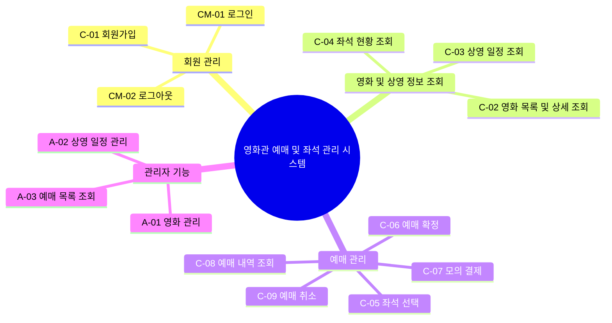

# 업무 기능도

**프로젝트명:** 영화관 예매 및 좌석 관리 시스템 (Cinema Reservation System)

---

## 1. 업무 기능도 개요

### 1.1 목적

업무 기능도(Business Function Diagram)는 영화관 예매 및 좌석 관리 시스템이 제공하는 업무 기능을 계층적으로 분해하여 나타낸 문서이다. 본 문서는 시스템 전체 기능의 구성과 각 기능의 담당 사용자를 명확히 하여, 이후 업무 흐름 분석과 데이터베이스 설계의 기준으로 활용하는 것을 목적으로 한다.

### 1.2 범위

본 문서는 프로젝트 개요서(`project_overview.md`)에서 승인된 범위를 따른다.

| 항목 | 범위 |
|---|---|
| 영화관 | 1개 |
| 상영관 | 5개 (상영관당 좌석 50석, 총 250석) |
| 영화 | 샘플 영화 5편 |
| 상영 일정 | 연속 7일간 총 140회 |
| 사용자 역할 | 고객(CUSTOMER), 관리자(ADMIN) |
| 개발 환경 | Python, Flask, PostgreSQL |

### 1.3 분해 기준

업무 기능은 3단계로 분해한다.

| 단계 | 구분 | 구성 |
|---|---|---|
| Level 1 | 전체 시스템 | 영화관 예매 및 좌석 관리 시스템 (1개) |
| Level 2 | 기능 그룹 | 회원 관리, 영화 및 상영 정보 조회, 예매 관리, 관리자 기능 (4개) |
| Level 3 | 개별 기능 | 기능 번호가 부여된 단위 기능 (14개) |

기능 번호는 프로젝트 개요서의 체계를 그대로 사용한다. 공통 기능은 `CM-`, 고객 전용 기능은 `C-`, 관리자 전용 기능은 `A-`로 시작한다.

---

## 2. 업무 기능 계층 구조

아래 다이어그램은 업무 기능의 계층 구조를 나타낸 기능 분해도이며, 업무 처리 순서를 나타내는 흐름도가 아니다.

### 2.1 기능 그룹별 구성

| Level 2 기능 그룹 | Level 3 기능 | 기능 수 |
|---|---|---|
| 회원 관리 | CM-01, CM-02, C-01 | 3 |
| 영화 및 상영 정보 조회 | C-02, C-03, C-04 | 3 |
| 예매 관리 | C-05, C-06, C-07, C-08, C-09 | 5 |
| 관리자 기능 | A-01, A-02, A-03 | 3 |
| **합계** | | **14** |

---

## 3. 기능별 상세 설명

| 기능 번호 | 기능명 | 기능 설명 | 담당 사용자 |
|---|---|---|---|
| CM-01 | 로그인 | 고객과 관리자가 계정으로 시스템에 접속한다. | CUSTOMER, ADMIN |
| CM-02 | 로그아웃 | 고객과 관리자가 시스템 접속을 종료한다. | CUSTOMER, ADMIN |
| C-01 | 회원가입 | 고객 계정을 생성한다. 공개 회원가입으로는 CUSTOMER 계정만 생성할 수 있다. | CUSTOMER |
| C-02 | 영화 목록 및 상세 조회 | 등록된 영화 목록과 영화별 상세 정보를 조회한다. | CUSTOMER |
| C-03 | 상영 일정 조회 | 영화별 상영 일정을 조회한다. | CUSTOMER |
| C-04 | 좌석 현황 조회 | 선택한 상영 일정의 좌석별 예매 가능 여부를 조회한다. | CUSTOMER |
| C-05 | 좌석 선택 | 예매 가능한 좌석을 한 개 이상 선택한다. 하나의 예매는 하나의 상영 일정에 속하며 여러 좌석을 포함할 수 있다. 하나의 좌석은 같은 상영 일정에서 유효한 예매를 하나만 가질 수 있다. | CUSTOMER |
| C-06 | 예매 확정 | 선택한 좌석에 대한 예매를 확정한다. 로그인한 고객만 수행할 수 있으며, 상영이 시작된 이후에는 예매할 수 없다. | CUSTOMER |
| C-07 | 모의 결제 | 실제 결제 없이 결제 절차를 모의로 처리한다. | CUSTOMER |
| C-08 | 예매 내역 조회 | 본인의 예매 내역을 조회한다. | CUSTOMER |
| C-09 | 예매 취소 | 상영이 시작되기 전에 한하여 본인의 예매를 취소한다. 예매에 포함된 모든 좌석이 함께 취소되어 해제되며, 취소된 예매의 이력은 보존된다. | CUSTOMER |
| A-01 | 영화 관리 | 영화를 추가하고 영화 정보를 수정한다. | ADMIN |
| A-02 | 상영 일정 관리 | 상영 일정을 추가하고 수정한다. 같은 상영관의 상영 일정은 시간이 서로 겹칠 수 없다. | ADMIN |
| A-03 | 예매 목록 조회 | 전체 예매 내역을 조회한다. | ADMIN |

---

## 4. 사용자별 기능 구분

### 4.1 사용자별 담당 기능

| 기능 번호 | 기능명 | CUSTOMER (고객) | ADMIN (관리자) |
|---|---|:---:|:---:|
| CM-01 | 로그인 | ○ | ○ |
| CM-02 | 로그아웃 | ○ | ○ |
| C-01 | 회원가입 | ○ | — |
| C-02 | 영화 목록 및 상세 조회 | ○ | — |
| C-03 | 상영 일정 조회 | ○ | — |
| C-04 | 좌석 현황 조회 | ○ | — |
| C-05 | 좌석 선택 | ○ | — |
| C-06 | 예매 확정 | ○ | — |
| C-07 | 모의 결제 | ○ | — |
| C-08 | 예매 내역 조회 | ○ | — |
| C-09 | 예매 취소 | ○ | — |
| A-01 | 영화 관리 | — | ○ |
| A-02 | 상영 일정 관리 | — | ○ |
| A-03 | 예매 목록 조회 | — | ○ |

### 4.2 역할별 책임

| 구분 | 내용 |
|---|---|
| 공통 기능 | 로그인(CM-01)과 로그아웃(CM-02)은 고객과 관리자가 함께 사용하는 공통 기능이다. |
| 회원가입 | 공개 회원가입(C-01)으로는 CUSTOMER 계정만 생성할 수 있으며, ADMIN은 회원가입으로 생성할 수 없다. |
| 고객의 예매 조회 및 취소 | 고객은 본인의 예매만 조회(C-08)하고 취소(C-09)할 수 있으며, 타인의 예매에는 접근할 수 없다. |
| 영화 및 상영 일정 관리 | 영화와 상영 일정의 추가 및 수정(A-01, A-02)은 관리자만 수행할 수 있다. 고객은 영화와 상영 일정을 조회만 할 수 있다. |
| 전체 예매 조회 | 관리자는 전체 예매 내역을 조회(A-03)할 수 있다. |
| 예매 관련 제약 | 고객은 예매를 확정(C-06)하기 전에 로그인해야 하며, 모의 결제(C-07)는 실제 결제 게이트웨이를 사용하지 않는다. |
