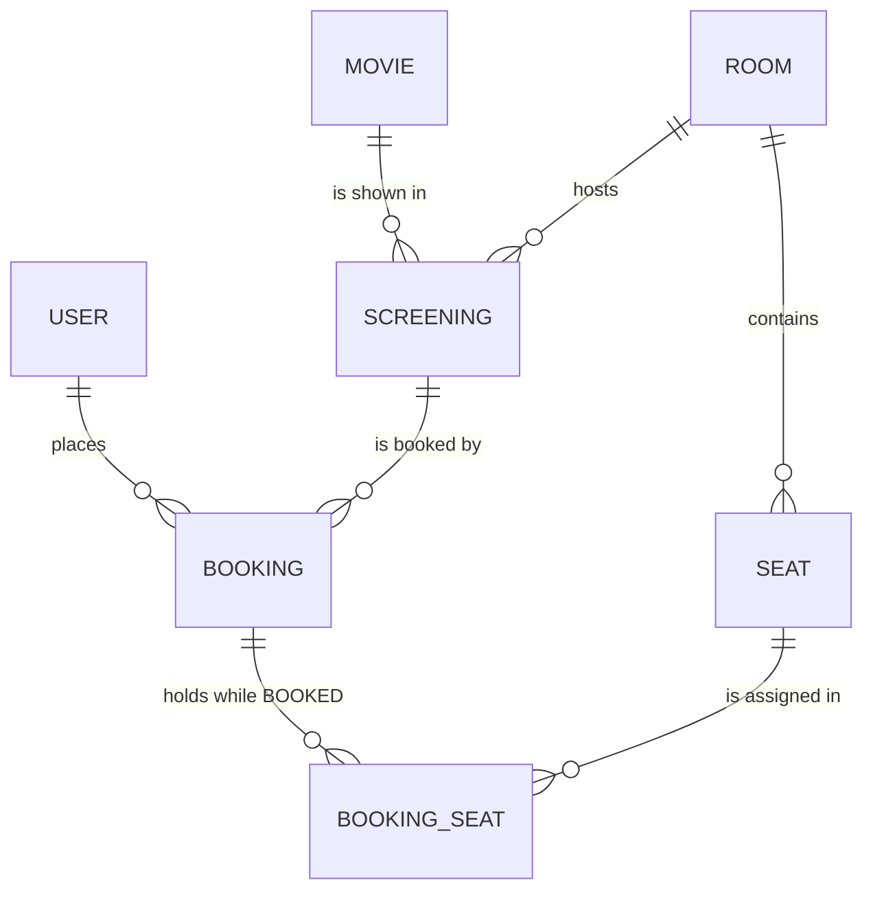

# 개념적 데이터 모델 (Conceptual Data Model)

**기준:** B01~B05, BR-DL-001(D1~D6). 속성 상세는 논리·물리 모델 문서를 참조한다.

## 1. 엔티티

| 엔티티 | 설명 | 물리 테이블 |
|---|---|---|
| 사용자 (User) | 고객(CUSTOMER) 또는 관리자(ADMIN) 계정 | `users` |
| 영화 (Movie) | 제목·장르·상영 시간·관람 등급·줄거리·개봉일 | `movies` |
| 상영관 (Room) | 1개 영화관의 5개 상영관 | `theater_rooms` |
| 좌석 (Seat) | 상영관에 속한 50석 | `seats` |
| 상영 일정 (Screening) | 영화·상영관·시작/종료·좌석당 가격 | `showtimes` |
| 예매 (Booking) | 한 상영 일정에 대한 고객의 예매(상태, 결제 상태, 기한, 총액) | `bookings` |
| 예매 좌석 (BookingSeat) | 활성 예매에 배정된 좌석과 단가 스냅샷 | `booking_seats` |

## 2. 관계

| 관계 | 카디널리티 | 업무 규칙 |
|---|---|---|
| 상영관 – 좌석 | 1 : N (50) | BR-01, BR-02 |
| 영화 – 상영 일정 | 1 : N | BR-03 |
| 상영관 – 상영 일정 | 1 : N (같은 상영관에서 시간 겹침 금지) | BR-03, BR-04 |
| 사용자(고객) – 예매 | 1 : N | BR-09 |
| 상영 일정 – 예매 | 1 : N | BR-06 |
| 예매 – 예매 좌석 | 1 : N (`BOOKED`이면 1개 이상, 취소·만료 시 0개) | BR-06, D1, D3 |
| 좌석 – 예매 좌석 | 1 : N (같은 상영 일정에서 활성 예매는 하나) | BR-07, BR-08 |

## 3. ERD

## 4. 모델링 결정 (승인된 결정과의 대응)

* **D1/D3:** 예매(Booking)는 이력으로 남고 예매 좌석(BookingSeat)은 활성 예매에만 존재한다.
* **D2:** 상영 일정은 예매가 한 건이라도 참조하면 변경 불가한 이력 맥락이 된다.
* **D4:** 비회원 방문자는 엔티티가 아니다(계정 역할이 아님).
* **D6:** 가격은 상영 일정의 속성이며, 예매 좌석이 단가 스냅샷을, 예매가 총액을 보관한다.
* 동일 좌석은 다른 상영 일정에 각각 배정할 수 있다. 활성 배정의 고유성은 (상영 일정, 좌석) 단위다. 개념적 엔티티와 관계는 유지한다.
* 0004의 유한 금액 제약은 물리적 제약이다. 기존 엔티티와 카디널리티는 그대로 유지된다.
* 좌석에는 상태 속성이 없다. 가용 여부는 (상영 일정, 좌석)별로 활성 예매 좌석의 존재로 판정한다.
