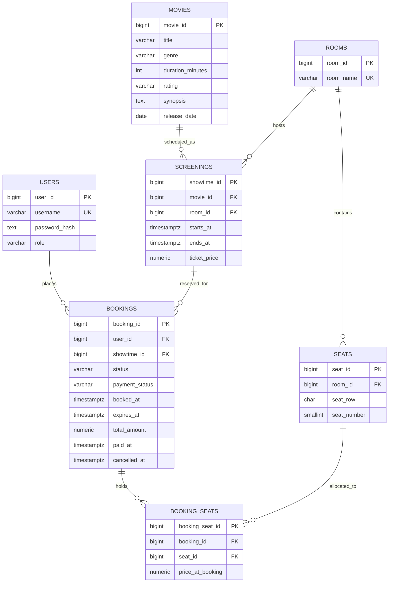

# 논리적 데이터 모델 (Logical Data Model)

**기준:** `database/schema.sql`. 표기: PK 밑줄 대신 **PK**, 외래키는 FK, 후보키는 UK.

## 1. 릴레이션 스키마

```
USERS(user_id PK, username UK, password_hash, role, created_at)
MOVIES(movie_id PK, title, genre, duration_minutes, rating, synopsis, release_date)
ROOMS(room_id PK, room_name UK)                                  -- theater_rooms
SEATS(seat_id PK, room_id FK→ROOMS, seat_row, seat_number)       -- UK(room_id, seat_row, seat_number)
SCREENINGS(showtime_id PK, movie_id FK→MOVIES, room_id FK→ROOMS,
           starts_at, ends_at, ticket_price)                     -- showtimes
BOOKINGS(booking_id PK, user_id FK→USERS, showtime_id FK→SCREENINGS,
         status, payment_status, booked_at, expires_at, total_amount,
         paid_at, cancelled_at)
BOOKING_SEATS(booking_seat_id PK, booking_id FK→BOOKINGS, seat_id FK→SEATS,
              price_at_booking)                                  -- UK(booking_id, seat_id)
```

## 2. 무결성 규칙 (논리 수준)

| 규칙 | 표현 |
|---|---|
| 역할은 `CUSTOMER`/`ADMIN` | `role` 도메인 (D4: GUEST 없음) |
| 예매 상태 `BOOKED`/`CANCELLED`/`EXPIRED`, 결제 상태 `UNPAID`/`PAID` | 도메인 (D3) |
| `expires_at = booked_at + 10분` | 파생 제약 (D3) |
| `PAID` ⇔ `paid_at` 존재, `CANCELLED` ⇔ `cancelled_at` 존재, `EXPIRED`는 `PAID`가 아님 | 상태 일관성 |
| `ends_at > starts_at`; 같은 `room_id`에서 `[starts_at, ends_at)` 구간 비중첩 | BR-04 |
| 예매 좌석의 `seat.room_id = screening.room_id` | BR-07 (트리거) |
| (상영 일정, 좌석)당 `BOOKED` 예매 좌석은 최대 1개 | BR-08 (트리거 + 상영 일정 행 잠금) |
| 예매를 참조하는 상영 일정은 5개 속성 모두 변경 불가 | D2 (트리거) |
| `BOOKED` 예매: 좌석 ≥ 1, `total_amount = Σ price_at_booking`, `price_at_booking = ticket_price` | D6 (지연 제약 트리거 + 트리거) |
| `CANCELLED`/`EXPIRED` 예매: 좌석 행 0개, 예매 행·`total_amount`·`payment_status` 보존 | D1, D3 |

## 3. 논리 ERD



정규화 분석은 `normalization.md`, 물리 구현은 `physical_data_model.md`를 참조한다.
