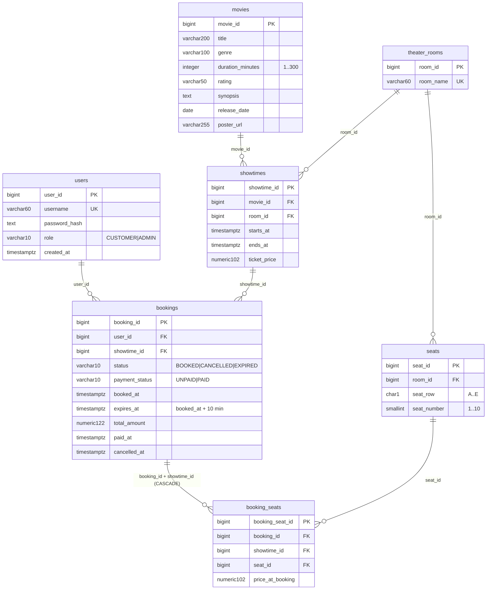

# 물리적 데이터 모델 (Physical Data Model)

**DBMS:** PostgreSQL 18 (18.7에서 검증) · **확장:** `btree_gist` · **DDL:** `backend/migrations/0001_baseline.sql` + `0002_movie_delete_permissions.sql` + `0003_booking_integrity.sql` + `0004_finite_money.sql` · **시드:** `backend/seeds/demo.sql`
컬럼별 타입·제약은 `table_description.md`, 도메인은 `domain_definition.md`에 있다. 이 문서는 구현 구조를 요약한다.

## 1. 물리 ERD

## 2. 구현 요소

| 구분 | 요소 | 목적 |
|---|---|---|
| 선언적 제약 | `showtimes_no_room_overlap` (EXCLUDE gist), `showtimes_end_after_start`, `bookings_expiry_is_10_minutes`, `bookings_paid_at_matches`, `bookings_cancelled_at_matches`, `bookings_paid_never_expired`, 도메인 CHECK, UNIQUE, FK | BR-04, D3, D6 |
| 금액 CHECK | `showtimes_ticket_price_finite`, `bookings_total_amount_finite`, `booking_seats_price_at_booking_finite` | 비유한 단가·총액·스냅샷 거부, 기존 음수 제한 별도 적용 |
| BEFORE 트리거 | `trg_showtimes_default_end_time`, `trg_showtimes_protect_booked` (D2), `trg_bookings_validate` (D1/D3 상태 전이·시각 설정), `trg_booking_seats_validate` (BR-07/08, D6 스냅샷, 상영 일정 행 잠금), `trg_booking_seats_protect_delete` | 규칙 강제 |
| 첫 예매 BEFORE INSERT | `trg_bookings_z_version_showtime` | 첫 예매 시 상영 행 버전을 갱신하여 오래된 스냅샷을 가진 일정 수정 차단 |
| AFTER 트리거 | `trg_bookings_release_seats` | 취소·만료 시 좌석 행 전부 삭제 (D1, D3) |
| 지연 제약 트리거 | `trg_bookings_z_consistency`, `trg_booking_seats_consistency` | COMMIT 시 좌석 ≥ 1, 총액 = 스냅샷 합 (D6) |
| 함수 | `create_booking`, `pay_booking`, `cancel_booking`, `expire_overdue_bookings` | Flask가 호출하는 원자적 작업 (만료는 요청 시점 호출, 자동 스케줄러 없음) |
| 활성 배정 제약 | `bookings_id_showtime_key`, `booking_seats_booking_showtime_fkey`, `booking_seats_showtime_seat_key` | 부모의 상영 ID와 일치하고 상영별 좌석 고유성 강제 |
| 인덱스 | `idx_showtimes_movie_start`, `idx_showtimes_room_start`, `idx_bookings_user`, `idx_bookings_showtime_status`, `idx_booking_seats_seat`, `idx_bookings_pending_expiry`(부분), `users_username_lower_key`(`lower(username)` 고유) | 조회·만료 탐색. UNIQUE 제약은 B-tree 고유 인덱스를 사용 |

## 3. 동시성 설계

상영 일정의 `FOR UPDATE` 잠금은 가격과 일정 변경을 조정한다. 첫 예매는 일정 속성을 그대로 둔 채 행 버전을 작성하므로 상위 격리 수준에서 오래된 스냅샷으로 일정을 수정할 수 없다. 활성 좌석의 즉시 UNIQUE 인덱스는 다른 MVCC 스냅샷의 행과도 충돌을 검사한다. 삽입 트리거는 부모 예매를 `FOR SHARE`로 잠그고 동일한 상영 ID를 채운다. 취소·만료가 완료되면 활성 행이 삭제되고 같은 좌석을 다시 예매할 수 있다. 결제·취소는 예매 행을 잠그고, `expire_overdue_bookings`는 `FOR UPDATE SKIP LOCKED`로 동시에 처리 중인 행을 건너뛴다. 상영관 시간 겹침은 EXCLUDE 제약이 동시 입력에서도 보장한다. 검증은 `database_test_documentation.md` 참조. SERIALIZABLE 또는 REPEATABLE READ에서 40001이 발생하면 새 트랜잭션에서 전체 업무를 다시 시작해야 한다.

## 4. 시드 데이터 (데모 데이터이며 업무 규칙이 아님)

계정 3개(관리자 1 `admin`, 고객 2 `customer1`·`customer2`; 비밀번호는 루트 `README.md` 및 `backend/seeds/demo.sql` 참조), 영화 6편(장르·등급·개봉일·포스터 경로는 데모 값), 상영관 5개, 좌석 250석, 상영 일정 280회(실행일부터 Asia/Seoul 기준 14일, 하루 20회, 방마다 10·13·16·19시), `ends_at` = 시작 + 영화 상영 시간, 좌석당 가격 12000.00(데모 값, D6 #6).
