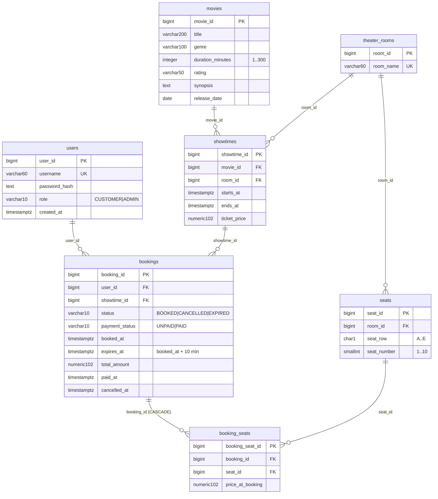

# 물리적 데이터 모델 (Physical Data Model)

**DBMS:** PostgreSQL 14+ (18.6에서 검증) · **확장:** `btree_gist` · **DDL:** `backend/migrations/0001_baseline.sql` · **시드:** `backend/seeds/demo.sql`
컬럼별 타입·제약은 `table_description.md`, 도메인은 `domain_definition.md`에 있다. 이 문서는 구현 구조를 요약한다.

## 1. 물리 ERD

## 2. 구현 요소

| 구분 | 요소 | 목적 |
|---|---|---|
| 선언적 제약 | `showtimes_no_room_overlap` (EXCLUDE gist), `showtimes_end_after_start`, `bookings_expiry_is_10_minutes`, `bookings_paid_at_matches`, `bookings_cancelled_at_matches`, `bookings_paid_never_expired`, 도메인 CHECK, UNIQUE, FK | BR-04, D3, D6 |
| BEFORE 트리거 | `trg_showtimes_default_end_time`, `trg_showtimes_protect_booked` (D2), `trg_bookings_validate` (D1/D3 상태 전이·시각 설정), `trg_booking_seats_validate` (BR-07/08, D6 스냅샷, 상영 일정 행 잠금), `trg_booking_seats_protect_delete` | 규칙 강제 |
| AFTER 트리거 | `trg_bookings_release_seats` | 취소·만료 시 좌석 행 전부 삭제 (D1, D3) |
| 지연 제약 트리거 | `trg_bookings_z_consistency`, `trg_booking_seats_consistency` | COMMIT 시 좌석 ≥ 1, 총액 = 스냅샷 합 (D6) |
| 함수 | `create_booking`, `pay_booking`, `cancel_booking`, `expire_overdue_bookings` | Flask가 호출하는 원자적 작업 (만료는 요청 시점 호출, 자동 스케줄러 없음) |
| 인덱스 | `idx_showtimes_movie_start`, `idx_showtimes_room_start`, `idx_bookings_user`, `idx_bookings_showtime_status`, `idx_booking_seats_seat`, `idx_bookings_pending_expiry`(부분) | 조회·만료 탐색 |

## 3. 동시성 설계

`booking_seats` 삽입 트리거가 해당 상영 일정 행을 `FOR UPDATE`로 잠근 뒤 중복 좌석을 검사하므로 같은 상영 일정의 동시 예매가 직렬화된다. 결제·취소는 예매 행을 잠그고, `expire_overdue_bookings`는 `FOR UPDATE SKIP LOCKED`로 동시에 처리 중인 행을 건너뛴다. 상영관 시간 겹침은 EXCLUDE 제약이 동시 입력에서도 보장한다. 검증은 `database_test_documentation.md` 참조.

## 4. 시드 데이터 (데모 데이터이며 업무 규칙이 아님)

계정 3개(관리자 1, 고객 2; 해시는 Member A 제공, 평문 비밀번호는 미문서·미검증), 영화 5편(장르·등급·개봉일은 데모 값), 상영관 5개, 좌석 250석, 상영 일정 140회(실행일부터 Asia/Seoul 기준 7일, 하루 20회, 방마다 10·13·16·19시), `ends_at` = 시작 + 영화 상영 시간, 좌석당 가격 12000.00(데모 값, D6 #6).
