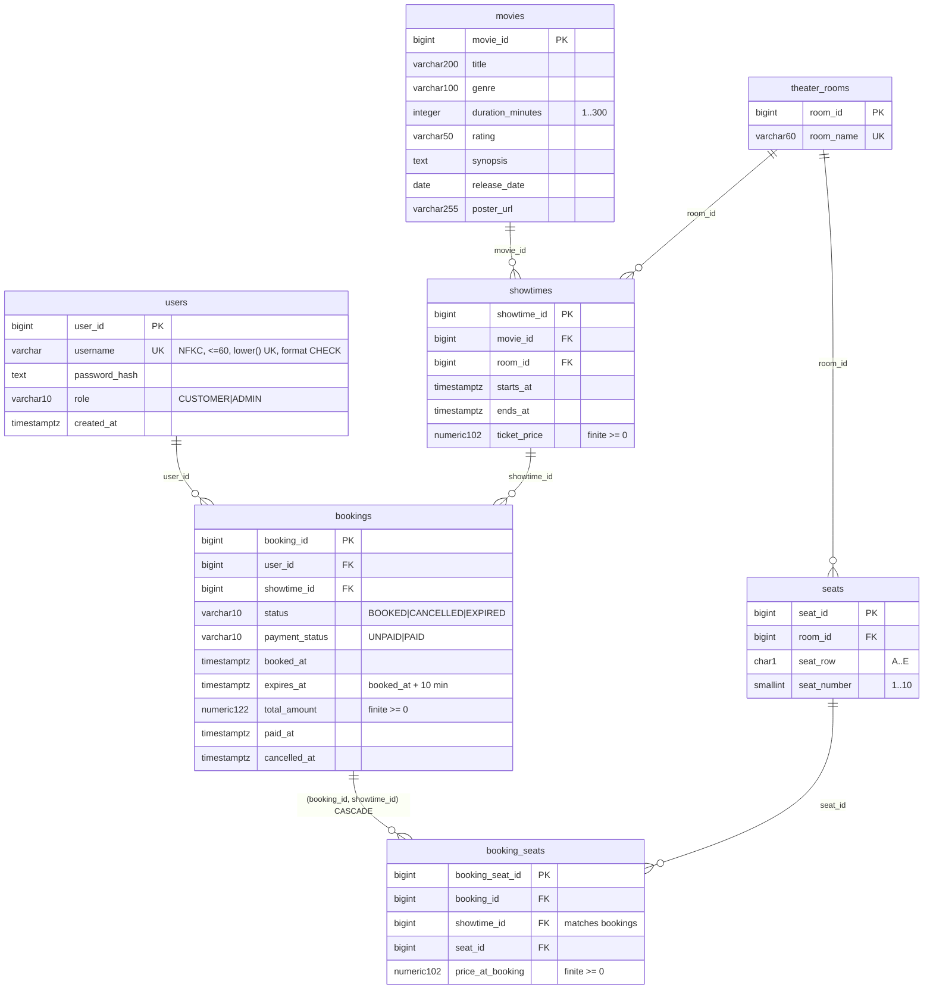

# Tài Liệu Tổng Hợp Đầy Đủ Để Thuyết Trình Dự Án — Cinema Reservation System

**Tên dự án:** 영화관 예매 및 좌석 관리 시스템 (**Cinema Reservation System** — Hệ thống Đặt vé & Quản lý Ghế Rạp chiếu phim)  
**Cập nhật theo mã nguồn mới nhất:** `27/11/2026` — commit `02ef682` (PR #2, **Schema 0006** — chính sách Account ID thống nhất 3 tầng)  
**Thành viên nhóm (2 người):**
- **Thành viên A — Database Lead:** **응오후인느 (Ngo Huynh Nhu)** — Khoa Phần mềm (`소프트웨어학과`): Thiết kế Conceptual/Logical/Physical ERD, chuẩn hóa 1NF–3NF, DDL/Constraints/Triggers/Functions PostgreSQL, chuỗi nâng cấp DB (`0003`, `0004`, `0006`), mô hình ER (`.drawio`/PDF/PNG), dump/restore, kịch bản SQL demo và tài liệu DB.
- **Thành viên B — Application Lead:** **응웬치롱 (Nguyen Chi Long)** — Khoa AI Software (`AI소프트웨어학과`): Phân tích nghiệp vụ (`docs/business/*`), REST API Flask & bảo mật, Frontend SPA React + TypeScript (+ Legacy UI fallback), Docker Compose, kiểm thử tự động & rà soát đối kháng.

> **Mục đích tài liệu này:** Tổng hợp toàn bộ sự thật kỹ thuật đã đối chiếu trực tiếp từ mã nguồn, tài liệu nghiệp vụ, tài liệu CSDL, log kiểm thử `0006` và yêu cầu thuyết trình của giáo sư vào một file duy nhất để nhóm **làm slide (PPT), luyện thuyết trình 15 phút, chạy Live Demo (Web + SQL) và trả lời Q&A (5–10 phút)**.

---

## Mục Lục

1. [Yêu cầu buổi thuyết trình & Tiêu chí đánh giá](#1-yêu-cầu-buổi-thuyết-trình--tiêu-chí-đánh-giá)
2. [Tổng quan dự án, Bài toán cốt lõi & Quy mô hệ thống](#2-tổng-quan-dự-án-bài-toán-cốt-lõi--quy-mô-hệ-thống)
3. [Môi trường phát triển, DBMS, Công cụ & Thiết lập ban đầu](#3-môi-trường-phát-triển-dbms-công-cụ--thiết-lập-ban-đầu)
4. [Kiến trúc tách biệt Logic & Vật lý (3 tầng độc lập)](#4-kiến-trúc-tách-biệt-logic--vật-lý-3-tầng-độc-lập)
5. [Phân tích nghiệp vụ & 6 Quyết định cốt lõi (`BR-DL-001`)](#5-phân-tích-nghiệp-vụ--6-quyết-định-cốt-lõi-br-dl-001)
6. [Thiết kế Cơ sở dữ liệu (Conceptual → Logical → 3NF → Physical)](#6-thiết-kế-cơ-sở-dữ-liệu-conceptual--logical--3nf--physical)
7. [Câu chuyện kỹ thuật: Đối soát bàn giao & Tiến hóa Schema `0001` → `0006`](#7-câu-chuyện-kỹ-thuật-đối-soát-bàn-giao--tiến-hóa-schema-0001--0006)
8. [Hiện thực hóa Backend REST API & Bảo mật đa lớp](#8-hiện-thực-hóa-backend-rest-api--bảo-mật-đa-lớp)
9. [Hiện thực hóa Frontend SPA & Trải nghiệm Người dùng](#9-hiện-thực-hóa-frontend-spa--trải-nghiệm-người-dùng)
10. [Kiểm chứng đa tầng & Số liệu xác nhận mới nhất (Schema `0006`)](#10-kiểm-chứng-đa-tầng--số-liệu-xác-nhận-mới-nhất-schema-0006)
11. [Đề xuất cấu trúc Slide & Kịch bản thuyết trình 15 phút (16 Slide)](#11-đề-xuất-cấu-trúc-slide--kịch-bản-thuyết-trình-15-phút-16-slide)
12. [Kịch bản Live Demo chi tiết (Web UI + SQL trực tiếp) & Lệnh chuẩn bị](#12-kịch-bản-live-demo-chi-tiết-web-ui--sql-trực-tiếp--lệnh-chuẩn-bị)
13. [Nội dung Bắt buộc: Ý nghĩa của dự án nhóm trong kỷ nguyên AI](#13-nội-dung-bắt-buộc-ý-nghĩa-của-dự-án-nhóm-trong-kỷ-nguyên-ai)
14. [Bộ 10 câu hỏi Q&A phản biện dự kiến & Đáp án chuẩn](#14-bộ-10-câu-hỏi-qa-phản-biện-dự-kiến--đáp-án-chuẩn)
15. [Bảng đối chiếu 12 hạng mục nộp bài & Checklist trước giờ G](#15-bảng-đối-chiếu-12-hạng-mục-nộp-bài--checklist-trước-giờ-g)

---

## 1. Yêu cầu buổi thuyết trình & Tiêu chí đánh giá

Tổng hợp từ hướng dẫn phát biểu cuối kỳ của giáo sư (`important.md` trong lịch sử git) và kế hoạch dự án (`chia_viec.md`):

### 1.1 Các yêu cầu bắt buộc khi thuyết trình

| # | Yêu cầu của giáo sư | Cách dự án Cinema đáp ứng |
|---|---|---|
| 1 | Giải thích **cấu hình môi trường ban đầu**, **DBMS**, **ngôn ngữ lập trình**, **công cụ bổ trợ** (framework, container, công cụ cộng tác) | PostgreSQL 18 (`btree_gist`), Python 3.12 + Flask 3.1.3 + `psycopg2`, React 19 + TypeScript + Vite, Docker Compose v2, pytest/Playwright/Node test, Git/GitHub. Thiết lập ban đầu 3 bước qua `.env` → `docker compose up` → `demo.sql`. |
| 2 | **Kiến trúc tách biệt cả logic lẫn vật lý** giữa Database/Backend và Client (Web/App frontend) | 3 container & 3 tiến trình độc lập (`db:5432`, `api:5000`, `frontend:8080`). API không phục vụ HTML (`static_folder=None, template_folder=None`); Frontend là static server thuần không có thư viện DB; PostgreSQL chỉ kết nối nội bộ với API qua role `cinema_api`. Có test tự động `test_process_separation.py` và `test_architecture_live.py`. |
| 3 | Trình bày theo **mạch câu chuyện (Storyline)**: Lập kế hoạch → Thiết kế → Hiện thực hóa → Kiểm chứng, **không chỉ liệt kê tính năng** | Đi xuyên suốt: 4 bài toán dữ liệu → Kiến trúc 3 tầng → 14 nghiệp vụ & 6 quyết định `D1–D6` → Mô hình hóa 3NF & Động cơ toàn vẹn DB → Đối soát 13 lỗi & 6 migrations `0001–0006` → Backend/Frontend → Kiểm chứng 5 tầng → Live Demo (UI + SQL) → Đúc kết vai trò làm nhóm thời AI. |
| 4 | **Tài liệu PPT:** Tự do mẫu thiết kế | Đề xuất bộ 16 slide (mục 11), trình bày bằng tiếng Hàn (hoặc song ngữ theo yêu cầu lớp). |
| 5 | **Thời lượng:** **15 phút thuyết trình** (cần tập bấm giờ) + **5–10 phút Q&A** | Đã chia chi tiết từng mốc phút–giây cho 16 slide (Slide 1–11: `08:05`, Demo Web: `02:00`, Demo SQL: `03:10`, Slide AI & Kết: `01:45`, tổng `15:00`). |
| 6 | **Người trình bày & Demo:** Tiêu chuẩn 1 người (tùy tình huống 2 người trở lên) | Có sẵn phương án phân vai 2 người (B phụ trách mở đầu/kiến trúc/API/UI/Demo Web ~8:30; A phụ trách CSDL/migration/Demo SQL ~6:30) hoặc linh hoạt gộp 1 người nói chính + 1 người bấm demo. |
| 7 | **Chuẩn bị sẵn môi trường demo:** Bắt đầu là demo được ngay; mọi lỗi môi trường thuộc trách nhiệm nhóm | Đóng gói Docker Compose khởi động 1 lệnh + healthcheck; mở sẵn 2 phiên trình duyệt (Customer & Admin) và 1 terminal `psql` vào DB cô lập `cinema_test_demo`. |
| 8 | **Chuẩn bị sẵn SQL scripts điều khiển dữ liệu:** Trạng thái dữ liệu, tình huống ngoại lệ, kiểm tra phân quyền | Bộ script có sẵn trong `database/demo/`: `main.sql` (vòng đời trạng thái), `exceptions.sql` (`UC002`, `UC003`, `23P01`, `23514`), `permissions_grants.sql` (`cinema_api`, `GRANT`/`REVOKE`, `42501`), `concurrency_{prepare,a,b}.sql` (tranh chấp 2 phiên). Tự `ROLLBACK` sạch dữ liệu sau khi chạy. |
| 9 | **Trang cuối (hoặc giữa bài) BẮT BUỘC:** *"AI가 모든 것을 다 해주는 시대에 팀 단위 프로젝트가 왜 의미가 있는가?"* dựa trên trải nghiệm thật | Dành riêng Slide 14 với 3 dẫn chứng thật từ dự án: chốt hợp đồng `BR-DL-001` (`D1–D6`), đối soát chéo 20/11 phát hiện **13 điểm lệch**, và kiểm chứng đối kháng tạo ra các bản vá thực chiến `0003`–`0006`. |

### 1.2 Ánh xạ 5 tiêu chí chấm điểm của giáo sư

| Tiêu chí đánh giá | Điểm ăn điểm mạnh nhất của dự án |
|---|---|
| **Mạch câu chuyện (`발표 스토리`)** | Câu chuyện tiến hóa thực tế từ thiết kế ban đầu → đối soát chéo phát hiện 13 lỗi → sửa lỗi biên MVCC / `NaN` / Unicode → kiểm chứng 5 tầng. |
| **Tính năng cốt lõi riêng (`핵심 기능`)** | **Động cơ toàn vẹn ngay tại tầng PostgreSQL**: `EXCLUDE USING gist` chống chồng lịch, khóa hàng + FK kép + `UNIQUE(showtime_id, seat_id)` chống bán trùng ghế, hết hạn 10 phút theo *request-time expiry* (`FOR UPDATE SKIP LOCKED`), bảo toàn lịch sử & snapshot giá, thống nhất chính sách username 3 tầng từ Unicode 15.0. |
| **Mức độ hiểu kỹ thuật (`기술 이해도`)** | Không dùng ORM "hộp đen": hiểu sâu MVCC, thứ tự alphabet của PostgreSQL `AFTER` trigger, đặc thù `'NaN'::numeric >= 0`, `varchar(60)` cắt khoảng trắng cuối trước CHECK, fail-closed policy, chống timing attack, SQLSTATE mapping, retryable transactions (`40001`/`40P01`). |
| **Độ vững chắc của thiết kế (`설계 견고성`)** | Chuẩn hóa 3NF + *Controlled Redundancy* có kiểm soát bằng trigger/FK; tách quyền `cinema_owner` vs `cinema_api`; 6 migration nâng cấp có kiểm tra dữ liệu & không sửa dữ liệu ngầm; 1,415 pytest + 177 SQL integrity + 31 probes + 5 mutation checks + 16 concurrency checks + 121 Node tests + 8 Playwright E2E. |
| **Sáng tạo / Độ hoàn thiện (`창의성·완성도`)** | Trải nghiệm khách chọn ghế trước khi đăng nhập (giữ nguyên nhiều ghế qua `login?next=...`), đồng hồ đếm ngược đồng bộ server, chống bấm đúp (`UI-01`), chống SQLi/XSS (`SEC-01`), có UI dự phòng `dist-legacy`, đóng gói Docker Compose chuẩn chạy một lệnh cả dev lẫn verify. |

---

## 2. Tổng quan dự án, Bài toán cốt lõi & Quy mô hệ thống

### 2.1 Vì sao bài toán đặt vé rạp chiếu phim là bài toán điển hình về CSDL?

Nhìn bề ngoài như ứng dụng CRUD đơn giản, nhưng nghiệp vụ đặt vé rạp chiếu phim xoay quanh **4 thách thức dữ liệu cốt lõi**:

1. **Chống bán trùng ghế dưới tải đồng thời (Double Booking / Concurrency):** Hai khách hàng cùng chọn và bấm xác nhận cùng một ghế cho cùng một suất chiếu tại đúng một thời điểm — chỉ duy nhất 1 người được thành công.
2. **Giữ chỗ tạm có thời hạn (Unpaid Seat Hold Timeout):** Khách xác nhận giữ ghế nhưng bỏ ngang không thanh toán sẽ làm "chết" ghế. Hệ thống chỉ giữ ghế đúng **10 phút**, quá hạn phải nhả ghế nguyên tử (atomic).
3. **Chống chồng lịch chiếu trong cùng phòng (Schedule Overlap):** Hai suất chiếu trong cùng một phòng không được giao nhau về khoảng thời gian `[starts_at, ends_at)`, kể cả khi hai admin thao tác đồng thời.
4. **Bảo toàn lịch sử giao dịch & bất biến ngữ cảnh (History & Price Immutability):** Khi khách hủy vé hoặc vé hết hạn, ghế phải mở lại ngay cho người khác đặt, nhưng bản ghi giao dịch, tổng tiền, trạng thái thanh toán và ngữ cảnh suất chiếu (phim, phòng, giờ, giá vé) vẫn phải giữ nguyên không bị sai lệch.

### 2.2 Quy mô hệ thống & Dữ liệu mẫu (`project_overview.md`, `backend/seeds/demo.sql`)

| Hạng mục | Quy mô thực tế | Ghi chú kỹ thuật |
|---|---|---|
| **Số rạp chiếu phim** | 1 rạp | Phạm vi 1 rạp duy nhất |
| **Số phòng chiếu (`theater_rooms`)** | **5 phòng** | `Hall 1` ~ `Hall 5` |
| **Số ghế (`seats`)** | **50 ghế/phòng × 5 = 250 ghế** | Hàng `A`–`E` (5 hàng) × Số `1`–`10` (10 ghế/hàng). Không lưu cột trạng thái ghế toàn cục. |
| **Số phim mẫu (`movies`)** | **6 phim** | Dữ liệu demo thực tế kèm poster cục bộ trong `frontend/public/images/posters/` (nguồn TMDB). |
| **Số suất chiếu (`showtimes`)** | **280 suất chiếu** | 14 ngày liên tiếp tính từ ngày chạy seed theo múi giờ `Asia/Seoul`, 20 suất/ngày (5 phòng × 4 khung giờ `10:00`, `13:00`, `16:00`, `19:00`). Giá demo `12000.00` (không phải quy tắc cố định). |
| **Vai trò tài khoản (`users.role`)** | **2 vai trò** | `CUSTOMER` và `ADMIN` (không tồn tại role `GUEST`). |
| **Tài khoản demo (`demo.sql`)** | **3 tài khoản** | `admin` / `admin1234` (`ADMIN`); `customer1` / `customer1234` và `customer2` / `customer1234` (`CUSTOMER`). Mật khẩu băm `pbkdf2:sha256:600000`. |

**Danh sách 6 phim mẫu trong `backend/seeds/demo.sql`:**

| # | Tên phim (`title`) | Thể loại (`genre`) | Thời lượng | Xếp hạng (`rating`) | Ngày khởi chiếu | Poster (`poster_url`) |
|---|---|---|---|---|---|---|
| 1 | *Jujutsu Kaisen 0* | Animation | 105 phút | 15 | `2022-02-17` | `/images/posters/jjk-0.jpg` |
| 2 | *Jujutsu Kaisen: Hidden Inventory / Premature Death* | Animation | 110 phút | 15 | `2025-10-16` | `/images/posters/jjk-hidden-inventory.jpg` |
| 3 | *Jujutsu Kaisen: Execution* | Animation | 87 phút | 15 | `2025-12-03` | `/images/posters/jjk-execution.jpg` |
| 4 | *20th Century Girl* | Romance | 119 phút | 12 | `2022-10-06` | `/images/posters/20th-century-girl.jpg` |
| 5 | *Exhuma* | Horror | 134 phút | 15 | `2024-02-22` | `/images/posters/exhuma.jpg` |
| 6 | *Godzilla x Kong: The New Empire* | Action | 115 phút | 12 | `2024-03-27` | `/images/posters/godzilla-x-kong.jpg` |

*(Lưu ý: Phim dài nhất là 134 phút, nhỏ hơn khoảng cách 3 giờ giữa các khung giờ 10/13/16/19h nên dữ liệu seed không bao giờ chồng lịch. File `demo.sql` tự khóa 7 bảng ở chế độ `EXCLUSIVE MODE` và từ chối chạy đè nếu DB đã có dữ liệu.)*

### 2.3 Phạm vi ngoài dự án (Out of Scope — cố ý không làm để giữ chuẩn MVP)

- Nhiều cụm rạp hoặc hơn 5 phòng chiếu.
- Thanh toán thật (payment gateway) và luồng hoàn tiền (refund).
- Hủy lẻ từng ghế trong một booking.
- Thu hồi token phía server (token revocation / Redis), rate limiting, HTTPS termination (khuyến nghị dùng reverse proxy).
- Gửi email xác thực, mã QR, tích điểm, combo bắp nước, chỉnh sửa sơ đồ ghế động.

---

## 3. Môi trường phát triển, DBMS, Công cụ & Thiết lập ban đầu

### 3.1 Tech Stack & Phiên bản chính xác (đối chiếu từ `requirements.txt`, `package.json`, `Dockerfile`, `docker-compose.yml`)

| Thành phần | Công nghệ & Phiên bản | Vai trò cụ thể |
|---|---|---|
| **DBMS** | **PostgreSQL 18** (kiểm chứng trên `18.6` & `18.7`, tương thích `14+`) + extension **`btree_gist`** | Lưu trữ quan hệ, ràng buộc khai báo (`EXCLUDE`, `CHECK`, `UNIQUE`, `FK`), 9 triggers, 5 functions, khóa giao dịch đồng thời, đồng hồ nghiệp vụ (`clock_timestamp()`). |
| **Backend API** | **Python 3.12**, **Flask `3.1.3`**, **`psycopg2-binary 2.9.13`**, `Werkzeug >= 3.1.9`, `itsdangerous`, `python-dotenv 1.2.4`, `tzdata 2026.6` | REST API thuần JSON, SQL tham số hóa trực tiếp (không ORM ẩn), xác thực Bearer token, dịch mã lỗi `SQLSTATE`, tự thử lại giao dịch (`40001`/`40P01`). |
| **Frontend UI** | **React `19.3.1`**, **TypeScript `5.9.3`**, **Vite `7.3.8`**, **Node.js `24`** (Docker) / `26` (host) + Server tĩnh Python `frontend/server.py` + bản dự phòng `dist-legacy` HTML/JS | Giao diện SPA 12 trang độc lập, gọi API qua HTTP + CORS, kiểm tra kiểu tĩnh, không chứa logic nghiệp vụ hay mã DB. |
| **Container & Triển khai** | **Docker Compose v2** (`postgres:18`, `python:3.12-slim-trixie`, `node:24-trixie-slim`) | Đóng gói 3 service chính (`db`, `api`, `frontend`) chạy bằng non-root user (`uid 10001`), healthcheck đầy đủ, volume bền vững `cinema_data`; profile `test` (`test-db` trên `tmpfs` + `verify` trong mạng `internal: true`). |
| **Kiểm thử tự động** | **pytest `9.2.0`**, **Node test runner**, **Playwright `1.65.1`** (Chromium headless), `psql` | Kiểm thử tự động 5 tầng trên DB cô lập dùng một lần (`cinema_test_*`). |
| **Mô hình hóa & Tài liệu** | **draw.io desktop `32.7.4`** (sinh từ catalog DB qua `meta_query.sql` + `gen_drawio.py`), **Mermaid**, Markdown | File mô hình ER 3 trang (`.drawio`, `.pdf`, 3 ảnh `.png`), 11 tài liệu nghiệp vụ & CSDL. |
| **Cộng tác nhóm** | **Git / GitHub** (nhánh tính năng + Pull Request), `chia_viec.md`, các tài liệu hợp đồng (`BR-DL-001`, `api_contract.md`, `postgresql_flask_integration_contract.md`) | Phân tách rõ sở hữu DB (A) và App (B), rà soát chéo qua PR và báo cáo đối soát. |

### 3.2 Quy trình thiết lập môi trường ban đầu (3 bước đơn giản)

1. **Bước 1 — Cấu hình biến môi trường `.env`:**
   Sao chép `backend/.env.example` ra `.env` tại thư mục gốc, sinh ngẫu nhiên `SECRET_KEY` và `DB_PASSWORD` (64 ký tự hex bằng `secrets.token_hex(32)`). Không commit mật khẩu vào Git.
2. **Bước 2 — Khởi chạy Docker Compose:**
   ```sh
   docker compose up --build -d --wait
   docker compose ps
   ```
   Khi tạo volume PostgreSQL mới, container `db` tự động thực thi tuần tự toàn bộ 7 file init trong `/docker-entrypoint-initdb.d/`:
   `10-schema.sql` (`0001`) → `20-runtime-role.sql` (`compose-role`) → `30-movie-delete-permissions.sql` (`0002`) → `40-booking-integrity.sql` (`0003`) → `50-finite-money.sql` (`0004`) → `60-username-case-insensitive.sql` (`0005`) → `70-username-validation.sql` (`0006`).
3. **Bước 3 — Nạp dữ liệu demo (chỉ 1 lần khi DB trống):**
   ```sh
   docker compose exec -T db psql -X -v ON_ERROR_STOP=1 -U cinema_owner -d cinema -f /opt/cinema/demo.sql
   ```
   Kiểm tra nhanh: `http://localhost:5000/health/db` → `{"status": "ok", "database": "ok"}`, mở giao diện tại `http://localhost:8080`.

*(Hệ thống cũng hỗ trợ chạy trực tiếp trên host không cần Docker bằng Flask + Vite + PostgreSQL 18; chi tiết trong `README.md`.)*

---

## 4. Kiến trúc tách biệt Logic & Vật lý (3 tầng độc lập)

Đáp ứng triệt để yêu cầu bắt buộc: **DB/Backend và Frontend tách biệt hoàn toàn cả về mặt logic lẫn vật lý**.

```text
┌─────────────────────────────┐      JSON / HTTP + CORS       ┌──────────────────────────────┐     PostgreSQL Protocol     ┌──────────────────────────────┐
│     Frontend Container      │ ◄───────────────────────────► │     Backend API Container    │ ◄─────────────────────────► │     PostgreSQL Container     │
│  (frontend/server.py :8080) │  Authorization: Bearer <tok>  │  (Flask REST API :5000)      │    Role: cinema_api (ít     │    (PostgreSQL 18 :5432)     │
│  React/Vite dist/ (static)  │  (Không cookie, Exact CORS)   │  static_folder=None          │    quyền) · Mạng nội bộ     │    KHÔNG mở cổng ra ngoài    │
│  Cấp động /config.js        │                               │  template_folder=None        │    Docker                   │    Duy nhất API kết nối tới  │
└─────────────────────────────┘                               └──────────────────────────────┘                             └──────────────────────────────┘
```

### 4.1 Chứng minh Tách biệt Vật lý (Physical Separation)

- **3 tiến trình / 3 container độc lập** với cấu hình biến môi trường tách riêng (`docker-compose.yml`).
- **PostgreSQL (`:5432`) không publish port ra host** trong Docker Compose và không bao giờ mở cho trình duyệt. Kể cả khi triển khai LAN cho thiết bị thứ 2 (`CINEMA_BIND_HOST=0.0.0.0`, `API_BASE_URL=http://<LAN_IP>:5000`, `CORS_ALLOWED_ORIGINS=http://<LAN_IP>:8080`), thiết bị client chỉ thấy cổng `8080` và `5000`, hoàn toàn không có đường mạng tới PostgreSQL.
- **Frontend (`:8080`)** chạy bằng HTTP server tĩnh chỉ dùng thư viện chuẩn Python (`frontend/server.py`, không cài Flask, không cài `psycopg2`, không có thông tin `DB_*`). Địa chỉ API được bơm động lúc chạy qua `/config.js` từ biến môi trường `API_BASE_URL` → cùng một bản build có thể trỏ tới bất kỳ server API nào mà không cần build lại.

### 4.2 Chứng minh Tách biệt Logic (Logical Separation)

| Tầng | Trách nhiệm duy nhất | Tuyệt đối KHÔNG làm |
|---|---|---|
| **Frontend (`frontend/`)** | Render 12 trang UI, giữ lựa chọn ghế tạm, lưu token ở `sessionStorage`, kiểm tra định dạng UX, hiển thị giá ước tính & đếm ngược. | Kết nối PostgreSQL, chứa SQL/credentials, import code backend, tự quyết định kết quả nghiệp vụ hay mốc hết hạn. |
| **Backend (`backend/app/`)** | Phân lớp rõ ràng: `api/v1/` (HTTP) → `schemas/` (validation) → `services/` (transaction) → `models/` (SQL) → `core/` (config, DB, security, CORS, error mapping). Khởi tạo `Flask(..., static_folder=None, template_folder=None)`. | Render HTML, phục vụ static file hay template, tự tính giờ hết hạn bằng đồng hồ host Flask. |
| **Database (`backend/migrations/`)** | Schema, ràng buộc khai báo, triggers, 4 hàm giao dịch nguyên tử (`create_booking`, `pay_booking`, `cancel_booking`, `expire_overdue_bookings`), tính mọi mốc thời gian bằng `clock_timestamp()`. | Không phụ thuộc session hay trạng thái UI. |

**Kiểm chứng tự động tính tách biệt:** `backend/tests/test_process_separation.py` (kiểm tra độc lập import, cấu hình, static/template = None) và `backend/tests/test_architecture_live.py` (khởi chạy 2 tiến trình độc lập thật qua HTTP + CORS).

---

## 5. Phân tích nghiệp vụ & 6 Quyết định cốt lõi (`BR-DL-001`)

### 5.1 Cây chức năng 3 cấp (`business_function.md` — 4 nhóm, 14 chức năng)

| Nhóm chức năng (Level 2) | Mã & Tên chức năng (Level 3) | Người dùng |
|---|---|---|
| **1. Quản lý thành viên** (`회원 관리`, 3) | `CM-01` Đăng nhập · `CM-02` Đăng xuất · `C-01` Đăng ký khách hàng | `CM`: Customer + Admin · `C-01`: Khách chưa đăng nhập (tạo `CUSTOMER`) |
| **2. Tra cứu phim & suất chiếu** (`조회`, 3) | `C-02` Danh sách & chi tiết phim · `C-03` Tra cứu lịch chiếu · `C-04` Xem tình trạng ghế | Công khai (không cần đăng nhập — `D4`) |
| **3. Quản lý đặt vé** (`예매 관리`, 5) | `C-05` Chọn ghế tạm *(công khai)* · `C-06` Xác nhận đặt vé · `C-07` Thanh toán mô phỏng · `C-08` Xem lịch sử đặt vé · `C-09` Hủy đặt vé | `C-05`: Công khai · `C-06~09`: Chỉ `CUSTOMER` (Admin cũng bị chặn đặt vé) |
| **4. Chức năng quản trị** (`관리자 기능`, 3) | `A-01` Quản lý phim (thêm/sửa/xóa có điều kiện) · `A-02` Quản lý suất chiếu (thêm/sửa/xóa có điều kiện) · `A-03` Xem toàn bộ danh sách đặt vé (chỉ đọc, có bộ lọc) | Chỉ `ADMIN` |

- **15 Quy tắc nghiệp vụ nền tảng (`BR-01` ~ `BR-15`):** Quan hệ phòng–ghế (`BR-01~02`), suất chiếu & không trùng giờ cùng phòng (`BR-03~04`), bắt buộc đăng nhập trước khi chốt vé (`BR-05`), 1 booking = 1 suất + nhiều ghế đúng phòng + tối đa 1 booking hiệu lực/ghế (`BR-06~08`), chỉ xem/hủy vé của mình trước giờ chiếu, hủy toàn bộ ghế & giữ lịch sử (`BR-09~11`), cấm đặt sau giờ chiếu (`BR-12`), phân quyền admin, đăng ký công khai chỉ tạo `CUSTOMER`, thanh toán mô phỏng (`BR-13~15`).
- **3 Lưu đồ nghiệp vụ có nhánh lỗi (`business_flowchart.md`):** Process 01 (Đặt vé & Thanh toán mô phỏng), Process 02 (Hủy vé), Process 03 (Quản lý suất chiếu).
- **7 Tài liệu/biểu mẫu nghiệp vụ (`business_document_list.md`):** `DOC-01` Thông tin thành viên, `DOC-02` Thông tin phim, `DOC-03` Lịch chiếu, `DOC-04` Sơ đồ ghế, `DOC-05` Chi tiết đặt vé, `DOC-06` Lịch sử hủy & hết hạn, `DOC-07` Danh sách đặt vé toàn hệ thống.

### 5.2 Sáu Quyết định kiến trúc–nghiệp vụ đã chốt (`BR-DL-001` — ngày 17/11/2026)

| Mã | Quyết định đã duyệt | Hệ quả thiết kế & Triển khai |
|---|---|---|
| **D1** | **Xử lý chi tiết ghế khi hủy vé (Option A)** | Đổi `status = 'CANCELLED'`, **xóa toàn bộ** dòng tương ứng trong `booking_seats` để nhả ghế ngay; **giữ nguyên** bản ghi cha `bookings` (kèm `total_amount` & `payment_status`). Nếu đã thanh toán rồi mới hủy thì giữ nguyên `CANCELLED` + `PAID` (không có hoàn tiền). Không hiển thị lại danh sách ghế của đơn đã hủy/hết hạn. |
| **D2** | **Khóa sửa & xóa có điều kiện suất chiếu/phim** | Một khi suất chiếu đã có **bất kỳ** dòng `bookings` nào (bất kể `BOOKED`, `CANCELLED` hay `EXPIRED`), **khóa sửa toàn bộ 5 thuộc tính** (phim, phòng, giờ bắt đầu, giờ kết thúc, giá vé — mã `UC001`). Ngoài ra suất đã bắt đầu cũng không thể sửa (`409 screening_has_started`). Chỉ được xóa suất/phim khi **chưa chiếu và chưa từng có booking**. |
| **D3** | **Hết hạn vé chưa thanh toán sau 10 phút (Option B)** | Vé mới tạo ở trạng thái `BOOKED` + `UNPAID`, lưu `expires_at = booked_at + 10 minutes`. Chỉ cho thanh toán khi `clock_timestamp() < expires_at`. Đúng hoặc sau `expires_at`, đổi sang `EXPIRED` + `UNPAID`, xóa hết `booking_seats`, giữ bản ghi cha. Thực thi theo cơ chế **request-time expiry** (`expire_overdue_bookings()` chạy trước khi xem ghế, tạo vé, trả tiền, hủy vé, xem lịch sử — không dùng cron ngoài). |
| **D4** | **Xem và chọn ghế không cần đăng nhập (Option A)** | `C-02 ~ C-05` mở công khai; chọn ghế tạm **không giữ ghế** và chưa tính 10 phút. Chỉ bắt buộc đăng nhập `CUSTOMER` tại `C-06` (xác nhận đặt). **Không tạo role `GUEST`** trong DB. |
| **D5** | **Đầu vào đăng ký & Thuộc tính phim** | Đăng ký chỉ gồm `username` (Account ID) và `password` (hash một chiều, hệ thống tự gán `CUSTOMER`). Cập nhật `0005`–`0006`: chấp nhận Unicode ID hoặc email ASCII hợp lệ, không khoảng trắng/ký tự ẩn, chuẩn hóa NFKC tối đa 60 ký tự, duy nhất không phân biệt hoa/thường. Phim gồm **6 thuộc tính chuẩn** (`title`, `genre`, `duration_minutes`, `rating`, `synopsis`, `release_date`) + `poster_url` tùy chọn (`genre`/`rating` là free text, không ép ENUM). |
| **D6** | **Giá vé định nghĩa riêng theo từng suất chiếu (Option B)** | Lưu `ticket_price` ở `showtimes`, chụp snapshot `price_at_booking` vào mỗi dòng `booking_seats`, và lưu tổng `total_amount = ticket_price × số ghế` vào `bookings`. |

### 5.3 Mô hình trạng thái độc lập (`bookings.status` × `bookings.payment_status`)

| `status` | `payment_status` | Ý nghĩa | Đang giữ ghế? | Dòng `booking_seats` | Chuyển trạng thái hợp lệ tiếp theo |
|---|---|---|---|---|---|
| `BOOKED` | `UNPAID` | Vừa đặt, đang trong cửa sổ 10 phút | Có (nếu `< expires_at`) | Còn (≥ 1 dòng) | → `BOOKED/PAID` (trước `expires_at`)<br>→ `CANCELLED/UNPAID` (trước giờ chiếu & trước `expires_at`)<br>→ `EXPIRED/UNPAID` (tại/sau `expires_at`) |
| `BOOKED` | `PAID` | Đã thanh toán mô phỏng; không bao giờ hết hạn | Có | Còn (≥ 1 dòng) | → `CANCELLED/PAID` (trước giờ chiếu) |
| `CANCELLED` | `UNPAID` hoặc `PAID` | Khách hủy trước giờ chiếu (**trạng thái kết thúc**) | Không | **0 dòng** (đã xóa) | Bất biến (cấm đổi lại) |
| `EXPIRED` | `UNPAID` | Quá hạn 10 phút chưa trả (**trạng thái kết thúc**) | Không | **0 dòng** (đã xóa) | Bất biến (cấm thanh toán, hủy hay kích hoạt lại) |

*(Tổ hợp `EXPIRED` + `PAID` bị cấm tuyệt đối bằng `CHECK bookings_paid_never_expired`.)*

---

## 6. Thiết kế Cơ sở dữ liệu (Conceptual → Logical → 3NF → Physical)

### 6.1 Ánh xạ 7 Thực thể / Bảng cốt lõi & Tóm tắt cấu trúc (`table_description.md`)

Tất cả khóa chính `*_id` đều dùng `bigint GENERATED ALWAYS AS IDENTITY`.

| # | Tên Logic | Bảng Vật lý | Khóa chính / Khóa ứng viên | Cột chính & Ràng buộc nổi bật |
|---|---|---|---|---|
| 1 | `USERS` | `users` | PK `user_id`<br>UK `username`<br>Unique Index `lower(username)` (`0005`) | `username varchar` (`users_username_format_check` từ `0006` kiểm tra NFKC, 1–60 ký tự, format Unicode ID/email), `password_hash text`, `role ∈ {'CUSTOMER','ADMIN'}` default `'CUSTOMER'`, `created_at timestamptz`. |
| 2 | `MOVIES` | `movies` | PK `movie_id` | `title varchar(200)`, `genre varchar(100)`, `duration_minutes int (1..300)`, `rating varchar(50)`, `synopsis text`, `release_date date`, `poster_url varchar(255)` (CHECK regex `/images/posters/...(jpg\|png)`). |
| 3 | `ROOMS` | `theater_rooms` | PK `room_id`<br>UK `room_name` | `room_name varchar(60)` (`Hall 1` ~ `Hall 5`). |
| 4 | `SEATS` | `seats` | PK `seat_id`<br>UK `(room_id, seat_row, seat_number)` | `room_id` FK→`theater_rooms` (`RESTRICT`), `seat_row char(1)` (`A`–`E`), `seat_number smallint` (`1`–`10`). **Không có cột trạng thái ghế.** |
| 5 | `SCREENINGS` | `showtimes` | PK `showtime_id` | `movie_id` FK→`movies`, `room_id` FK→`theater_rooms`, `starts_at timestamptz`, `ends_at timestamptz` (`> starts_at`), `ticket_price numeric(10,2)` (`>= 0` & finite `0004`). **`EXCLUDE USING gist` chống chồng giờ trong cùng phòng.** |
| 6 | `BOOKINGS` | `bookings` | PK `booking_id`<br>UK `(booking_id, showtime_id)` *(superkey cho FK kép `0003`)* | `user_id` FK→`users`, `showtime_id` FK→`showtimes`, `status`, `payment_status`, `booked_at`, `expires_at` (`= booked_at + 10 min`), `total_amount numeric(12,2)` (`>= 0` & finite `0003`/`0004`), `paid_at`, `cancelled_at`. |
| 7 | `BOOKING_SEATS` | `booking_seats` | PK `booking_seat_id`<br>UK `(booking_id, seat_id)`<br>**UK `(showtime_id, seat_id)`** (`0003`) | FK kép `(booking_id, showtime_id)` → `bookings(booking_id, showtime_id)` (`ON DELETE CASCADE`), `seat_id` FK→`seats` (`RESTRICT`), `price_at_booking numeric(10,2)` (`>= 0` & finite `0004`). Chỉ tồn tại dòng khi đơn là `BOOKED`. |

### 6.2 Sơ đồ ERD Vật lý (Mermaid — đồng bộ Schema `0006`)



### 6.3 Chuẩn hóa 1NF → 3NF & Dư thừa có kiểm soát (`normalization.md`)

- **1NF:** Loại bỏ nhóm lặp (không lưu danh sách `'A1,A2'` trong `bookings` → tách thành từng dòng nguyên tử ở `booking_seats`).
- **2NF:** Trên các bảng có khóa ứng viên kết hợp (`seats(room_id, seat_row, seat_number)` và `booking_seats(booking_id, seat_id)`), mọi thuộc tính không khóa (như `price_at_booking`) phụ thuộc toàn phần vào khóa ứng viên; thông tin khách/trạng thái ở `bookings`.
- **3NF:** Không có phụ thuộc bắc cầu giữa các thuộc tính không khóa (tên phim chỉ ở `movies`, tên phòng chỉ ở `theater_rooms`). Với `booking_seats`, phụ thuộc `booking_id → showtime_id` khiến bảng vật lý không đạt BCNF nhưng **vẫn đạt 3NF** vì `showtime_id` là thuộc tính khóa thuộc khóa ứng viên `(showtime_id, seat_id)`.
- **5 Điểm Dư thừa có kiểm soát (*Controlled Redundancy*) — có lý do kỹ thuật & cơ chế khóa nhất quán:**

| Cột lưu trữ | Nguồn tính được | Lý do lưu trữ có chủ đích | Cơ chế giữ nhất quán tại DB |
|---|---|---|---|
| `bookings.total_amount` | `Σ booking_seats.price_at_booking` | Giữ nguyên tổng tiền sau khi xóa dòng `booking_seats` lúc hủy/hết hạn (`D1, D3, D6`) | Deferred constraint trigger lúc `COMMIT` + bất biến khi `UPDATE` |
| `booking_seats.showtime_id` | `bookings.showtime_id` | Dựng `UNIQUE(showtime_id, seat_id)` tức thời chống đặt trùng ghế ở mọi MVCC snapshot (`0003`) | FK kép `(booking_id, showtime_id)` + trigger ép khớp |
| `booking_seats.price_at_booking` | `showtimes.ticket_price` | Chụp snapshot đơn giá tại thời điểm đặt (`D6`) | Trigger ép khớp `showtimes.ticket_price` |
| `bookings.expires_at` | `booked_at + 10 minutes` | Lưu tường minh hạn thanh toán để quét index & kiểm toán (`D3`) | `CHECK (expires_at = booked_at + interval '10 minutes')` + trigger |
| `showtimes.ends_at` | `starts_at + movies.duration_minutes` | Đổi thời lượng phim về sau không làm dịch chuyển suất chiếu đã công bố (`D2`, `DB-02`) | `CHECK (ends_at > starts_at)` + trigger điền mặc định khi bỏ trống |

### 6.4 Động cơ toàn vẹn PostgreSQL: 9 Triggers, 5 Functions, 7+ Indexes & Mã lỗi

**9 Triggers trên CSDL:**

| Bảng | Trigger | Thời điểm | Vai trò |
|---|---|---|---|
| `showtimes` | `trg_showtimes_default_end_time` | `BEFORE INSERT/UPDATE` | Tự tính `ends_at = starts_at + duration_minutes` nếu bỏ trống rồi lưu cứng. |
| `showtimes` | `trg_showtimes_protect_booked` | `BEFORE UPDATE` | So sánh cả 5 thuộc tính (`movie_id, room_id, starts_at, ends_at, ticket_price`); nếu có bất kỳ booking nào (mọi trạng thái) → báo **`UC001`** (`D2`). |
| `bookings` | `trg_bookings_validate` | `BEFORE INSERT/UPDATE` | Chỉ cho `CUSTOMER` đặt (`UC008`), cấm đặt sau giờ chiếu (`UC004`), gán `booked_at = clock_timestamp()` & `expires_at = +10 min`; ép máy trạng thái hợp lệ (`D1, D3`), cấm hủy sau giờ chiếu (`UC005`), cấm thanh toán quá hạn (`UC006`), cấm sửa cột bất biến (`UC007`). |
| `bookings` | `trg_bookings_z_version_showtime` | `BEFORE INSERT` (`0003`) | Ghi row version trên `showtimes` khi booking đầu tiên xuất hiện → chặn giao dịch sửa suất chiếu chạy trên snapshot cũ (`40001`). |
| `bookings` | `trg_bookings_release_seats` | `AFTER UPDATE OF status` | Khi chuyển `BOOKED` → `CANCELLED`/`EXPIRED`, xóa toàn bộ `booking_seats` trong cùng transaction (`D1, D3`). |
| `bookings` | `trg_bookings_z_consistency` | `CONSTRAINT TRIGGER` (`DEFERRED`) | Đặt tên `z_` để chạy sau `release_seats`. Tại `COMMIT`: `BOOKED` phải có `>= 1` ghế (`UC010`) và `total_amount = Σ price_at_booking` (`UC009`); `CANCELLED`/`EXPIRED` phải có `0` ghế (`UC007`). |
| `booking_seats` | `trg_booking_seats_validate` | `BEFORE INSERT/UPDATE` | Cấm `UPDATE` (`UC007`); khóa `bookings FOR SHARE`, ép `showtime_id` khớp cha; khóa `showtimes FOR UPDATE`; kiểm tra suất chưa chiếu (`UC004`), ghế thuộc đúng phòng (`UC003`), snapshot giá khớp (`UC009`), ghế chưa bị đặt (`UC002`). |
| `booking_seats` | `trg_booking_seats_protect_delete` | `BEFORE DELETE` | Chặn xóa trực tiếp dòng ghế khi đơn vẫn đang là `BOOKED` (`UC007`). |
| `booking_seats` | `trg_booking_seats_consistency` | `CONSTRAINT TRIGGER` (`DEFERRED`) | Kiểm tra tổng tiền và số lượng ghế tại thời điểm `COMMIT`. |

**5 PostgreSQL Functions:**
1. `create_booking(p_user_id, p_showtime_id, p_seat_ids bigint[]) → booking_id`: Kiểm tra danh sách ghế hợp lệ/không trùng (`UC010`), khóa dòng suất chiếu `FOR UPDATE`, gọi `expire_overdue_bookings()`, tính tổng và chèn `bookings` + `booking_seats` nguyên tử; bắt `unique_violation` trên `booking_seats_showtime_seat_key` chuyển thành `UC002`.
2. `pay_booking(p_booking_id, p_user_id) → 'PAID' | 'EXPIRED'`: Khóa dòng booking `FOR UPDATE`; nếu quá hạn (`clock_timestamp() >= expires_at`), chuyển sang `EXPIRED` + nhả ghế và trả `'EXPIRED'` (Flask commit); nếu trong hạn, chuyển `PAID` và trả `'PAID'`.
3. `cancel_booking(p_booking_id, p_user_id) → 'CANCELLED' | 'EXPIRED'`: Khóa dòng booking `FOR UPDATE`; nếu chưa thanh toán và đã quá hạn thì hết hạn (`'EXPIRED'`); ngược lại hủy (`'CANCELLED'`), giữ nguyên `payment_status`, nhả hết ghế.
4. `expire_overdue_bookings() → integer`: Dùng `SELECT ... FOR UPDATE SKIP LOCKED` để hết hạn đồng loạt mọi đơn `BOOKED + UNPAID` đã chạm `expires_at` mà không gây nghẽn giao dịch thanh toán/hủy đang chạy song song; hoàn toàn lũy đẳng (idempotent).
5. `cinema_username_is_valid(value text) → boolean` (`0006`): Hàm `IMMUTABLE STRICT PARALLEL SAFE` kiểm tra độ dài 1–60, dạng `NFKC NORMALIZED`, và khớp regex Unicode 15.0 ID hoặc email ASCII hợp lệ.

**7 Index tường minh** (+ các unique B-tree index của PK/UNIQUE):
- `idx_showtimes_movie_start (movie_id, starts_at)`
- `idx_showtimes_room_start (room_id, starts_at)`
- `idx_bookings_user (user_id, booked_at DESC)`
- `idx_bookings_showtime_status (showtime_id, status)`
- `idx_booking_seats_seat (seat_id)`
- `idx_bookings_pending_expiry (expires_at) WHERE status = 'BOOKED' AND payment_status = 'UNPAID'` *(Partial Index tối ưu quét hết hạn)*
- `users_username_lower_key ON users (lower(username))` *(Unique Functional Index từ `0005`)*

### 6.5 Phân quyền Database theo Nguyên tắc Đặc quyền Tối thiểu (`cinema_owner` vs `cinema_api`)

Ứng dụng Flask **không bao giờ** chạy bằng `cinema_owner` hay superuser, mà dùng role `cinema_api` (`rolcanlogin = t`, `rolsuper = f`, `rolcreatedb = f`, `rolcreaterole = f`):

| Bảng | `SELECT` | `INSERT` | `UPDATE` | `DELETE` | `TRUNCATE` | Ý nghĩa bảo mật |
|---|:---:|:---:|:---:|:---:|:---:|---|
| `users` | ✅ | ✅ | ❌ | ❌ | ❌ | Cho phép đăng ký/đăng nhập; **chống leo thang quyền `UPDATE users SET role='ADMIN'`** và xóa tài khoản. |
| `movies` | ✅ | ✅ | ✅ | ✅ *(0002)* | ❌ | Quản trị phim đầy đủ (xóa có điều kiện qua API). |
| `theater_rooms` | ✅ | ❌ | ❌ | ❌ | ❌ | Dữ liệu nền 5 phòng chiếu bất biến ở runtime. |
| `seats` | ✅ | ❌ | ❌ | ❌ | ❌ | **Chống sửa/xóa sơ đồ 250 ghế gốc**. |
| `showtimes` | ✅ | ✅ | ✅ | ✅ *(0002)* | ❌ | Quản trị lịch chiếu (bị bảo vệ bởi `D2` trigger & điều kiện xóa). |
| `bookings` | ✅ | ✅ | ✅ | ❌ | ❌ | **Tuyệt đối không thể `DELETE` hay `TRUNCATE` lịch sử đặt vé** (lỗi `42501`). |
| `booking_seats` | ✅ | ✅ | ❌ | ✅ | ❌ | Thêm khi đặt, xóa khi hủy/hết hạn (trigger chặn xóa nếu đơn còn `BOOKED`). |

---

## 7. Câu chuyện kỹ thuật: Đối soát bàn giao & Tiến hóa Schema `0001` → `0006`

Đây là **điểm nhấn thuyết phục nhất cho tiêu chí "Storyline" và "Độ vững chắc của thiết kế"**:

### 7.1 Mốc 20/11 — Đối soát bàn giao A → B (`handover_reconciliation_report.md`: 13 Mismatch → 0 Mismatch)

- Khi Thành viên A bàn giao bản DDL ban đầu, schema chạy sạch và vượt qua toàn bộ test nội bộ của chính nó (`7/7` integrity + `1` concurrency test).
- Tuy nhiên, Thành viên B đã viết bộ **Reconciliation Probes** chạy đối soát độc lập từng điều khoản `D1–D6` trên PostgreSQL 18.6 cô lập và phát hiện **13 điểm lệch nghiệp vụ**:
  - Thiếu hoàn toàn `EXPIRED`, `payment_status`, `expires_at` (`D3`); bản cũ dùng `CONFIRMED` và tự gán `paid_at = now()` lúc tạo!
  - Trigger `D2` quên khóa cột `ticket_price` (thử `UPDATE showtimes SET ticket_price=...` trên suất đã có booking vẫn lọt qua!).
  - Thiếu 3 cột phim `genre`, `rating`, `release_date` (`D5`) và cột `bookings.total_amount` (`D6`).
  - Tự ý thêm 2 luật ngoài đặc tả: **buffer dọn phòng 15 phút (`X1`)** chặn suất chiếu nối tiếp sát giờ và **khóa sửa `duration_minutes` (`X2`)**.
- Hai bên thống nhất danh sách chỉnh sửa **`DB-01` ~ `DB-11`**, xây dựng bản chuẩn `0001_baseline.sql` và đạt **31/31 MATCH (0 Mismatch)**.

### 7.2 Bắt được lỗi biên tinh vi: Thứ tự alphabet của Trigger

- Trong PostgreSQL, các `AFTER` trigger cùng sự kiện chạy theo **thứ tự tên bảng chữ cái**.
- Ban đầu trigger kiểm tra nhất quán chạy trước `trg_bookings_release_seats`, khiến thao tác hủy/hết hạn lỗi khi chạy trong chế độ `SET CONSTRAINTS ALL IMMEDIATE`.
- Nhóm phát hiện qua kiểm thử, đổi tên thành `trg_bookings_z_consistency` và thêm thành regression test cố định.

### 7.3 Chuỗi 6 Migrations nâng cấp liên tục (`0001` → `0006`)

| Migration | Vấn đề thực tế phát hiện | Giải pháp kỹ thuật đã triển khai |
|---|---|---|
| **`0001_baseline.sql`** | Bản chuẩn hóa sau đối soát 20/11 (`DB-01`~`DB-11`). | 7 bảng, `btree_gist` EXCLUDE, 8 trigger nền, 4 hàm nguyên tử, partial index hết hạn. |
| **`0002_movie_delete_permissions.sql`** | Bổ sung tính năng xóa phim/suất chưa chiếu chưa có booking cần quyền `DELETE` cho runtime role. | `GRANT DELETE ON movies, showtimes TO cinema_api;` (có thể chạy lặp an toàn). |
| **`0003_booking_integrity.sql`** | (1) Dưới MVCC ở mức cô lập cao, kiểm tra trùng ghế chỉ bằng `EXISTS` có kẽ hở snapshot; (2) `total_amount numeric(10,2)` bị tràn khi đặt 50 ghế ở mức giá trần `99,999,999.99`. | Thêm `booking_seats.showtime_id` + FK kép `(booking_id, showtime_id)` + `UNIQUE(showtime_id, seat_id)` tức thời; thêm `trg_bookings_z_version_showtime`; nâng `total_amount` lên **`numeric(12,2)`** (chứa đủ `4,999,999,999.50`). Tự kiểm trùng lịch sử trước khi chạy (`23505`). |
| **`0004_finite_money.sql`** | **Bẫy đặc thù của PostgreSQL:** kiểu `numeric` quy ước `'NaN'` lớn hơn mọi số hữu hạn nên **`'NaN'::numeric >= 0` cho kết quả `TRUE`**! | Thêm 3 `CHECK (... NOT IN ('NaN', 'Infinity', '-Infinity'))` cho `ticket_price`, `total_amount`, `price_at_booking`. Quét dữ liệu cũ dưới khóa, dừng với `23514` nếu phát hiện lỗi. |
| **`0005_username_case_insensitive.sql`** | Qua rà soát đối kháng (26/11), các tên `Customer1`, ` customer1 `, và chữ full-width `ａｄｍｉｎ` từng đăng ký được thành tài khoản riêng. | Chuẩn hóa NFKC + cắt khoảng trắng ở API và thêm unique index `users_username_lower_key ON users (lower(username))` tại DB. Tự dừng (`23505`/`23514`) nếu có dữ liệu cũ xung đột, không sửa ngầm. |
| **`0006_username_validation.sql`** | Đảm bảo quy tắc định dạng Account ID đồng nhất tuyệt đối giữa **JS Frontend, Python Backend và PostgreSQL**, ngăn bypass qua SQL trực tiếp hoặc ký tự ẩn/khoảng trắng giữa chừng (`c u s t o m e r`, `!!!!!n`, zero-width space `\u200b`, Hangul filler `\u3164`). | Tạo script sinh từ một nguồn duy nhất (**Unicode 15.0.0** — `generate_username_policy.py`) đồng bộ ra `username-policy-data.js`, `username_policy_data.py` và hàm `cinema_username_is_valid(text)` trong `0006`. Đổi cột `username` từ `varchar(60)` sang `varchar` + CHECK độ dài ≤ 60 để tránh PostgreSQL tự cắt khoảng trắng cuối trước khi CHECK phát hiện! Kèm quy trình dọn có kiểm chứng 2 tài khoản test xác nhận (`remove_confirmed_test_accounts.sql`) trên bản sao phục hồi. |

---

## 8. Hiện thực hóa Backend REST API & Bảo mật đa lớp

### 8.1 Toàn bộ 28 REST API Endpoints (`docs/api/api_contract.md`)

| Nhóm | Số lượng | Endpoints & Policy |
|---|:---:|---|
| **Health & Meta** | 3 | `GET /api`, `GET /health`, `GET /health/db` — **`PUBLIC`** |
| **Xác thực (`auth.py`)** | 4 | `POST /api/auth/register` (`PUBLIC`), `POST /api/auth/login` (`PUBLIC`), `GET /api/auth/me` (`AUTHENTICATED`), `POST /api/auth/logout` (`PUBLIC`, trả `204` ngay cả khi chưa đăng nhập theo `CM-02`) |
| **Tra cứu công khai (`movies.py`, `showtimes.py`)** | 5 | `GET /api/movies`, `GET /api/movies/{id}`, `GET /api/screenings?movie_id=&date=`, `GET /api/screenings/{id}`, `GET /api/screenings/{id}/seats` *(chạy `expire_overdue_bookings()` trước khi trả 50 ghế)* — **`PUBLIC`** (`D4`) |
| **Đặt vé khách hàng (`bookings.py`, `payments.py`)** | 5 | `POST /api/bookings` (`201`), `GET /api/bookings`, `GET /api/bookings/{id}`, `POST /api/bookings/{id}/pay` (`PAID`\|`EXPIRED`), `POST /api/bookings/{id}/cancel` (`CANCELLED`\|`EXPIRED`) — **`CUSTOMER`** |
| **Quản trị (`admin.py`)** | 11 | `GET/POST /api/admin/movies`, `GET/PUT/DELETE /api/admin/movies/{id}`, `GET/POST /api/admin/screenings`, `GET/PUT/DELETE /api/admin/screenings/{id}`, `GET /api/admin/bookings?status=&screening_id=&user_id=` — **`ADMIN`** |

### 8.2 Các cơ chế bảo mật & kỹ thuật trọng tâm tại Backend (`backend/app/core/`)

1. **Fail-Closed Route Policies (`security.py`):** Mọi route bắt buộc gắn `@policy(PUBLIC | AUTHENTICATED | CUSTOMER | ADMIN)`. Hàm `check_route_policies(app)` chạy ngay trong `create_app()` và **từ chối khởi động server** nếu tồn tại dù chỉ 1 route chưa khai báo quyền. Nếu thiếu `user_loader`, mọi route bảo vệ đều trả `401`.
2. **Stateless Bearer Token + Live DB Lookup:** Dùng `itsdangerous.URLSafeTimedSerializer` (mặc định hết hạn 8 giờ / `28800s`), payload chỉ chứa `{"uid": user_id}` — **không chứa `role` hay `username`**. Mọi request được bảo vệ đều truy vấn lại bảng `users` thực tế (`auth.load_user`), nên tài khoản bị đổi role hoặc bị xóa mất hiệu lực tức thì.
3. **Băm mật khẩu & Chống Timing Attack (`passwords.py`, `auth.py`):** Dùng `pbkdf2:sha256:600000` (salted). Khi đăng nhập với tài khoản không tồn tại, server vẫn chạy `verify_against_dummy()` để thời gian phản hồi đồng nhất với sai mật khẩu, và trả chung 1 lỗi `401 invalid_credentials` ("The account ID or password is incorrect.").
4. **Dịch mã `SQLSTATE` an toàn (`errors.py`):** Ánh xạ chính xác 11 mã tùy biến `UC001`–`UC011`, 5 mã chuẩn (`23505`, `23503`, `23514`, `23P01`, `23001`) và `22003` (numeric overflow) sang JSON envelope `{"error": {"code", "message", "fields"?}}`. Không bao giờ rò rỉ SQL, tên cột, stack trace, thông tin host hay mật khẩu ra response/log.
5. **Tự thử lại giao dịch (`run_retryable_transaction()` trong `database.py`):** Khi PostgreSQL hủy giao dịch vì `40001` (serialization failure) hoặc `40P01` (deadlock), backend rollback sạch và chạy lại toàn bộ thao tác trong transaction mới tối đa **3 lần** (áp dụng cho đặt vé, thanh toán, hủy vé).
6. **Chống SQL Injection & Giới hạn đầu vào:** 100% SQL dùng tham số hóa (`%s`) — được kiểm tra tự động bằng AST parser trong `test_security_injection.py`. Chặn ký tự NUL (`\x00`) trả `400` thay vì `500`, giới hạn body `64 KiB`, yêu cầu `Content-Type: application/json`, trả `numeric` dưới dạng chuỗi thập phân (`"12000.00"`), timestamp luôn có UTC offset (`+09:00`).
7. **CORS chính xác & Security Headers (`cors.py`, `security.py`):** `CORS_ALLOWED_ORIGINS` cấm wildcard `*`, không gửi `Access-Control-Allow-Credentials`, kiểm tra preflight `OPTIONS` theo từng route thật. Mọi response gắn `Cache-Control: no-store`, `X-Content-Type-Options: nosniff`, `Referrer-Policy: no-referrer`, `Content-Security-Policy: default-src 'none'; frame-ancestors 'none'`.
8. **Công cụ tiền kiểm Read-only (`backend/scripts/check_schema.py`):** Chạy trên phiên `readonly=True` để xác minh đầy đủ 7 bảng, tất cả hàm (gồm `cinema_username_is_valid`), 9 triggers đang bật, các index & ràng buộc từ `0001`–`0006`, kiểu `numeric(12,2)`, `btree_gist`, và `movies.poster_url`.

---

## 9. Hiện thực hóa Frontend SPA & Trải nghiệm Người dùng

### 9.1 12 Trang giao diện (`frontend/src/App.tsx`)

| Nhóm | Đường dẫn URL | Chức năng chính |
|---|---|---|
| **Khám phá & Tra cứu (Công khai)** | `/`, `/movies.html`, `/movie.html?id=...`, `/screenings.html` | Trang chủ "Now Showing", danh sách phim dạng lưới, chi tiết 6 thuộc tính phim, lịch chiếu lọc theo phim & ngày (`Asia/Seoul`). |
| **Luồng Đặt vé & Thanh toán** | `/seats.html?screening_id=...`, `/booking.html?id=...`, `/bookings.html` | Sơ đồ 50 ghế (`A1–E10`) phân biệt Trống/Đang chọn/Đã đặt + thanh tiến trình 3 bước (`Seats → Booking → Payment`), đồng hồ đếm ngược 10 phút (`CountdownTimer.tsx`), nút `Pay Now` & `Cancel Booking`, trang lịch sử `My Bookings`. |
| **Xác thực** | `/login.html`, `/register.html` | Đăng nhập & đăng ký với kiểm tra quy tắc username Unicode 15.0 tức thì phía client (`username-policy.js`), đồng bộ 100% với Backend & DB. |
| **Quản trị (`ADMIN`)** | `/admin-movies.html`, `/admin-screenings.html`, `/admin-bookings.html` | Thêm/sửa/xóa có điều kiện phim & suất chiếu (có hộp thoại xác nhận, khóa sửa suất đã chiếu/có booking), xem & lọc toàn bộ booking theo trạng thái, suất chiếu, khách hàng. |

### 9.2 Điểm nổi bật về UX, An toàn Client & Khả năng dự phòng

- **Luồng khách vãng lai liền mạch (`D4`):** Khách chưa đăng nhập chọn nhiều ghế (ví dụ `A1, A2`) rồi bấm *Proceed to booking* → chuyển sang `/login.html?next=...` (đã mã hóa `encodeURIComponent`, sửa lỗi mất nhiều ghế phát hiện khi rà soát đối kháng 26/11) → có thể đăng ký mới, đăng nhập xong tự quay lại đúng màn hình ghế với lựa chọn được giữ nguyên.
- **Chống bấm đúp & lỗi mạng (`UI-01`):** Khóa đồng bộ bằng `useRef(false)` (`inFlight.current`) kết hợp trạng thái `aria-busy` và nút `"Booking…"`; nếu rớt mạng thì tự mở khóa cho thử lại; reload / Back / Forward không bao giờ gửi lại `POST /api/bookings`.
- **Đồng hồ đếm ngược tin cậy (`CheckoutPage.tsx` + `deadline.js`):** Hiển thị thời gian còn lại theo `expires_at` của server; khi đếm về 0 tự gọi lại server (`confirmExpiry`) để xác nhận trạng thái `EXPIRED` theo đồng hồ PostgreSQL.
- **An toàn phía Client (`frontend/server.py` & `SEC-01`):**
  - Không dùng `innerHTML`, toàn bộ dữ liệu API (tên phim, thể loại, tóm tắt, username) được render thuần text → vô hiệu hóa Stored & Reflected XSS.
  - Server tĩnh chỉ chấp nhận `GET`/`HEAD`, chống path traversal (`..`, backslash, symlink ngoài thư mục, `:`, NUL), gắn `Content-Security-Policy` nghiêm ngặt (`script-src 'self'`, `connect-src 'self' <API_BASE_URL>`, `frame-ancestors 'none'`, `X-Frame-Options: DENY`).
  - Định dạng tiền (`"12000.00"` → `₩12,000`) bằng regex trên chuỗi thập phân, không ép kiểu floating-point; hiển thị giờ trực tiếp theo offset `+09:00` từ API.
- **Responsive & UI Dự phòng:** Đã kiểm thử thực tế trên Chromium ở các độ rộng `320px`, `375px`, `768px`, `1024px`, `1440px` không tràn ngang. Kèm bản giao diện dự phòng HTML/JS thuần (`dist-legacy/`) chuyển tức thì qua `CINEMA_LEGACY_UI=1`.

---

## 10. Kiểm chứng đa tầng & Số liệu xác nhận mới nhất (Schema `0006`)

Toàn bộ kiểm chứng chạy tự động trên môi trường Docker Compose cô lập (mạng nội bộ `verification`, PostgreSQL 18 trên `tmpfs`) bằng 1 lệnh duy nhất:
```sh
docker compose --profile test run --build --rm verify
```

### 10.1 Bảng tổng hợp kết quả 5 tầng kiểm thử (nguồn: `database/verification/0006/regression-summary.txt` & `database_test_documentation.md`)

| Tầng kiểm thử | Bộ test & Tập tin | Số liệu đạt được (mới nhất `0006`) | Phạm vi kiểm chứng chính |
|---|---|---|---|
| **1. SQL Toàn vẹn, Đối soát & Miền tiền tệ** | `integrity_tests.sql`, `reconciliation_probes.sql`, `money_domain.sql` | **177** checks toàn vẹn (`integrity_tests.sql`) · **31/31 MATCH** (0 mismatch, + P16) · **`money_domain.sql` PASS** · **5 mutation checks** | Xác minh toàn bộ `D1–D6`, `BR-01~15`, thứ tự trigger `IMMEDIATE`, chặn `NaN`/`±Infinity`/`-0.01`, đặt trọn 50 ghế ở giá trần `99,999,999.99` → tổng `4,999,999,999.50`. 5 mutation checks chứng minh bộ test phát hiện được lỗi cố tình cài vào. |
| **2. Đồng thời đa phiên DB** | `test_booking_concurrency.py` (đa luồng `psycopg2`, 6 kịch bản `C1–C6`) | **16/16 checks PASS** | `C1`: 8 phiên tranh 1 ghế (1 thắng, 7 `UC002`); `C2`: B chờ lock đến khi A commit rồi nhận `UC002`; `C3`: đặt nhiều ghế chồng nhau (người thua rollback sạch); `C4`: 40 luồng thanh toán đụng 2 luồng hết hạn đúng mốc 10 phút; `C5`: 20 cuộc đua pay vs cancel; `C6`: 5 luồng hết hạn song song (mỗi đơn hết hạn đúng 1 lần). |
| **3. Backend API, Bảo mật & Nâng cấp** | `pytest` (`32` file `backend/tests/test_*.py`) | **1,415 passed, 1 skipped** *(55.21s trên Linux Compose; chỉ skip 1 ca Windows junction)* | Ma trận phân quyền (`test_access_matrix`), luồng đặt/trả/hủy/admin, tách biệt tiến trình, retry `40001`/`40P01`, active SQLi/XSS + AST kiểm tra SQL tham số hóa (`test_security_injection`), nâng cấp `0001→0003→0004→0005→0006` (`test_migration_upgrade`), ma trận **28 ca username `U-01`–`U-28`** (`username-matrix.csv`) khớp đồng nhất JS / Python / Flask / PostgreSQL + đăng ký đồng thời. |
| **4. Unit Test Frontend & TypeScript** | `npm test` (10 file `frontend/tests/*.test.js`), `tsc --noEmit` | **121/121 Node tests PASS** · Typecheck sạch lỗi | Logic chọn ghế, deadline, format tiền/giờ, URL an toàn `safeNext`, phân quyền nav, poster, chính sách username. |
| **5. E2E Trình duyệt (Playwright) & Vận hành DB** | `frontend/e2e/reservation.spec.ts` + `legacy-username.spec.ts` + dump/restore + upgrade `0005→0006` | **6/6 React E2E PASS** *(10.2s)* + **2/2 Legacy username E2E PASS** *(3.5s)* + Upgrade & Dump/Restore PASS | Toàn bộ luồng khách (`375px`), layout responsive (`320px`/`1440px`), CRUD & delete admin, `UI-01` double-click/Enter/rớt mạng/Back-Forward, `SEC-01` XSS + email ID; kiểm chứng nâng cấp `0005→0006` (`upgrade.log`) và `pg_dump`/`pg_restore` cả plain & custom (`demo-dump-restore.txt`: 6 phim / 5 phòng / 250 ghế / 280 suất / CHECK valid). |

*(Ngoài ra ngày 26/11 nhóm còn chạy rà soát đối kháng ~300 kịch bản trên app thật, phát hiện & vá dứt điểm lỗi mã hóa `next` khi chọn nhiều ghế, lỗi NUL character 500→400, và mở đường cho migration `0005`–`0006`.)*

---

## 11. Đề xuất cấu trúc Slide & Kịch bản thuyết trình 15 phút (16 Slide)

### 11.1 Bảng phân bổ thời gian chuẩn 15:00 & Phân công trình bày

| Slide | Tiêu đề gợi ý (Việt / Hàn) | Thời lượng | Mốc giờ | Người nói gợi ý |
|---|---|---:|---|---|
| **01** | Trang bìa & Giới thiệu nhóm (`프로젝트 소개`) | 0:30 | 00:00 – 00:30 | **B** (응웬치롱) |
| **02** | Bài toán & Quy mô hệ thống (`배경 및 시스템 규모`) | 0:35 | 00:30 – 01:05 | **B** |
| **03** | Môi trường cài đặt, DBMS & Tech Stack (`초기 환경 설정 및 기술 스택`) | 0:35 | 01:05 – 01:40 | **B** |
| **04** | Kiến trúc tách biệt Logic & Vật lý (`논리적·물리적 분리 아키텍처`) | 0:50 | 01:40 – 02:30 | **B** |
| **05** | Phân tích nghiệp vụ & 6 Quyết định `D1–D6` (`업무 분석 및 핵심 규칙`) | 0:55 | 02:30 – 03:25 | **B** |
| **06** | Mô hình dữ liệu & Chuẩn hóa 1NF–3NF (`데이터 모델링 및 정규화`) | 0:50 | 03:25 – 04:15 | **A** (응오후인느) |
| **07** | Thiết kế vật lý & Động cơ toàn vẹn PostgreSQL (`물리 설계 및 DB 무결성 엔진`) | 1:00 | 04:15 – 05:15 | **A** |
| **08** | Đối soát bàn giao & Tiến hóa Schema `0001–0006` (`교차 검증 및 스키마 고도화`) | 0:50 | 05:15 – 06:05 | **A** |
| **09** | Hiện thực hóa Backend REST API & Bảo mật (`백엔드 REST API 및 다층 보안`) | 0:40 | 06:05 – 06:45 | **B** |
| **10** | Hiện thực hóa Frontend SPA & Trải nghiệm (`프런트엔드 SPA 및 사용자 흐름`) | 0:30 | 06:45 – 07:15 | **B** |
| **11** | Kiểm chứng đa tầng & Kết quả (`다층 검증 전략 및 테스트 결과`) | 0:50 | 07:15 – 08:05 | **B** |
| **12** | **Live Demo 1:** Trải nghiệm Web UI (`실시간 시연 ① — 웹 애플리케이션`) | 2:00 | 08:05 – 10:05 | **B** |
| **13** | **Live Demo 2:** Kịch bản SQL trực tiếp (`실시간 시연 ② — SQL 데이터 제어·예외·권한`) | 3:10 | 10:05 – 13:15 | **A** |
| **14** | **Slide bắt buộc:** Ý nghĩa dự án nhóm thời AI (`AI 시대에 팀 프로젝트가 왜 의미가 있는가?`) | 1:15 | 13:15 – 14:30 | **A + B** |
| **15** | Tổng kết & Hướng phát triển (`결론 및 향후 계획`) | 0:30 | 14:30 – 15:00 | **B** |
| **16** | Lời cảm ơn (`감사합니다` — slide sạch kết thúc trước khi vào Q&A) | — | — | **B** |

> **Tổng thời lượng chia vai:** 응웬치롱 (B) `~8:30`, 응오후인느 (A) `~6:30`. Nếu giáo sư yêu cầu 1 người trình bày chính, một bạn nói trọn vẹn 15 phút và bạn còn lại phụ trách bấm Demo / hỗ trợ Q&A chuyên sâu.

### 11.2 Tóm tắt nội dung cốt lõi & Ý nói (Speaker Notes) cho từng Slide

- **Slide 01 — Trang bìa:** Giới thiệu tên dự án, 2 thành viên + vai trò Database Lead / Application Lead, và thông điệp mở đầu: *"Không chỉ làm web đặt vé — mà xây hệ thống không thể bán trùng ghế, không thể chồng lịch chiếu và bảo toàn lịch sử ngay ở tầng PostgreSQL."*
- **Slide 02 — Bài toán & Quy mô:** Nêu 4 bài toán dữ liệu (double booking, giữ ghế quá hạn, chồng lịch phòng, mất vết lịch sử/giá) và quy mô 1 rạp / 5 phòng / 250 ghế / 6 phim / 280 suất (14 ngày) / 2 vai trò (`CUSTOMER`, `ADMIN`).
- **Slide 03 — Môi trường & Công cụ:** Trình bày bảng Tech Stack (PostgreSQL 18 + `btree_gist`, Python 3.12 + Flask 3.1.3 + `psycopg2`, React 19 + TS + Vite, Docker Compose, pytest/Playwright, Git/GitHub) + 3 bước dựng môi trường (`.env` → `docker compose up` tự chạy `0001–0006` → `demo.sql`).
- **Slide 04 — Kiến trúc 3 tầng tách biệt:** Đặt sơ đồ 3 container (`frontend:8080` ↔ `api:5000` ↔ `db:5432`). Nhấn mạnh: Frontend không có thư viện DB và lấy URL qua `/config.js`; Backend `static_folder=None, template_folder=None`; DB chỉ mở nội bộ cho `cinema_api`.
- **Slide 05 — Phân tích nghiệp vụ & `D1–D6`:** Tóm tắt 14 chức năng (`CM/C/A`), 15 `BR`, 3 lưu đồ và bảng 6 quyết định `D1–D6` (đặc biệt nhấn mạnh tách biệt `status` vs `payment_status` và cơ chế *request-time expiry* 10 phút).
- **Slide 06 — Mô hình hóa & Chuẩn hóa:** Giới thiệu 7 bảng (chèn ảnh `database/model/cinema_model_logical.png`), giải thích vì sao `seats` không có cột trạng thái, luồng chuẩn hóa 1NF→3NF và bảng 5 điểm *Controlled Redundancy*.
- **Slide 07 — Thiết kế vật lý & Động cơ toàn vẹn:** Chèn ảnh `database/model/cinema_model_physical.png` (hoặc `cinema_model_constraints.png`), nhấn mạnh 4 trụ cột: `EXCLUDE USING gist`, `FOR UPDATE` + FK kép + `UNIQUE(showtime_id, seat_id)`, 9 triggers + 4 hàm nguyên tử (`FOR UPDATE SKIP LOCKED` & deferred consistency trigger), 7 indexes (gồm partial index hết hạn & functional index `lower(username)`).
- **Slide 08 — Đối soát & Tiến hóa `0001` → `0006`:** Kể câu chuyện thật: đối soát 20/11 từ **13 Mismatch → 0 Mismatch**, lỗi thứ tự alphabet trigger (`z_consistency`), rồi 5 nâng cấp `0002` (quyền xóa), `0003` (MVCC + `numeric(12,2)`), `0004` (bẫy `NaN >= 0`), `0005` (NFKC + không phân biệt hoa/thường), `0006` (chính sách username thống nhất 3 tầng từ Unicode 15.0 + `varchar` chống cắt space cuối).
- **Slide 09 — Backend API & Bảo mật:** Tóm tắt 28 endpoints, Fail-Closed `@policy`, stateless token + live DB lookup, `pbkdf2:sha256:600000` + dummy hash chống timing attack, SQLSTATE mapping `UC001–UC011`, `run_retryable_transaction()` cho `40001`/`40P01`, 100% SQL tham số hóa.
- **Slide 10 — Frontend SPA & Trải nghiệm:** 12 trang React 19/TS + fallback `dist-legacy`, chọn ghế trước khi đăng nhập (bảo lưu nhiều ghế), đếm ngược 10 phút, chống bấm đúp `UI-01`, không `innerHTML` + CSP chặt chẽ chống XSS `SEC-01`, responsive `320px–1440px`.
- **Slide 11 — Kiểm chứng đa tầng:** Bảng 5 tầng với số liệu chuẩn `0006`: **1,415** pytest, **177** SQL integrity + **31/31** probes + **5** mutation checks, **16/16** concurrency `C1–C6`, **121** Node tests, **6 + 2** Playwright E2E, **28** ca username matrix, dump/restore & upgrade `0005→0006`.
- **Slide 12 — Live Demo 1 (Web UI):** Trình diễn trực tiếp trên `http://localhost:8080` (chi tiết mục 12.1).
- **Slide 13 — Live Demo 2 (SQL trực tiếp):** Trình diễn trực tiếp trên terminal `cinema_test_demo` (chi tiết mục 12.2).
- **Slide 14 — Ý nghĩa làm nhóm trong kỷ nguyên AI:** Chi tiết ở mục 13.
- **Slide 15 — Tổng kết & Hướng mở rộng:** Tóm tắt thành quả đạt được & hướng mở rộng ngoài phạm vi MVP (cổng thanh toán thật + hoàn tiền, Redis token revocation, HTTPS reverse proxy, đa chi nhánh/combo).
- **Slide 16 — Cảm ơn (`감사합니다`):** Nền tối tối giản, chỉ chữ `감사합니다` để kết thúc gọn gàng trước khi bước vào Q&A.

---

## 12. Kịch bản Live Demo chi tiết (Web UI + SQL trực tiếp) & Lệnh chuẩn bị

### 12.1 Kịch bản Live Demo 1 — Web Application (2 phút — Slide 12)

**Môi trường:** `http://localhost:8080` (Frontend) ↔ `http://localhost:5000/health/db` (API + PostgreSQL 18 trong Docker Compose).

1. **Luồng Khách hàng (60 giây):**
   - Mở `http://localhost:8080` khi **chưa đăng nhập** → chọn 1 phim → chọn 1 suất chiếu tương lai (ngày mai) → chọn 2 ghế `A1, A2`.
   - Bấm **Proceed to booking** → tự điều hướng sang `/login.html?next=...` → đăng nhập `customer1` / `customer1234` → **ghế `A1, A2` vẫn được giữ nguyên**.
   - Xác nhận đặt vé → chuyển sang trang Booking Details: thấy `BOOKED / UNPAID`, tổng `₩24,000` (2 × ₩12,000 giá demo) và **đồng hồ đếm ngược 10 phút**.
   - Bấm **Pay Now** → thanh toán mô phỏng chuyển `PAID` (step chuyển sang *Payment*).
   - Vào **My Bookings** → bấm **Cancel** → trạng thái đổi thành `CANCELLED` nhưng vẫn giữ `PAID` và `₩24,000` (`D1`). Quay lại sơ đồ ghế suất chiếu đó → `A1, A2` đã mở trống trở lại!
2. **Luồng Quản trị & Quy tắc bảo vệ `D2` (60 giây):**
   - Đăng nhập `admin` / `admin1234` (trên tab ẩn danh mở sẵn) → vào **Movies (Admin)** tạo nhanh 1 phim mới.
   - Vào **Screenings (Admin)**: thử thêm 1 suất chiếu **cố tình trùng giờ** trong Hall 1 → bị chặn tức thì (`409 screening_overlap` từ `EXCLUDE` `23P01`). Sau đó tạo 1 suất hợp lệ cho phim mới.
   - Mở suất chiếu **vừa có vé hủy ở Bước 1**, thử đổi `ticket_price` → bị chặn theo **`D2`** (`409 screening_has_bookings` từ `UC001`).
   - Vào **All Bookings** → lọc trạng thái `CANCELLED` → thấy đầy đủ lịch sử giao dịch được bảo toàn.

### 12.2 Kịch bản Live Demo 2 — SQL Điều khiển dữ liệu, Ngoại lệ & Phân quyền (3 phút 10 giây — Slide 13)

**Nguyên tắc an toàn:** Chạy trên DB cô lập `cinema_test_demo` (bảo vệ bằng `database/demo/guard.sql`, không đụng vào DB `cinema` đang phục vụ Web UI). Cả 3 script chính đều kết thúc bằng `ROLLBACK;` nên chạy lại nhiều lần không làm bẩn dữ liệu.

| Thứ tự & Thời lượng | Script | Nội dung chứng minh trực tiếp trước lớp |
|---|---|---|
| **1 (~0:55)** | `main.sql` | Kiểm tra DB cô lập & số liệu (6 phim / 250 ghế / 280 suất) → `create_booking` 2 ghế (`BOOKED / UNPAID / 24,000.00`) → `pay_booking` (`PAID`) → `cancel_booking` (`CANCELLED / PAID / 24,000.00`, `active_seats = 0`) → Khách #3 gọi `create_booking` đúng ghế số 1 vừa nhả → **Thành công**. |
| **2 (~0:50)** | `exceptions.sql` | Chứng minh DB tự chặn ngoại lệ ngay cả khi bỏ qua Flask API:<br>• Đặt trùng ghế → **`UC002`**<br>• Đặt ghế phòng khác (`seat_id = 51` ở Hall 2 cho suất Hall 1) → **`UC003`**<br>• Thêm suất chiếu trùng giờ cùng phòng → **`23P01`** (`EXCLUDE USING gist`)<br>• Nhập giá `'NaN'::numeric` và `-1` → **`23514`** (`0004` finite money + non-negative check) |
| **3 (~1:05)** | `permissions_grants.sql` | Chứng minh phân quyền ở tầng DBMS (`cinema_api`):<br>• Thuộc tính role (`LOGIN`, không superuser/createdb/createrole)<br>• Ma trận `has_table_privilege` trên 7 bảng & `information_schema.role_table_grants`<br>• Thực thi trực tiếp `REVOKE INSERT ON showtimes` (`true → false`) rồi `GRANT` lại<br>• `SET LOCAL ROLE cinema_api`: đọc được `movies`, nhưng **`DELETE bookings`**, **`UPDATE seats`**, **`UPDATE users`** đều bị từ chối với **`42501` (`insufficient_privilege`)** |
| **Dự phòng (Q&A)** | `concurrency_prepare.sql`<br>`concurrency_a.sql`<br>`concurrency_b.sql` | Trình diễn tranh chấp 2 terminal thật: Phiên A gọi `create_booking` và giữ lock chưa commit; Phiên B gọi cùng ghế và bị treo chờ; A nhấn Enter `COMMIT` → B lập tức bật lỗi **`UC002`**, xác nhận chỉ có đúng 1 dòng trong `booking_seats`. |

### 12.3 Lệnh chuẩn bị môi trường trước giờ thuyết trình (15–20 phút trước giờ G)

**Phần A — Khởi chạy Stack Web UI:**
```powershell
# Tại thư mục gốc d:\dev\project\Cinema
docker compose up --build -d --wait
docker compose ps

# Nếu volume DB mới tạo và đang trống, nạp demo data 1 lần duy nhất:
docker compose exec -T db psql -X -v ON_ERROR_STOP=1 -U cinema_owner -d cinema -f /opt/cinema/demo.sql
```
Mở sẵn kiểm tra: `http://localhost:5000/health/db`, `http://localhost:8080` (1 profile cho `customer1`, 1 tab ẩn danh cho `admin`), xác nhận có suất chiếu tương lai trong `/screenings.html`.

**Phần B — Dựng DB cô lập `cinema_test_demo` đầy đủ tới Schema `0006` trong container `db`:**
```powershell
# Từ thư mục gốc dự án (PowerShell):
docker compose cp database/demo db:/tmp/demo
docker compose exec db sh
```
```sh
# Chạy bên trong shell của container db (1 lần trước giờ thuyết trình):
psql -X -v ON_ERROR_STOP=1 -U cinema_owner -d postgres -c "DROP DATABASE IF EXISTS cinema_test_demo"
psql -X -v ON_ERROR_STOP=1 -U cinema_owner -d postgres -c "CREATE DATABASE cinema_test_demo"

for f in /docker-entrypoint-initdb.d/10-schema.sql \
         /docker-entrypoint-initdb.d/40-booking-integrity.sql \
         /docker-entrypoint-initdb.d/50-finite-money.sql \
         /docker-entrypoint-initdb.d/60-username-case-insensitive.sql \
         /docker-entrypoint-initdb.d/70-username-validation.sql \
         /opt/cinema/demo.sql; do
  psql -X -v ON_ERROR_STOP=1 -U cinema_owner -d cinema_test_demo -f "$f" || break
done

# Role cinema_api đã tồn tại ở mức cluster; cấp lại GRANT cho cinema_test_demo:
grep -vE 'CREATE ROLE|getenv' /docker-entrypoint-initdb.d/20-runtime-role.sql \
  | psql -X -v ON_ERROR_STOP=1 -U cinema_owner -d cinema_test_demo
psql -X -v ON_ERROR_STOP=1 -U cinema_owner -d cinema_test_demo \
  -f /docker-entrypoint-initdb.d/30-movie-delete-permissions.sql

# Mở sẵn terminal này tại /tmp/demo; đến Slide 13 chỉ việc gõ lần lượt:
cd /tmp/demo
psql -X -v ON_ERROR_STOP=1 -U cinema_owner -d cinema_test_demo -f main.sql
psql -X -v ON_ERROR_STOP=1 -U cinema_owner -d cinema_test_demo -f exceptions.sql
psql -X -v ON_ERROR_STOP=1 -U cinema_owner -d cinema_test_demo -f permissions_grants.sql
```

---

## 13. Nội dung Bắt buộc: Ý nghĩa của dự án nhóm trong kỷ nguyên AI

**Câu hỏi đề bài (`important.md`):**
> ***"AI가 모든 것을 다 해주는 시대에 팀 단위 프로젝트가 왜 의미가 있는가?"***  
> *(Trong thời đại AI có thể làm hộ mọi thứ, vì sao dự án làm việc theo nhóm vẫn có ý nghĩa?)*

### Luận điểm cốt lõi (dựa trên trải nghiệm thật 17/11 – 27/11 của nhóm)

**Kết luận:** **Có ý nghĩa — thậm chí quan trọng hơn trước**, nhưng giá trị cốt lõi đã chuyển dịch từ *"chia nhau gõ code"* sang ***"cùng xác lập đúng bài toán, ký kết hợp đồng ranh giới, phản biện chéo điểm mù và cùng chịu trách nhiệm cho hệ thống vận hành thật."***

**3 Bằng chứng thực tế từ chính dự án Cinema:**

1. **Quyết định nghiệp vụ & Hợp đồng kỹ thuật (`Decision Ownership & Contracts`):**
   - AI có thể sinh DDL hay React trong vài giây, nhưng **AI không thể thay con người quyết định** khi hủy vé thì xóa hay giữ chi tiết ghế (`D1`), thời hạn giữ ghế là 10 phút (`D3`), hay không tồn tại role `GUEST` (`D4`).
   - Nhờ phân vai **A (Database Lead)** và **B (Application Lead)**, hai thành viên buộc phải chốt rõ `BR-DL-001`, `postgresql_flask_integration_contract.md` và `api_contract.md` làm "luật chơi chung" để phát triển song song mà không gãy khi tích hợp.
2. **Phản biện chéo chống "ảo giác hợp lý" (`Cross-Review & Reconciliation`):**
   - Ngày 20/11, bản schema bàn giao đầu tiên trông cực kỳ gọn đẹp và vượt qua mọi bài test tự viết của chính nó. Chỉ khi thành viên còn lại đối soát độc lập từng quy tắc (`handover_reconciliation_report.md`), nhóm mới phát hiện **13 điểm lệch nghiệp vụ** (thiếu `EXPIRED`, quên khóa `ticket_price` trong trigger `D2`, tự thêm buffer 15 phút `X1`).
   - Làm một mình với AI rất dễ rơi vào trạng thái tin rằng kết quả "chạy được trên bề mặt" là đã đúng; làm nhóm tạo ra **áp lực phản biện độc lập**.
3. **Kỷ luật kiểm chứng thực chiến & Trách nhiệm đầu–cuối (`End-to-End Accountability`):**
   - Hàng loạt lỗi biên khó thấy chỉ lộ diện khi người giữ DB và người giữ App cùng ép hệ thống qua bài kiểm thử đối kháng: thứ tự chạy trigger theo bảng chữ cái (`IMMEDIATE`), kẽ hở MVCC dẫn tới `0003`, bẫy `'NaN'::numeric >= 0` ở PostgreSQL dẫn tới `0004`, và lỗ hổng username full-width / khoảng trắng cuối dẫn tới `0005`–`0006` (đồng bộ 3 tầng từ Unicode 15.0).

**Câu chốt gợi ý bằng tiếng Hàn cho Slide 14:**
> *"AI는 코드를 빠르게 생성할 수 있지만, 무엇이 옳은 업무 규칙인지 합의하고 계층 간 사각지대를 교차 검증하며 최종 운영 결과에 책임지는 일은 여전히 팀의 몫입니다."*

---

## 14. Bộ 10 câu hỏi Q&A phản biện dự kiến & Đáp án chuẩn

1. **Tại sao xử lý hết hạn 10 phút bằng *request-time expiry* (`expire_overdue_bookings()`) mà không dùng Cron job / background worker?**
   - Để không phụ thuộc dịch vụ nền ngoài PostgreSQL và tránh độ trễ giữa chu kỳ cron với thời điểm khách bấm xem ghế/thanh toán. Mọi luồng đọc ghế, tạo vé, trả tiền, hủy vé và xem lịch sử đều gọi `expire_overdue_bookings()` (dùng `FOR UPDATE SKIP LOCKED`) hoặc so trực tiếp `clock_timestamp()` ngay trong cùng transaction, chính xác tới micro-giây và hoàn toàn lũy đẳng (idempotent).
2. **Lưu thêm `showtime_id` trong `booking_seats` có vi phạm chuẩn hóa 3NF không?**
   - **Không vi phạm 3NF.** Dù phụ thuộc hàm `booking_id → showtime_id` làm bảng vật lý không đạt BCNF, `showtime_id` là một phần của khóa ứng viên `(showtime_id, seat_id)` nên vẫn thỏa 3NF. Đây là *Controlled Redundancy* có chủ đích (`0003`) để dựng `UNIQUE(showtime_id, seat_id)` tức thời dưới MVCC, khóa đồng bộ với bảng cha bằng FK kép `(booking_id, showtime_id)`.
3. **Nếu khách bấm thanh toán đúng tại hoặc sau mốc 10 phút (`clock_timestamp() >= expires_at`) thì điều gì xảy ra?**
   - `pay_booking()` khóa dòng booking `FOR UPDATE`; thấy `clock_timestamp() >= expires_at` sẽ từ chối thanh toán, đổi `status = 'EXPIRED'` (giữ `payment_status = 'UNPAID'`), kích hoạt trigger xóa `booking_seats` và trả `'EXPIRED'` để Flask `COMMIT` trạng thái hết hạn rồi mới báo hết giờ cho khách.
4. **Sửa `duration_minutes` của phim có làm thay đổi giờ kết thúc của các suất chiếu đã tạo không?**
   - **Không.** Khi tạo suất chiếu mà bỏ trống `ends_at`, `trg_showtimes_default_end_time` tính và **lưu cứng** `ends_at` vào bảng `showtimes`. Việc sửa thời lượng phim chỉ áp dụng cho các suất mới tạo về sau, không làm xê dịch suất đã công bố và không vi phạm `D2`.
5. **Làm sao chứng minh Frontend và Database thực sự tách biệt về vật lý và logic?**
   - 3 container riêng biệt; `frontend` chỉ chạy `frontend/server.py` phục vụ static bundle, không cài `psycopg2` hay Flask, chỉ lấy `API_BASE_URL` qua `/config.js`. `api` khởi tạo `Flask(..., static_folder=None, template_folder=None)` chỉ trả JSON với exact CORS. `db` không mở port ra ngoài, chỉ nhận kết nối từ `api` qua role hạn chế `cinema_api`. Có test tự động `test_process_separation.py` và `test_architecture_live.py`.
6. **Vì sao cần migration `0004_finite_money.sql` khi cột tiền đã có `CHECK (ticket_price >= 0)`?**
   - Trong PostgreSQL, kiểu `numeric` quy ước giá trị đặc biệt `'NaN'` lớn hơn mọi số hữu hạn, nên `'NaN'::numeric >= 0` đánh giá là **`TRUE`**. Vì vậy nhóm thêm 3 `CHECK (... NOT IN ('NaN', 'Infinity', '-Infinity'))` khóa chặt miền tiền tệ ngay ở tầng DB.
7. **Vì sao migration `0006` lại đổi `users.username` từ `varchar(60)` sang `varchar` không giới hạn độ dài cứng?**
   - Theo chuẩn SQL/PostgreSQL, khi ghi vào `varchar(60)`, khoảng trắng dư ở cuối chuỗi có thể bị tự động cắt bỏ (silent truncation) **trước khi `CHECK` constraint kịp nhìn thấy**, khiến một chuỗi 60 ký tự + dấu cách cuối có thể lọt qua khi ghi SQL trực tiếp. Đổi sang `varchar` và để hàm `cinema_username_is_valid(username)` tự kiểm tra `char_length(value) BETWEEN 1 AND 60` + cấm khoảng trắng giúp chặn triệt để 100% ca biên (đã kiểm chứng bằng case `U-11` trong `username-matrix.csv`).
8. **Tại sao không dùng ORM (SQLAlchemy) mà dùng `psycopg2` thuần?**
   - Vì trọng tâm của đồ án CSDL là kiểm soát tường minh ranh giới transaction (`with transaction():`), gọi trực tiếp 4 hàm giao dịch PostgreSQL, bắt đúng mã `SQLSTATE` (`UC001–UC011`, `23P01`, `40001`, `40P01`) và kiểm tra tính tham số hóa SQL rõ ràng. Dùng `psycopg2` giúp không có hành vi sinh SQL ẩn hay auto-commit khó lường.
9. **Khi xảy ra lỗi xung đột đồng thời `40001` hoặc deadlock `40P01`, ứng dụng xử lý thế nào?**
   - `run_retryable_transaction()` trong `backend/app/core/database.py` sẽ rollback sạch giao dịch bị hủy và thực thi lại toàn bộ thao tác trong một transaction hoàn toàn mới (tối đa 3 lần) cho các nghiệp vụ an toàn khi chạy lại từ đầu (`create_booking`, `pay_booking`, `cancel_booking`). Riêng `UC002` (ghế đã bị người khác đặt mất) không retry mà trả `409 seat_unavailable` để khách chọn ghế khác.
10. **Về phân quyền: Hệ thống chứng minh phân quyền ở những tầng nào?** *(Dự phòng câu hỏi về giao diện Admin vs SQL)*
    - Hệ thống bảo vệ phân quyền theo **2 tầng độc lập (Defense in Depth)**:
      - **Tầng Ứng dụng (RBAC):** Phân biệt `CUSTOMER` và `ADMIN` qua fail-closed `@policy`, kiểm tra lại dòng `users` ở DB trên từng request (khách không gọi được `/api/admin/*`, admin cũng không đặt vé được như khách).
      - **Tầng DBMS (Role/Privilege):** API kết nối bằng role `cinema_api` không phải chủ bảng — không có quyền `DELETE/TRUNCATE` trên `bookings`, không có quyền `UPDATE` trên `users` hay `seats` (chứng minh trực tiếp bằng `permissions_grants.sql` với mã `42501`).

---

## 15. Bảng đối chiếu 12 hạng mục nộp bài & Checklist trước giờ G

### 15.1 Đối chiếu 12 sản phẩm nộp bài (đã cập nhật tới Schema `0006`)

| # | Hạng mục nộp bài (tiếng Hàn) | File tương ứng trong dự án | Trạng thái | Ghi chú quan trọng |
|---|---|---|---|---|
| 1 | 프로젝트 개요서 | `docs/business/project_overview.md` | ✅ Đủ | Đồng bộ 6 phim, 280 suất, `0001–0006`. |
| 2 | 업무 기능도 | `docs/business/business_function.md` | ✅ Đủ | Cây phân rã Mermaid 3 cấp, 14 chức năng `CM/C/A`. |
| 3 | 단위 업무 기술서 | `docs/business/unit_business_description.md` | ✅ Đủ | 14 đơn vị nghiệp vụ × mẫu 9 trường, đã cập nhật `0006`. |
| 4 | 업무 흐름도 | `docs/business/business_flowchart.md` | ✅ Đủ | 3 lưu đồ Mermaid có nhánh lỗi + bảng mô tả bước. |
| 5 | 업무 문서 리스트 | `docs/business/business_document_list.md` | ✅ Đủ | `DOC-01` ~ `DOC-07`. |
| 6 | 개념적 데이터 모델 (ER) | `docs/database/conceptual_data_model.md` | ✅ Đủ | 7 thực thể, bảng quan hệ & bản số, ERD Mermaid. |
| 7 | 논리적 데이터 모델 (relation schema, chuẩn hóa) | `docs/database/logical_data_model.md` + `docs/database/normalization.md` | ✅ Lưu ý | Đủ schema 7 bảng + chuẩn hóa 1NF→3NF (đã cập nhật `0006`). Hỏi lại giáo sư nếu cần gộp 2 file thành 1. |
| 8 | 물리적 데이터 모델 (DDL, ràng buộc, index) | `docs/database/physical_data_model.md` + `backend/migrations/0001`–`0006` + `database/dump/cinema_schema.sql` | ✅ Đủ | Đã có file DDL gộp `cinema_schema.sql` (922 dòng, schema `0006` chạy sạch trên DB trống). |
| 9 | 용어 사전 *(bắt buộc)* | `docs/database/glossary.md` | ✅ Đủ | 27 thuật ngữ chuẩn hóa (đã cập nhật Account ID `0005`–`0006`). |
| 10 | 도메인 정의서 | `docs/database/domain_definition.md` | ✅ Đủ | Miền toàn bộ cột, quy tắc giờ, mã lỗi `UC001–UC011`, cập nhật `0006`. |
| 11 | 테이블 기술서 | `docs/database/table_description.md` | ✅ Đủ | 7 bảng chi tiết từng cột, ràng buộc, 9 triggers, indexes, functions, quyền. |
| 12 | 응용프로그램 + 데이터베이스 통합 파일 (.DB) | `database/model/cinema_model.{drawio,pdf}` + 3 ảnh `.png` + `database/dump/cinema_{schema.sql,full.sql,full.dump}` + `backend/` + `frontend/` + `docker-compose.yml` | ✅ Xác nhận định dạng | Mô hình ER 3 trang dựng từ catalog DB thật (`0006`) bằng draw.io + bản dump đầy đủ (suất chiếu `2026-11-27 ~ 2026-12-10`, không chứa mật khẩu/dữ liệu vận hành). Lưu trữ bản `0005` riêng ở `database/history/0005/`. |

### 15.2 Checklist các việc cần hoàn tất trước giờ thuyết trình

- [ ] **Tạo slide PPT chính thức** từ mục 11 của tài liệu này (có thể chèn trực tiếp 3 ảnh ERD mới nhất `0006` trong `database/model/cinema_model_{logical,physical,constraints}.png` và ảnh chụp màn hình Web UI).
- [ ] **Tập thuyết trình bấm giờ đủ 15:00** (kiểm tra khớp phân vai giữa Thành viên A và B, đảm bảo Live Demo không vượt quá 5:10).
- [ ] **Kiểm tra máy trình chiếu thật:** Chạy trước `docker compose up --build -d --wait`, xác nhận 3 container `healthy`, kiểm tra font tiếng Hàn trên PPT (ví dụ Malgun Gothic / Pretendard).
- [ ] **Kiểm tra ngày suất chiếu tương lai:** Seed hiện tại tạo suất cho 14 ngày từ ngày nạp (nếu thuyết trình sau `10/12/2026`, tạo sẵn suất tương lai trong *Screenings (Admin)*).
- [ ] **Dựng sẵn `cinema_test_demo` (gồm `0006`)** trong container `db` bằng lệnh ở mục 12.3 và chạy thử 1 lượt `main.sql`, `exceptions.sql`, `permissions_grants.sql` trước giờ G.
- [ ] **Chuẩn bị phương án dự phòng rủi ro demo:** Quay sẵn 1 video ngắn (~2 phút) hoặc lưu ảnh chụp màn hình phòng trường hợp máy chiếu / Docker tại phòng học gặp sự cố.
- [ ] **Xác nhận 3 điểm hành chính với đề gốc của giáo sư:** (1) Ngày giờ thuyết trình & hạn nộp chính thức, (2) Định dạng file `.drawio` + `.dump`/`.sql` cho mục 12, (3) Có cần gộp `normalization.md` vào chung `logical_data_model.md` hay nộp tách file.
