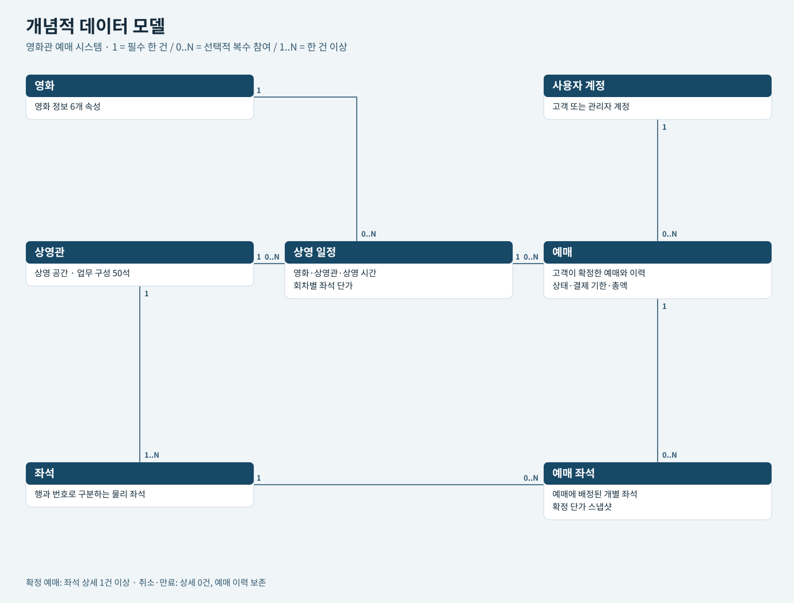

# 개념적 데이터 모델

영화관 예매에 필요한 업무 객체와 관계를 정의한다. 자료형, 인덱스 및 잠금은 [물리적 데이터 모델](../03_물리적_데이터_모델/physical_data_model.md)에서 다룬다.

[편집용 Draw.io](erd/conceptual.drawio) · [SVG](erd/conceptual.svg) · [PNG](erd/conceptual.png)

| 개체 | 업무 의미 |
|---|---|
| 사용자 계정 | 고객 또는 관리자 계정이다. 비회원 방문은 접근 상태다. |
| 영화 | 제목, 장르, 상영 시간, 관람 등급, 줄거리, 개봉일을 관리한다. |
| 상영관 | 영화가 상영되는 공간이다. |
| 좌석 | 상영관 내 행과 번호로 식별되는 물리적 위치다. |
| 상영 일정 | 한 영화가 한 상영관에서 정해진 시간에 상영되는 회차다. 좌석당 가격은 회차별로 정한다. |
| 예매 | 고객이 한 회차에서 좌석을 확정한 기록이다. 결제 상태, 기한과 총액을 관리한다. |
| 예매 좌석 | 확정 예매와 선택 좌석을 연결하고 확정 당시 단가를 보존한다. |

## 관계 및 참여 제약

| 부모 → 자식 | 부모 1건당 자식 | 자식 1건당 부모 | 업무 의미 |
|---|---|---|---|
| 사용자 계정 → 예매 | 0..N | 1 | 예매 주체는 고객이다. |
| 영화 → 상영 일정 | 0..N | 1 | 영화 등록 직후에는 일정이 없을 수 있다. |
| 상영관 → 상영 일정 | 0..N | 1 | 동일 상영관의 상영 시간은 겹치지 않는다. |
| 상영관 → 좌석 | 1..N (업무상 여러 좌석, 프로젝트 구성 50석) | 1 | 개념 ERD는 업무의 필수 참여를 표시한다. FK는 각 좌석의 소속을 보장하지만 부모의 최소 좌석 수를 강제하지 않는다. 논리·물리 ERD에는 저장 구조의 0..N을 표시한다. |
| 상영 일정 → 예매 | 0..N | 1 | 취소·만료를 포함한 예매 이력이 있으면 일정의 업무 속성을 바꿀 수 없다. |
| 예매 → 예매 좌석 | 상태별 1..N 또는 0 | 1 | 확정 상태의 커밋된 예매에는 좌석이 한 개 이상이다. 취소·만료 상태에는 좌석이 없다. |
| 좌석 → 예매 좌석 | 0..N | 1 | 여러 회차에 쓰일 수 있으며, 같은 회차의 한 좌석에는 유효한 예매가 최대 하나다. |

비회원도 영화·일정·좌석을 조회하고 임시로 선택할 수 있다. 좌석 점유와 10분 결제 기한은 로그인한 고객이 예매를 확정할 때 시작한다. 결제는 모의 처리다. 취소는 상영 시작 전에 전체 예매 단위로 이루어지며, 취소·만료 후에는 예매 이력을 보존하고 좌석 상세를 삭제한다.

업무 근거는 [B01](https://github.com/unhodrgn/Cinema-Reservation-System/blob/121854a0e006d824dd4aba7274deec7524da9694/docs/business/project_overview.md), [B02](https://github.com/unhodrgn/Cinema-Reservation-System/blob/121854a0e006d824dd4aba7274deec7524da9694/docs/business/business_function.md), [B03](https://github.com/unhodrgn/Cinema-Reservation-System/blob/121854a0e006d824dd4aba7274deec7524da9694/docs/business/unit_business_description.md), [B04](https://github.com/unhodrgn/Cinema-Reservation-System/blob/121854a0e006d824dd4aba7274deec7524da9694/docs/business/business_flowchart.md), [B05](https://github.com/unhodrgn/Cinema-Reservation-System/blob/121854a0e006d824dd4aba7274deec7524da9694/docs/business/business_document_list.md) 및 [D1–D6](https://github.com/unhodrgn/Cinema-Reservation-System/blob/121854a0e006d824dd4aba7274deec7524da9694/docs/business/business_rules_decision_log.md)이다.
