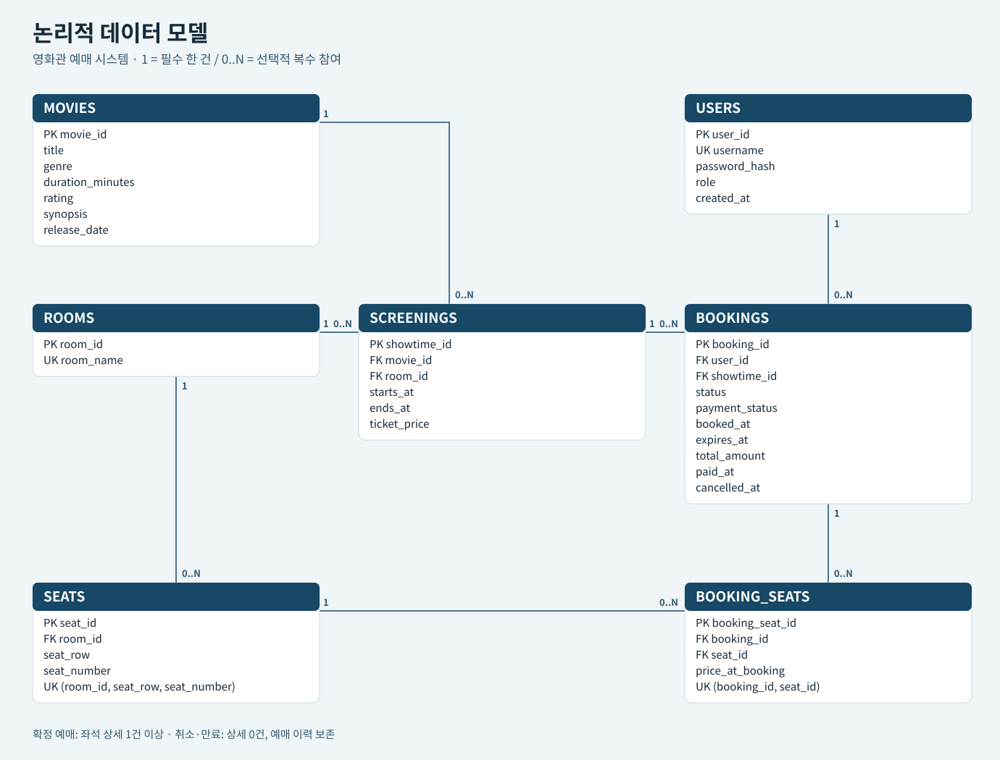

# 논리적 데이터 모델

일곱 개체를 릴레이션, 식별자, 참조 및 업무 제약으로 변환한다. 회차별 유일성에 필요한 물리 참조 열은 [물리적 데이터 모델](../03_물리적_데이터_모델/physical_data_model.md)에서 다룬다.

[편집용 Draw.io](erd/logical.drawio) · [SVG](erd/logical.svg) · [PNG](erd/logical.png)

| 릴레이션 | 속성 | 키와 참조 |
|---|---|---|
| USERS | user_id, username, password_hash, role, created_at | PK user_id, 대체 후보키 username |
| MOVIES | movie_id, title, genre, duration_minutes, rating, synopsis, release_date | PK movie_id |
| ROOMS | room_id, room_name | PK room_id, 대체 후보키 room_name |
| SEATS | seat_id, room_id, seat_row, seat_number | PK seat_id, FK room_id → ROOMS, 대체 후보키 (room_id, seat_row, seat_number) |
| SCREENINGS | showtime_id, movie_id, room_id, starts_at, ends_at, ticket_price | PK showtime_id, FK movie_id → MOVIES, room_id → ROOMS |
| BOOKINGS | booking_id, user_id, showtime_id, status, payment_status, booked_at, expires_at, total_amount, paid_at, cancelled_at | PK booking_id, FK user_id → USERS, showtime_id → SCREENINGS |
| BOOKING_SEATS | booking_seat_id, booking_id, seat_id, price_at_booking | PK booking_seat_id, FK booking_id → BOOKINGS, seat_id → SEATS, 대체 후보키 (booking_id, seat_id) |

- 모든 FK에서 자식은 부모 한 건을 반드시 참조한다. 부모는 참조 자식이 없을 수 있다. 예매와 좌석의 다대다 관계는 예매 좌석으로 해소한다. 커밋된 확정 예매는 상세 1건 이상, 취소·만료 예매는 0건이다.
- 장르·등급·줄거리·개봉일은 선택 속성이다. 결제 일시와 취소 일시는 해당 상태에서만 존재한다.
- 같은 상영관의 시간 구간은 겹치지 않으며, 선택 좌석의 상영관은 예매 회차의 상영관과 같다. 회차는 논리적으로 예매를 통해 결정된다. 물리적으로 회차 ID를 상세에도 저장하여 회차와 좌석의 조합에 유일성을 부여한다.
- 확정 시각에 10분을 더한 결제 기한, 두 상태, 확정 단가와 총액을 명시한다. 예매 이력이 있는 회차의 업무 속성은 변경할 수 없다.

참조 정책 및 자료형은 [테이블 기술서](../06_테이블_기술서/table_description.md), 함수 종속은 [정규화](normalization.md)를 참조한다.
