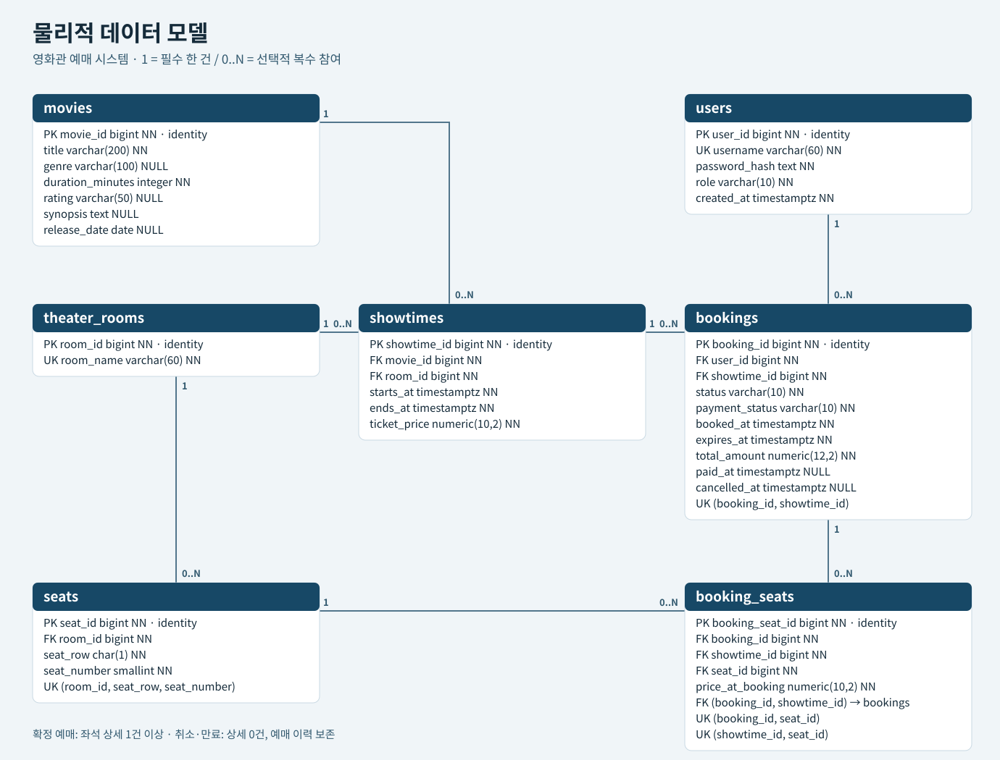

# 물리적 데이터 모델

PostgreSQL 14 이상을 대상으로 작성된 DDL이다. 실제 검증 버전은 18.7이다. 구현 기준은 [schema.sql](../07_PostgreSQL_구현/database/schema.sql)과 [권한 스크립트](../07_PostgreSQL_구현/database/grant_application_role.sql)다. 확장 모듈은 btree_gist다.

[편집용 Draw.io](erd/physical.drawio) · [SVG](erd/physical.svg) · [PNG](erd/physical.png)

## 열과 참조

[테이블 기술서](../06_테이블_기술서/table_description.md)에 일곱 테이블의 열, 자료형, NULL, 기본값 및 제약을 정리했다. 그림의 PK는 기본키, FK는 외래키, UK는 유일성 제약 또는 후보키 표기다. NN은 NOT NULL, NULL은 선택 열이다. 부모에서 자식으로 0..N, 자식에서 부모로 정확히 한 건을 표시한다. 모든 FK는 삭제 RESTRICT, 갱신 기본 NO ACTION이다. 예매 좌석의 showtime_id는 예매와의 복합 FK 구성원이다. showtimes에 직접 연결하는 별도 FK는 없다.

| 자식 테이블 | FK 열 → 부모 참조 열 |
|---|---|
| seats | room_id → theater_rooms(room_id) |
| showtimes | movie_id → movies(movie_id), room_id → theater_rooms(room_id) |
| bookings | user_id → users(user_id), showtime_id → showtimes(showtime_id) |
| booking_seats | (booking_id, showtime_id) → bookings(booking_id, showtime_id), seat_id → seats(seat_id) |

복합 FK 이름은 `booking_seats_booking_showtime_fk`다. 해당 FK는 `bookings_id_showtime_key`가 보장하는 유일한 열 조합을 참조한다.

## 제약 및 인덱스

| 종류 | 구현 |
|---|---|
| 기본키 | 일곱 테이블의 bigint identity 기본키마다 자동 고유 B-tree 인덱스가 생성된다. |
| UNIQUE | users(username), theater_rooms(room_name), seats(room_id, seat_row, seat_number), bookings(booking_id, showtime_id), booking_seats(booking_id, seat_id), booking_seats(showtime_id, seat_id). 각각 고유 B-tree 인덱스가 생성된다. 상세의 두 제약 이름은 `booking_seats_booking_seat_key` 및 `booking_seats_showtime_seat_key`다. |
| 배제 제약 | `showtimes_no_room_overlap`은 같은 room_id에서 tstzrange(starts_at, ends_at, '[)')의 중첩을 금지한다. GiST 인덱스를 사용한다. 끝 시각과 다음 시작 시각이 같을 수 있다. |
| 행 검사 | 사용자 역할, 영화 시간, 좌석 위치, 세 금액의 유한·비음수 조건, 종료 > 시작, 예매·결제 상태 및 기한·결제·취소 시각의 정합성은 CHECK로 검증한다. |

| 명시적 보조 인덱스 | 대상 | 용도 |
|---|---|---|
| idx_showtimes_movie_start | showtimes(movie_id, starts_at) | 영화별 시간표 |
| idx_showtimes_room_start | showtimes(room_id, starts_at) | 상영관별 시간표 |
| idx_bookings_user | bookings(user_id, booked_at DESC) | 고객 예매 이력 |
| idx_bookings_showtime_status | bookings(showtime_id, status) | 회차별 예매 및 상태 조회 |
| idx_booking_seats_seat | booking_seats(seat_id) | 좌석의 참조 조회 |
| idx_bookings_pending_expiry | bookings(expires_at), WHERE status='BOOKED' AND payment_status='UNPAID' | 미결제 기한 검색용 부분 인덱스 |

## 트리거

별도 표시가 없으면 행 단위다. 오른쪽 열의 함수는 모두 인수 없이 trigger를 반환한다.

| 트리거 | 테이블 / 이벤트 | 함수와 역할 |
|---|---|---|
| trg_showtimes_default_end_time | showtimes · BEFORE INSERT OR UPDATE | showtimes_default_end_time() · NULL인 종료 시각을 계산 |
| trg_showtimes_protect_booked | showtimes · BEFORE UPDATE | showtimes_protect_booked() · 이력 있는 회차의 영화·상영관·시작·종료·가격 변경 차단 |
| trg_bookings_validate | bookings · BEFORE INSERT OR UPDATE | bookings_validate() · 고객/시작 시각, 기한과 상태 전이, 불변 식별·금액 검사. 예매 삽입 시 상영 일정의 업무 값이 동일한 새 행 버전을 써서 최초 예매와 일정 변경을 조정 |
| trg_bookings_release_seats | bookings · AFTER UPDATE OF status | bookings_release_seats() · 취소·만료 시 상세 전체 삭제 |
| trg_bookings_protect_delete | bookings · BEFORE DELETE | bookings_protect_history() · 예매 이력 삭제 차단 |
| trg_bookings_protect_truncate | bookings · BEFORE TRUNCATE, 문장 단위 | bookings_protect_history() · 이력 절단 차단 |
| trg_booking_seats_protect_truncate | booking_seats · BEFORE TRUNCATE, 문장 단위 | bookings_protect_history() · 배정 절단 차단 |
| trg_booking_seats_validate | booking_seats · BEFORE INSERT OR UPDATE | booking_seats_validate() · 회차 도출, 상영관·시작 시각·단가 검사 및 수정 금지 |
| trg_booking_seats_protect_delete | booking_seats · BEFORE DELETE | booking_seats_protect_delete() · BOOKED 상세 직접 삭제 차단 |
| trg_bookings_z_consistency | bookings · AFTER INSERT OR UPDATE OF status | booking_check_consistency() · 기본 지연 제약 트리거 |
| trg_booking_seats_consistency | booking_seats · AFTER INSERT | booking_check_consistency() · 기본 지연 제약 트리거 |

두 제약 트리거는 DEFERRABLE INITIALLY DEFERRED다. 보통 COMMIT 시 BOOKED의 상세 1건 이상과 총액 일치, 종료 상태의 상세 0건을 검사한다. 상위 상태 변경에서 좌석 해제 트리거가 정합성 검사보다 먼저 실행되도록 이름을 지정했다. 확정 작업은 기본 지연 모드를 사용한다.

## 일반 함수 및 권한

| 함수 시그니처 | 반환 | 범위 |
|---|---|---|
| booking_deadline_elapsed(timestamptz, timestamptz) | boolean | IMMUTABLE STRICT SQL 비교 함수. 현재 시각이 기한 이상인지 판정 |
| expire_locked_showtime_bookings(bigint) | void | 내부 정리. 이미 회차 잠금을 가진 호출자가 사용. PUBLIC EXECUTE 철회 |
| expire_overdue_bookings(timestamptz DEFAULT clock_timestamp()) | integer | 업무 함수. 잠긴 예매를 건너뛴다. 전달한 기준 시각을 실제 DB 시각으로 상한 제한 |
| screening_seat_availability(bigint) | table(seat_id bigint, seat_row char, seat_number smallint, is_available boolean) | 업무 함수. 회차 잠금과 정리 이후 조회 |
| create_booking(bigint, bigint, bigint[]) | bigint | 업무 함수. 확정 ID 반환 |
| pay_booking(bigint, bigint) | text | 업무 함수. PAID 또는 새 EXPIRED |
| cancel_booking(bigint, bigint) | text | 업무 함수. CANCELLED 또는 새 EXPIRED |

다섯 업무 함수는 SECURITY DEFINER이고 search_path는 pg_catalog, public, pg_temp로 고정된다. PUBLIC 실행 권한을 철회하며, 별도 SQL이 앱 역할에 명시적으로 부여한다. 시간 제한 및 오류 계약은 [연동 계약](../10_설치_및_연동_가이드/postgresql_flask_integration_contract.md)을 참조한다.
